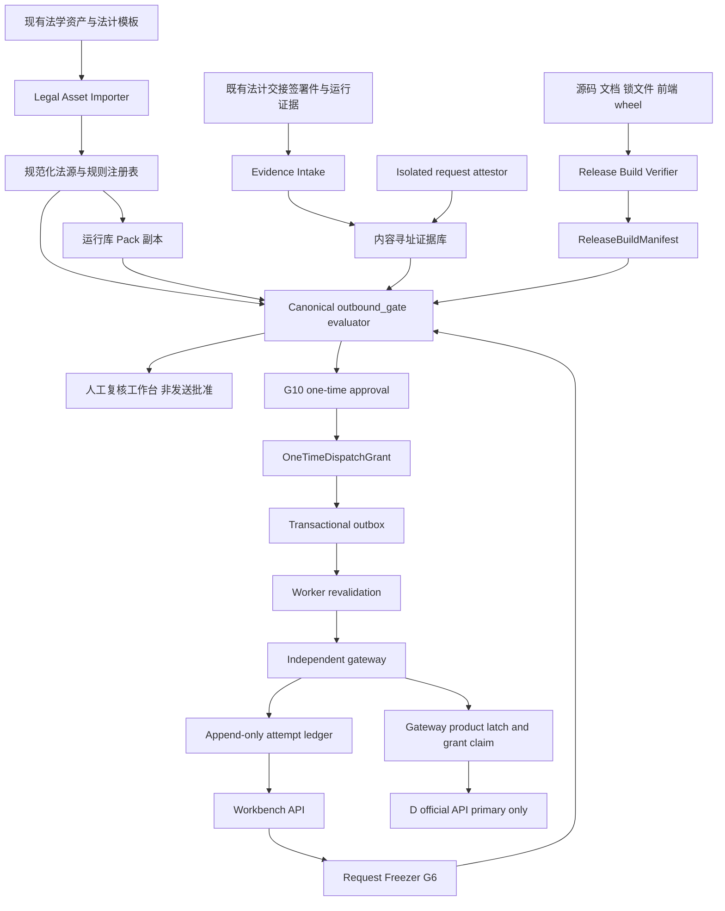
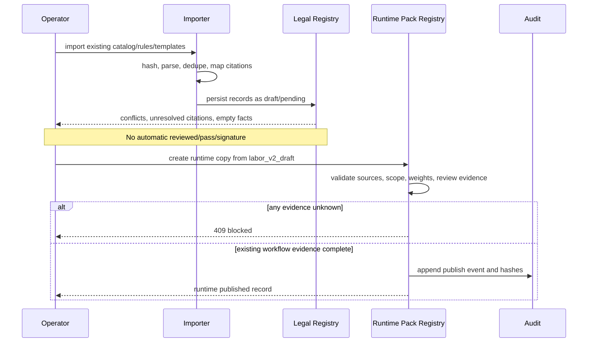
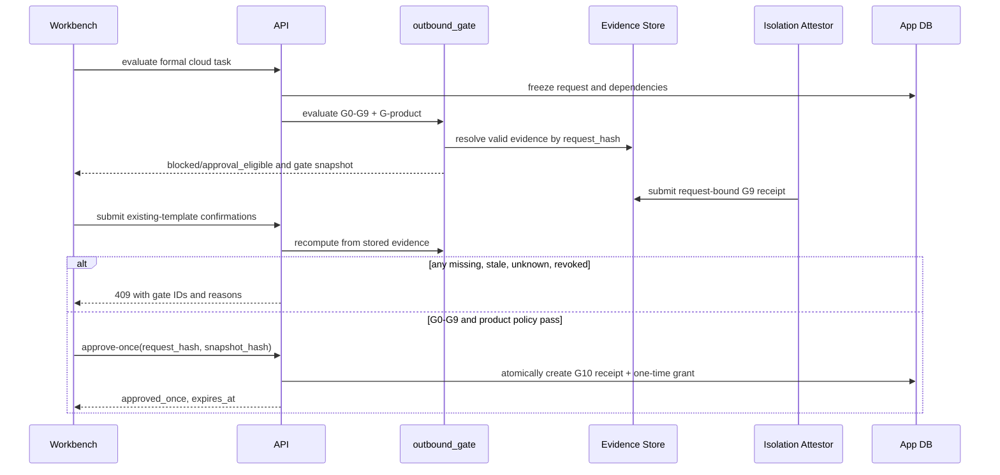

# Design Document: formal-outbound-release

## Overview

`formal-outbound-release` 在 LexAegis V1.0 现有失败关闭架构上增加一条**可验证、可撤销、最多消费一次、与冻结请求哈希绑定**的正式外发路径。它不把当前状态改写为已开通：仓库 `labor_v2_draft` 仍为 `2.0.0-draft.3`、`draft`、`dispatch_allowed=false`，当前 10 案仍为层 A 评估完成、0 案真实发送，D 路径 `evaluate` 仍不是 HTTP 发送。

设计只复用现有法学资产：140 行法源合并目录、规则正文、唯一 `outbound_gate` G 表、法计交接空表及签署册、人工审批页面设计稿、现有劳动争议草稿包和模板。系统负责去重、旧新条号映射、结构化导入、状态分层、具名确认及证据哈希绑定；系统**不推断或代填**合同、服务商事实、审批人、签署结果、攻击结论、隔离结论或法学结论。已有资产不能证明的事实保持 `unknown` / `pending` 并继续阻断。

正式释放采用“代码能力上线、产品闩仍关闭 → 证据只读导入与影子评估 → 单三元组武装 → 单次授权 → 网关原子消费 → 自动回闭”的分阶段方式。首个可讨论范围仅为现有模板限定的 `LA-001 × R_fact_summary × D_DeepSeek_official_API`；其他九案继续由 G2 层 B 关闭。任何阶段都不新增第二套门禁编号，不削弱 `validate_formal_gate`、`authorize_dispatch` 或网关校验。

### 设计目标

- 让 `product_dispatch_state` 从展示字段升级为 API、入队、worker 和网关共同强制执行的产品闩。
- 把 G1 与现有人工法学复核证据纳入批准前强制条件，但与 G10 发送批准严格分离。
- 用绑定 `request_hash`、环境和制品的请求级 G9 收据替代全局 `isolation_verified` 布尔值；native 永不自证隔离。
- 使 `validate_formal_gate` 名称与行为一致：完整评估正式路径；旧子集只保留为明确命名的内部兼容检查，不能用于授权。
- 规范律师法旧第 38 条与 2026-09-01 第 41 条的并存和映射，不静默覆盖历史文本，不以条号推算冒充已核现行全文。
- 通过发布构建清单解决工作树、文档、前端构建、wheel、运行包与部署制品漂移。
- 在并发、崩溃、超时和重试条件下保证同一授权最多触发一次新的外部网络尝试。

### 非目标

- 不自动发布仓库 pack，不把当前草稿改成 `published`。
- 不自动生成法学签署、服务商 `reviewed`、PIPIA、法学 `resisted` 或组织授权。
- 不把 Compose 五项历史探测当作请求级 G9 收据，也不允许 native 生成可接受收据。
- 不把 409 改成成功或产品故障；409 继续表示预期门禁阻断。
- 不把一次 LA-001 成功扩展为十案能力，不自动启用备用接收方，不提供盲重发。

## Architecture

### 总体架构



### 信任边界

| 边界 | 可信内容 | 不可信或不足内容 | 强制措施 |
| --- | --- | --- | --- |
| 法学资产入库 | 文件字节、来源路径、SHA-256、解析结果 | 文件名、空表、二手摘述本身不等于结论 | 内容寻址、来源追踪、重复组与冲突保留 |
| 人工证据 | 已认证本地用户的具名确认、受控库文件哈希 | 空栏、口述、未签设计稿、AI 生成意见 | 角色校验、结论枚举、签署件哈希、有效期、撤销状态 |
| API / worker | 案件、任务、冻结请求、规范化 gate snapshot | 客户端提交的 `pass`、客户端时钟 | 服务端重算、数据库事务、审计链 |
| 隔离栈 | 指定 isolated deployment 的当次探测和环境证据 | 全局 bool、历史 Compose 探测、native 自报 | 请求挑战、环境/制品哈希、短有效期、G9 复核收据 |
| API / 独立网关 | HMAC 信封、冻结请求、grant、构建与证据摘要 | API 单独声称“已批准” | 网关独立验签、重验、产品闩、原子 claim |
| 网关 / 云端 | allowlist 中冻结的 D 主槽目标 | 备用槽、重定向后新 host、动态模型或地址 | 禁止重定向、精确目标匹配、单主槽、一次 attempt |

### 唯一执法路径

`outbound_gate` 继续是唯一业务门禁。设计不创建新的编号，只补齐现有 G 表的数据来源和阶段语义：

| 既有 ID | 正式释放所需证据 | 缺失行为 |
| --- | --- | --- |
| G0 | 请求卫生、直接标识、材料复核、必要事实、禁止四要件、预算 | unknown/pending/fail 均阻断 |
| G1 | 现有法 01 的来源人审收据、采用集、具名结论、证据文件哈希 | 强制阻断，不再只停留纸面 |
| G2 | LA-001 “本次可用”整句、组织真实材料授权、三元组和期限；其余九案关闭 | 强制阻断 |
| G3 | 本账号服务商事实、合同引用、处理条件、PIPIA、已审档案和 D 主槽精确绑定 | 任一 unknown 阻断 |
| G5 | 运行库 pack 的 reviewed/published 状态、范围、法源、五类权重、内容哈希 | 仓库草稿不满足；运行库副本可经已有模板流程发布 |
| G6 | 完整冻结请求、依赖、材料、累计披露、构建清单与 `request_hash` | 变化即重冻，后续证据失效 |
| G7 | 同哈希组合检测、准标识检查和法 08 具名 `pass` | 工程未命中不等于法学 pass |
| G8 | 同哈希四类冻结攻击运行及法 09 逐项具名 `resisted` | 历史基线/uncertain/not_run 均阻断 |
| G9 | 同哈希请求级隔离收据、五项探测、宿主机防火墙和镜像供应链证据、法 10 确认 | 全局 bool 不满足；native 永不满足 |
| G10 | `approver` 对同一哈希、同一 gate snapshot 的一次批准 | 不齐返回 409 |
| G-product | 已安装且未撤销的单三元组 release policy、构建清单一致、剩余次数为 1 | 默认 blocked；发送后自动回闭 |

G10 不是第二条路径。批准前使用同一 G 表计算 `approval_eligible`（要求 G0–G9 与 G-product）；批准后仍使用同一 G 表加入 G10，计算 `dispatch_allowed`。阶段集合不同不等于门禁编号不同。

## Sequence Diagrams

### 资产导入与运行库发布准备



### 冻结、证据绑定与单次批准



### 入队、网关原子消费与自动回闭

```mermaid
sequenceDiagram
    participant W as Workbench
    participant API as API
    participant DB as App DB
    participant WK as Worker
    participant GW as Gateway
    participant GL as Gateway Ledger
    participant D as D Official API
    W->>API: send once
    API->>API: authorize_dispatch enqueue revalidation
    API->>DB: transaction reserve intent + outbox
    WK->>API: load frozen envelope
    WK->>WK: authorize_dispatch send revalidation
    WK->>GW: signed envelope + one-time grant
    GW->>GW: verify hash, evidence, build, target, latch
    GW->>GL: transaction claim nonce and persist sending
    alt nonce already claimed
        GW-->>WK: existing ledger record, no new network
    else claim succeeds
        GW->>D: exactly one new HTTP attempt
        D-->>GW: response or uncertain failure
        GW->>GL: complete or unknown; consume release slot
        GW-->>WK: ledger result
    end
    WK->>DB: reconcile task from gateway record
```

### 撤销与内容变化

```mermaid
sequenceDiagram
    participant O as Authorized user
    participant API as API
    participant DB as App DB
    participant GW as Gateway
    O->>API: revoke evidence/policy/grant
    API->>DB: append revocation and invalidate dependents
    API->>GW: signed revocation digest
    alt grant not claimed
        GW->>GW: mark revoked; reject dispatch
    else grant claimed or transmission possible
        GW->>GW: preserve consumed/unknown; prohibit retry
    end
    Note over API,GW: Changing facts, prompt, model, target, provider, material, pack, ledger, build, or evidence re-freezes request and voids downstream receipts
```

## Components and Interfaces

### LegalAssetImporter

**Purpose**: 从现有资产构建可追溯注册表，不产生新的法律结论。

```pascal
INTERFACE LegalAssetImporter
  FUNCTION ScanExistingAssets(root: Path): AssetInventory
  FUNCTION ImportLegalCatalog(file: Path, expected_hash: Hash OPTIONAL): ImportReport
  FUNCTION ImportRuleDocument(file: Path): ImportReport
  FUNCTION ImportHandoffTemplate(file: Path, template_kind: TemplateKind): TemplateRecord
  FUNCTION BuildCitationGraph(records: LIST OF LegalSourceRecord): CitationGraph
  FUNCTION CreateRuntimePackDraft(source_pack_id: String, source_hash: Hash): RuntimePack
END INTERFACE
```

职责：
- 对法源以规范化标题、条款、有效期和原文字节哈希分组；只标重复，不静默丢行。
- 保留 `v0_1_base`、`v0_2_added`、`v0_1_v0_2_merged` 和 pack seed 来源。
- 将空栏导入为 `unknown`，将设计稿导入为 `design_only`，不导入为 pass。
- 生成旧第 38 条与新第 41 条的显式引用关系和适用时间，不改写历史证据。

### EvidenceIntakeService

**Purpose**: 把既有法计模板的填写结果、扫描件和运行报告转成内容寻址、具名、可撤销证据。

```pascal
INTERFACE EvidenceIntakeService
  FUNCTION RegisterArtifact(metadata: ArtifactMetadata, bytes: ByteString, actor: Actor): EvidenceArtifact
  FUNCTION RecordGateReceipt(input: GateReceiptInput, actor: Actor): GateEvidenceReceipt
  FUNCTION RevokeEvidence(evidence_id: ID, reason: String, actor: Actor): Revocation
  FUNCTION ResolveEvidence(tuple: ReleaseTuple, request_hash: Hash OPTIONAL, at: Timestamp): EvidenceResolution
END INTERFACE
```

职责：不保存正文到审计日志；验证角色、模板类型、结论枚举、哈希、有效期和作用域；不允许客户端直接写 `pass` 而无对应证据对象。

### ReleaseBuildVerifier

**Purpose**: 证明源码、文档、前端、wheel、pack 和部署镜像属于同一可复现发布快照。

```pascal
INTERFACE ReleaseBuildVerifier
  FUNCTION InspectWorktree(repository: Path): WorktreeState
  FUNCTION BuildManifest(inputs: BuildInputs, results: ValidationResults): ReleaseBuildManifest
  FUNCTION VerifyRuntime(manifest: ReleaseBuildManifest, runtime: RuntimeIdentity): CheckResult
END INTERFACE
```

正式 release manifest 要求干净提交、固定 lockfile、通过的目标测试、wheel/前端/文档/pack/镜像摘要。当前大量未提交工作树只能生成 `pending` 清单，不能武装 G-product。

### RequestFreezer

**Purpose**: 生成 G6 的规范请求和稳定哈希。

```pascal
INTERFACE RequestFreezer
  FUNCTION Freeze(context: FreezeContext): FrozenFormalRequest
  FUNCTION ComputeRequestHash(request: FrozenFormalRequest): Hash
  FUNCTION Diff(old_request: FrozenFormalRequest, new_context: FreezeContext): DependencyDiff
END INTERFACE
```

规范哈希覆盖：wire payload、prompt、主槽精确目标和模型、provider profile hash、runtime pack hash、材料版本、规则版本、任务版本、mapping version、累计披露版本、组合输入 hash、攻击协议 hash、release build manifest hash。授权、运行 attempt 和响应不进入请求哈希。

### CanonicalOutboundGate

**Purpose**: 作为唯一正式外发判定器，完整计算现有 G 表。

```pascal
INTERFACE CanonicalOutboundGate
  FUNCTION Evaluate(context: FormalGateContext, phase: GatePhase): GateDecision
  FUNCTION ValidateFormalGate(context: FormalGateContext, phase: GatePhase): LIST OF GateHit
  FUNCTION ValidateLegacySubset(input: LegacyGateInput): LIST OF GateHit
END INTERFACE
```

`ValidateLegacySubset` 只供迁移期诊断并固定返回 `authoritative = false`；任何批准、入队、worker、网关路径若调用它应测试失败。公开名称 `validate_formal_gate` 改为完整上下文版本。旧四参数调用在迁移期失败关闭并返回“完整正式门禁上下文缺失”，不能得到空 blockers。

### RequestIsolationAttestor

**Purpose**: 生成 G9 请求级收据。

```pascal
INTERFACE RequestIsolationAttestor
  FUNCTION CreateChallenge(request_hash: Hash, build_hash: Hash, environment_hash: Hash): AttestationChallenge
  FUNCTION RunChecks(challenge: AttestationChallenge, deployment: DeploymentIdentity): ProbeResult
  FUNCTION IssueReceipt(challenge: AttestationChallenge, probes: ProbeResult, evidence: EnvironmentEvidence, actor: Actor): IsolationReceipt
END INTERFACE
```

只有 `deployment_mode = isolated` 可进入签发；五项原名和结果必须齐全；宿主机防火墙、Compose/镜像摘要、供应链证据必须有内容哈希；法 10 的具名确认作为独立 evidence receipt 引用技术收据。全局 `isolation_verified` 仅作为能力展示和迁移输入，不能满足 G9。

### ProductReleaseLatch

**Purpose**: 在所有进程强制执行默认关闭、单三元组、单次预算。

```pascal
INTERFACE ProductReleaseLatch
  FUNCTION State(scope: ReleaseTuple OPTIONAL): ProductDispatchState
  FUNCTION InstallPolicy(policy: FormalReleasePolicy, actor: Actor): ProductDispatchState
  FUNCTION RevokePolicy(policy_id: ID, reason: String, actor: Actor): ProductDispatchState
  FUNCTION AssertAllowed(context: FormalGateContext, phase: GatePhase): CheckResult
  FUNCTION Consume(policy_id: ID, grant_id: ID, gateway_attempt_id: ID): ConsumptionResult
END INTERFACE
```

无参数 `product_dispatch_state()` 保持返回 blocked，兼容现有能力面板；权威路径调用带 scope 的 `AssertAllowed`。policy 只能限定 LA-001 三元组、D 主槽、一个 build manifest、最大 1 次；不能以通配符扩大。

### OneTimeApprovalService

**Purpose**: 在 G0–G9 与 G-product 通过后创建 G10 单次 grant；人工法学复核本身不授予发送权。

```pascal
INTERFACE OneTimeApprovalService
  FUNCTION ApproveOnce(task_id: ID, request_hash: Hash, gate_snapshot_hash: Hash, actor: Actor): OneTimeDispatchGrant
  FUNCTION RevokeGrant(grant_id: ID, reason: String, actor: Actor): Revocation
  FUNCTION ValidateGrant(grant: OneTimeDispatchGrant, context: FormalGateContext, at: Timestamp): CheckResult
END INTERFACE
```

### DispatchCoordinator and GatewayClaimStore

```pascal
INTERFACE DispatchCoordinator
  FUNCTION Reserve(task_id: ID, grant_id: ID, actor: Actor): DispatchIntent
  FUNCTION RevalidateForSend(intent_id: ID): SignedDispatchEnvelope
  FUNCTION Reconcile(request_id: ID): DispatchResult
END INTERFACE

INTERFACE GatewayClaimStore
  FUNCTION Claim(envelope: SignedDispatchEnvelope): ClaimResult
  FUNCTION Complete(claim_id: ID, result_hash: Hash): GatewayRecord
  FUNCTION MarkUnknown(claim_id: ID, reason_code: String): GatewayRecord
  FUNCTION GetByRequest(request_id: ID): GatewayRecord OPTIONAL
END INTERFACE
```

网关 claim 事务必须先持久化 `sending` 和 grant nonce，再发生网络 I/O。相同 request/grant 重试返回原记录，不产生第二次网络调用。

### AuditLedger

```pascal
INTERFACE AuditLedger
  FUNCTION Append(event: AuditEvent): AuditRecord
  FUNCTION VerifyChain(scope: String): CheckResult
  FUNCTION ExportManifest(request_hash: Hash): EvidenceManifest
END INTERFACE
```

审计事件只记录 ID、状态、角色、时间、哈希和原因码；不得记录案件正文、映射、密钥或完整 provider 响应。

## Data Models

### 规范法源和引用映射

```pascal
STRUCTURE LegalSourceRecord
  id: ID
  canonical_title: String
  articles: LIST OF String
  provision_hash: Hash
  provision_text_ref: ContentAddress
  effective_from: Date OPTIONAL
  effective_to: Date OPTIONAL
  citation_status: ENUM(draft_reference, verified_text, historical, superseded)
  rule_nature: ENUM(statutory, standard_reference, provider_terms, project_control)
  granularity: ENUM(article, instrument_scope)
  source_assets: LIST OF AssetPointer
  duplicate_group_id: ID OPTIONAL
END STRUCTURE

STRUCTURE CitationMapping
  id: ID
  instrument: String
  from_article: String
  to_article: String
  effective_from: Date
  mapping_basis: ENUM(official_text, amendment_sequence, human_verified)
  basis_artifact_hash: Hash
  status: ENUM(pending, verified, rejected)
  note: String
END STRUCTURE
```

第 38/41 条策略：旧第 38 条记录保留为历史；第 41 条为 2026-09-01 之后规则引用目标；若只有修改顺序推算，则 `mapping_basis = amendment_sequence` 且不能提供现行全文逐字核验能力。当前正式 release 的规则引用若仍混用无时间边界的第 38 条，G5 为 pending。

### 证据对象

```pascal
STRUCTURE EvidenceArtifact
  id: ID
  content_hash: Hash
  media_type: String
  source_path_hint: String
  template_kind: String OPTIONAL
  created_at: Timestamp
  registered_by: ActorID
  storage_ref: ContentAddress
END STRUCTURE

STRUCTURE GateEvidenceReceipt
  id: ID
  gate_id: ENUM(G0, G1, G2, G3, G5, G6, G7, G8, G9, G10, G-product)
  tuple: ReleaseTuple
  request_hash: Hash OPTIONAL
  conclusion: ENUM(pass, fail, unknown, pending)
  evidence_artifact_ids: LIST OF ID
  evidence_manifest_hash: Hash
  confirmed_by: ActorID OPTIONAL
  confirmed_role: Role OPTIONAL
  confirmed_at: Timestamp OPTIONAL
  valid_from: Timestamp OPTIONAL
  valid_until: Timestamp OPTIONAL
  supersedes_id: ID OPTIONAL
  revoked_at: Timestamp OPTIONAL
  revocation_reason: String OPTIONAL
END STRUCTURE
```

校验规则：G6–G10 必须有同一 `request_hash`；G1–G5 若不绑定请求，也必须绑定精确三元组、版本和有效期。任何空签署人、空证据、未知结论、过期或撤销均不等于 pass。

### 正式释放策略和构建清单

```pascal
STRUCTURE ReleaseBuildManifest
  id: ID
  source_commit: Hash
  worktree_clean: Boolean
  source_tree_hash: Hash
  documentation_hash: Hash
  frontend_dist_hash: Hash
  wheel_hash: Hash
  lockfile_hashes: MAP OF String TO Hash
  runtime_pack_hash: Hash
  container_image_digests: MAP OF String TO Hash
  migration_revision: String
  validation_results_hash: Hash
  status: ENUM(pending, verified, revoked)
  created_at: Timestamp
  verified_by: ActorID OPTIONAL
END STRUCTURE

STRUCTURE FormalReleasePolicy
  id: ID
  tuple: ReleaseTuple
  build_manifest_hash: Hash
  allowed_target: URL
  allowed_model: String
  allowed_provider_profile_hash: Hash
  maximum_dispatches: Integer = 1
  consumed_dispatches: Integer = 0
  valid_from: Timestamp
  valid_until: Timestamp
  status: ENUM(blocked, armed_once, consumed, revoked, expired)
  installed_by: ActorID
  installed_at: Timestamp
END STRUCTURE
```

策略不包含法律事实；它只在已有证据可供每次 gate 重验时提供产品级技术武装。安装策略不等于批准或发送。

### 冻结请求、门禁快照和单次授权

```pascal
STRUCTURE FrozenFormalRequest
  request_id: ID
  tuple: ReleaseTuple
  wire_payload: WirePayloadV2
  prompt: String
  target: URL
  model: String
  provider_profile_hash: Hash
  runtime_pack_hash: Hash
  material_versions: MAP OF ID TO Integer
  rule_versions: MAP OF ID TO Hash
  task_version: Integer
  mapping_version: Integer
  ledger_version: Integer
  combination_input_hash: Hash
  attack_protocol_hashes: MAP OF AttackKind TO Hash
  build_manifest_hash: Hash
  request_hash: Hash
  created_at: Timestamp
END STRUCTURE

STRUCTURE GateHit
  gate_id: GateID
  status: ENUM(pass, fail, unknown, pending, not_applicable)
  kind: ENUM(prohibition, verification, minimization, engineering)
  reason_code: String
  message: String
  evidence_ids: LIST OF ID
END STRUCTURE

STRUCTURE GateDecision
  phase: ENUM(evaluate, approve, enqueue, send, gateway)
  request_hash: Hash
  hits: LIST OF GateHit
  snapshot_hash: Hash
  disposition: ENUM(allowed, needs_minimization, needs_verification, prohibited)
  system_readiness: ENUM(ready, not_ready)
  approval_eligible: Boolean
  dispatch_allowed: Boolean
  evaluated_at: Timestamp
END STRUCTURE

STRUCTURE OneTimeDispatchGrant
  id: ID
  nonce: Random128
  request_hash: Hash
  gate_snapshot_hash: Hash
  evidence_manifest_hash: Hash
  build_manifest_hash: Hash
  release_policy_id: ID
  tuple: ReleaseTuple
  actor: ActorID
  actor_role: ENUM(approver)
  issued_at: Timestamp
  expires_at: Timestamp
  state: ENUM(issued, reserved, claimed, consumed, revoked, expired)
  claimed_at: Timestamp OPTIONAL
  gateway_attempt_id: ID OPTIONAL
END STRUCTURE
```

### 请求级隔离收据

```pascal
STRUCTURE IsolationReceipt
  id: ID
  request_hash: Hash
  build_manifest_hash: Hash
  deployment_mode: ENUM(isolated)
  deployment_identity_hash: Hash
  compose_hash: Hash
  image_digests: MAP OF String TO Hash
  api_no_egress: Boolean
  worker_no_egress: Boolean
  gateway_no_case_volume: Boolean
  redteam_no_secrets: Boolean
  benchmark_no_secrets: Boolean
  probe_output_hash: Hash
  host_firewall_evidence_hash: Hash
  supply_chain_evidence_hash: Hash
  generated_at: Timestamp
  expires_at: Timestamp
  attested_by: ActorID
  legal_confirmation_receipt_id: ID OPTIONAL
  status: ENUM(pending_legal_confirmation, valid, failed, revoked, expired)
END STRUCTURE
```

### 状态分层

现有 task 主状态保留以减少迁移风险，新增正交 `formal_release` 子状态：

```pascal
ENUM FormalReleaseState
  blocked
  evidence_pending
  frozen
  approval_eligible
  approved_once
  reserved
  claimed
  consumed_complete
  consumed_unknown
  failed_before_disclosure
  revoked
  expired
END ENUM
```

关键转换：

| From | Event | To | 条件 |
| --- | --- | --- | --- |
| blocked/evidence_pending | freeze | frozen | G6 生成，尚不表示可批 |
| frozen | evidence_added + re-evaluate | approval_eligible | G0–G9、G-product 全 pass |
| approval_eligible | approve-once | approved_once | 具名 approver、快照未变、30 分钟 |
| approved_once | reserve | reserved | enqueue 重验通过，事务写 intent/outbox |
| reserved | gateway claim | claimed | send/gateway 双重重验、nonce 未消费 |
| claimed | provider complete | consumed_complete | 网关已发生唯一 attempt |
| claimed | uncertain provider outcome | consumed_unknown | 禁止自动重发 |
| 任一未 claim | revoke/expire/dependency change | revoked/expired/blocked | 下游证据失效 |

“发送前确定未离开本地”的技术失败可进入 `failed_before_disclosure`，但原 grant 仍不自动复用；重新尝试必须重新批准，以避免隐式多次授权。

## Algorithmic Pseudocode

### 现有资产规范化导入

```pascal
ALGORITHM ImportExistingLegalAssets(asset_paths)
INPUT: repository paths for existing catalog, rules, pack, templates
OUTPUT: ImportReport

BEGIN
  inventory <- EMPTY LIST
  FOR EACH path IN asset_paths DO
    ASSERT path IS UNDER configured repository roots
    bytes <- READ_BYTES(path)
    asset <- REGISTER_CONTENT_ADDRESS(hash(bytes), path, bytes)
    parsed <- PARSE_BY_DECLARED_TYPE(asset)
    APPEND (asset, parsed) TO inventory
  END FOR

  legal_rows <- EXTRACT all legal source rows FROM inventory
  groups <- GROUP legal_rows BY normalized_title, normalized_articles, effective_range

  FOR EACH group IN groups DO
    ASSERT every processed row remains linked to its source asset
    IF provision hashes are equal THEN
      MARK rows AS exact_duplicates WITHOUT deleting source links
    ELSE
      MARK group AS conflicting_variants
      SET canonical conclusion TO pending
    END IF
  END FOR

  mappings <- BUILD explicit article mappings INCLUDING lawyer law 38-to-41
  FOR EACH mapping IN mappings DO
    IF mapping basis is only amendment sequence THEN
      SET mapping.status TO pending
      PROHIBIT mapping FROM claiming verified current full text
    END IF
  END FOR

  FOR EACH empty template field IN inventory DO
    STORE field.status AS unknown
  END FOR

  ASSERT no review, signature, provider fact, or gate pass was synthesized
  RETURN report(inventory, groups, mappings, unresolved_items)
END
```

**Loop invariants**: 每个已处理输入字节都保留来源与哈希；去重不丢失冲突版本；未给结论始终保持 unknown/pending。

### 冻结请求

```pascal
ALGORITHM FreezeFormalRequest(context)
INPUT: formal LA-001 task context
OUTPUT: FrozenFormalRequest

BEGIN
  REQUIRE context.case.mode = formal
  REQUIRE context.transport = cloud
  REQUIRE context.tuple = (LA-001, R_fact_summary, D_DeepSeek_official_API)
  REQUIRE exactly one primary recipient AND no standby recipient

  wire <- BUILD WirePayloadV2 FROM approved disclosure decisions
  ASSERT wire contains no mapping, original_value, local_text, anchors, or case source text

  dependencies <- CANONICALIZE(
    wire, prompt, target, model, provider_profile_hash,
    runtime_pack_hash, material_versions, rule_versions,
    task_version, mapping_version, ledger_version,
    combination_input_hash, attack_protocol_hashes,
    release_build_manifest_hash
  )
  request_hash <- SHA256(CANONICAL_BYTES(dependencies))
  PERSIST immutable frozen request
  INVALIDATE every G7-G10 receipt and grant whose request_hash differs
  RETURN frozen request
END
```

**Postcondition**: 相同规范输入产生相同哈希；任何冻结依赖变化产生不同哈希；旧审批不能迁移。

### 完整门禁评估

```pascal
ALGORITHM EvaluateFormalGate(context, phase)
INPUT: complete FormalGateContext and phase
OUTPUT: GateDecision

BEGIN
  REQUIRE context contains frozen request, tuple, runtime pack, provider profile,
          evidence resolution, build manifest, ledger, attack runs, and product policy

  hits <- EVALUATE_G0(context)
  APPEND EVALUATE_G1_SOURCE_REVIEW(context) TO hits
  APPEND EVALUATE_G2_SCOPE_AND_MATERIAL_AUTHORIZATION(context) TO hits
  APPEND EVALUATE_G3_PROVIDER_AND_PIPIA(context) TO hits
  APPEND EVALUATE_G5_RUNTIME_RULE_RELEASE(context) TO hits
  APPEND EVALUATE_G6_FROZEN_REQUEST(context) TO hits
  APPEND EVALUATE_G7_COMBINATION_AND_LEGAL_ACCEPTANCE(context) TO hits
  APPEND EVALUATE_G8_ATTACKS_AND_LEGAL_ACCEPTANCE(context) TO hits
  APPEND EVALUATE_G9_REQUEST_ISOLATION(context) TO hits
  APPEND EVALUATE_G_PRODUCT(context) TO hits

  IF phase IN (enqueue, send, gateway) THEN
    APPEND EVALUATE_G10_ONE_TIME_GRANT(context) TO hits
  END IF

  FOR EACH hit IN hits DO
    ASSERT hit.gate_id belongs to existing outbound_gate G table
    IF hit.status IN (unknown, pending, fail) THEN
      MARK hit AS blocking
    END IF
  END FOR

  approval_eligible <- phase IN (evaluate, approve) AND all required G0-G9 and G-product hits pass
  dispatch_allowed <- phase IN (enqueue, send, gateway) AND all required hits including G10 pass
  snapshot_hash <- SHA256(CANONICAL_BYTES(hits, request_hash, phase))
  RETURN decision(hits, snapshot_hash, approval_eligible, dispatch_allowed)
END
```

**Loop invariants**: 已遍历 hit 的 blocking 语义不会因后续 hit 改写；工程类与法学 disposition 分层，但二者都参与发送阻断。

### 请求级隔离收据

```pascal
ALGORITHM IssueRequestIsolationReceipt(challenge, deployment, probes, evidence, actor)
INPUT: request-bound challenge and current isolated environment evidence
OUTPUT: IsolationReceipt OR DomainError

BEGIN
  REQUIRE deployment.mode = isolated
  IF deployment.mode = native THEN
    RAISE DomainError("native 不能生成正式 G9 收据")
  END IF
  REQUIRE challenge.request_hash equals frozen request hash
  REQUIRE challenge.build_manifest_hash equals runtime build manifest hash
  REQUIRE all five named probes exist AND equal true
  REQUIRE evidence.host_firewall_evidence_hash is nonempty
  REQUIRE evidence.supply_chain_evidence_hash is nonempty
  REQUIRE image digests equal release build manifest image digests

  receipt <- CREATE with status pending_legal_confirmation and short expiry
  PERSIST receipt
  RETURN receipt
END
```

法 10 对该技术收据具名确认后，才可派生 `status = valid`；确认不能改变原始探测字节或哈希。

### 单次批准

```pascal
ALGORITHM ApproveOnce(task_id, expected_request_hash, expected_snapshot_hash, actor)
INPUT: current task, expected hashes, authenticated actor
OUTPUT: OneTimeDispatchGrant

BEGIN TRANSACTION
  REQUIRE actor.role = approver AND actor has nonempty stable identity
  task <- LOAD task FOR UPDATE
  context <- BUILD_COMPLETE_GATE_CONTEXT(task)
  decision <- EvaluateFormalGate(context, approve)

  REQUIRE decision.approval_eligible = true
  REQUIRE task.request_hash = expected_request_hash
  REQUIRE decision.snapshot_hash = expected_snapshot_hash
  REQUIRE no active or consumed grant exists for request_hash
  REQUIRE product policy has exactly one remaining dispatch

  receipt <- CREATE G10 receipt bound to request_hash and snapshot_hash
  grant <- CREATE random one-time nonce, 30-minute expiry, state issued
  APPEND audit event with hashes and actor role
  COMMIT
  RETURN grant
END
```

**Postcondition**: 法学复核记录不能替代此函数；同一请求并发批准至多一个成功；批准不执行网络 I/O。

### 入队与网关 claim

```pascal
ALGORITHM ReserveAndDispatch(task_id, grant_id, actor)
INPUT: approved-once task and grant
OUTPUT: queued intent

BEGIN TRANSACTION
  task <- LOAD task FOR UPDATE
  decision <- EvaluateFormalGate(BUILD_CONTEXT(task, grant_id), enqueue)
  REQUIRE decision.dispatch_allowed = true
  REQUIRE grant.state = issued
  SET grant.state TO reserved
  CREATE dispatch intent and outbox event in same transaction
  APPEND audit event
  COMMIT
END

ALGORITHM GatewayClaimAndSend(envelope)
INPUT: signed frozen request and one-time grant
OUTPUT: GatewayRecord

BEGIN
  VERIFY envelope HMAC, request_hash, grant signature, expiry, evidence manifest,
         build manifest, exact D target, model, primary-only topology, and wire contract
  decision <- EvaluateFormalGate(BUILD_GATEWAY_CONTEXT(envelope), gateway)
  REQUIRE decision.dispatch_allowed = true

  BEGIN TRANSACTION
    existing <- FIND gateway record BY request_id OR grant_nonce
    IF existing exists THEN
      COMMIT
      RETURN existing
    END IF
    REQUIRE product policy has one unconsumed slot
    ATOMICALLY CLAIM grant_nonce and product policy slot
    CREATE gateway record WITH status sending BEFORE network I/O
    COMMIT
  END TRANSACTION

  TRY
    response <- HTTP_POST_ONCE(exact approved target, redirects disabled)
    VALIDATE response contract
    PERSIST complete and response hash
  CATCH any error AFTER network may have started
    PERSIST unknown and disclosure_state possible
  END TRY

  RETURN gateway record
END
```

**Postcondition**: 相同 request/grant 的任意重试不创建新 HTTP attempt；`unknown` 消费授权且禁止自动重发。

### 撤销和失效传播

```pascal
ALGORITHM InvalidateDependents(changed_object, reason, actor)
INPUT: changed or revoked evidence/dependency
OUTPUT: InvalidationReport

BEGIN TRANSACTION
  affected_requests <- FIND frozen requests referencing changed_object hash
  FOR EACH request IN affected_requests DO
    REVOKE unclaimed grants for request
    INVALIDATE G6-G10 receipts as applicable
    MARK pending intents cancelled if gateway has not claimed
    APPEND audit event with old and new hashes
  END FOR
  COMMIT

  FOR EACH claimed request IN affected_requests DO
    PRESERVE gateway record
    MARK cancellation requested or unknown according to transmission state
    PROHIBIT automatic retry
  END FOR
END
```

**Loop invariants**: 已 claim 的历史事实不被删除；未 claim 的授权最终全部不可用；撤销不伪造“请求未离开本地”。

## Key Functions with Formal Specifications

### `validate_formal_gate(context, phase)`

```pascal
FUNCTION validate_formal_gate(context: FormalGateContext, phase: GatePhase): GateDecision
```

**Preconditions**: context 完整、冻结请求存在、所有引用以哈希定位。缺失上下文本身产生 blocker，不允许宽松默认。

**Postconditions**: 返回所有适用 G hit；`dispatch_allowed` 当且仅当该阶段所有强制 hit 为 pass；不修改 evidence 或 task；不调用网络。

**Loop invariants**: gate 顺序固定，去重键为 `(gate_id, reason_code, evidence_ids)`；同门多条原因不得互相覆盖。

### `authorize_dispatch(repo, task, phase)`

```pascal
FUNCTION authorize_dispatch(repo: Repository, task: Task, phase: ENUM(approve, enqueue, send)): Case
```

**Preconditions**: task/current settings/current material 一致；正式路径有完整 gate snapshot。

**Postconditions**:
- approve：仅在 `approval_eligible` 为真时返回；不发送。
- enqueue/send：仅在含有效 G10 grant 的 `dispatch_allowed` 为真时返回。
- 每次都重验 pack、provider、evidence、build、ledger、expiry、revocation 和 product policy。
- 任何 unknown/pending/stale 返回 DomainError，经 API 映射为 409。

### `product_dispatch_state(repo, scope)`

```pascal
FUNCTION product_dispatch_state(repo: Repository OPTIONAL, scope: ReleaseTuple OPTIONAL): ProductDispatchState
```

**Preconditions**: 无参数允许能力面板调用。

**Postconditions**: 无参数或无有效 policy 返回 blocked；只有精确 LA-001 三元组且 policy/build 未过期、未撤销、未消费时返回 armed_once；不能返回全局 enabled。

### `issue_isolation_receipt(...)`

```pascal
FUNCTION issue_isolation_receipt(challenge: AttestationChallenge, probes: ProbeResult, evidence: EnvironmentEvidence, actor: Actor): IsolationReceipt
```

**Preconditions**: isolated 部署、当前 challenge、五项探测、宿主机及供应链证据齐全。

**Postconditions**: 收据绑定 request/build/environment；初始 pending，法 10 确认后才 valid；native 或历史 bool 永不产生 valid。

### `approve_once(...)`

```pascal
FUNCTION approve_once(task_id: ID, request_hash: Hash, snapshot_hash: Hash, actor: Actor): OneTimeDispatchGrant
```

**Preconditions**: G0–G9 与 G-product 全 pass；actor 为具名 approver；无已有 grant。

**Postconditions**: 一个 30 分钟、单 nonce grant；不更改冻结请求；不发送；并发调用至多一个成功。

### `gateway_claim_and_send(envelope)`

```pascal
FUNCTION gateway_claim_and_send(envelope: SignedDispatchEnvelope): GatewayRecord
```

**Preconditions**: 完整验签、完整 gate 快照、精确目标、有效 grant、未消费 policy。

**Postconditions**: claim 先于网络；每 grant 至多一次新 attempt；发送后 policy consumed；异常若不能证明未离开本地则 unknown。

## Example Usage

```pascal
SEQUENCE
  inventory <- LegalAssetImporter.ScanExistingAssets(repository_root)
  import_report <- LegalAssetImporter.ImportLegalCatalog(inventory.merged_catalog)
  ASSERT import_report.synthetic_pass_count = 0

  runtime_pack <- LegalAssetImporter.CreateRuntimePackDraft(
    "labor:2.0.0-draft.3",
    inventory.labor_pack_hash
  )
  ASSERT runtime_pack.status = draft

  build_manifest <- ReleaseBuildVerifier.BuildManifest(current_inputs, validation_results)
  IF build_manifest.worktree_clean = false THEN
    DISPLAY "阻断：工作树与发布制品未形成可验证基线"
    STOP
  END IF

  frozen <- RequestFreezer.Freeze(current_LA001_R_D_context)
  decision <- CanonicalOutboundGate.Evaluate(context_for(frozen), evaluate)

  IF decision.approval_eligible = false THEN
    DISPLAY_GATES(decision.hits)
    EXPECT any approve or send API call TO RETURN 409
    STOP
  END IF

  grant <- OneTimeApprovalService.ApproveOnce(
    frozen.task_id,
    frozen.request_hash,
    decision.snapshot_hash,
    current_named_approver
  )
  intent <- DispatchCoordinator.Reserve(frozen.task_id, grant.id, current_named_approver)
  result <- DispatchCoordinator.Reconcile(intent.request_id)

  IF result.status = unknown THEN
    DISPLAY "可能已披露，禁止自动重发"
  END IF
END SEQUENCE
```

上述示例是目标接口行为，不表示当前已有满足条件的 build manifest、签署、provider 档案、攻击结论、请求级隔离收据或 grant。

## Correctness Properties

### Property 1: 不完整上下文失败关闭

对任意正式 cloud 上下文 `c`，随机删除、置空、过期或撤销 `FormalGateContext` 中任一强制依赖后，`validate_formal_gate(c, phase)` 必须返回 blocker 或抛出领域错误，且 `dispatch_allowed = false`；批准、intent、grant、policy consumption 和网关 network attempt 的计数均不得增加。

**Validates: Requirements 1.5, 1.6, 5.5, 5.7, 5.9**

### Property 2: 任一强制门非 pass 即禁止发送

对任意适用阶段和随机生成的 G0–G10、G-product 状态向量，只要至少一个该阶段强制 hit 的状态属于 `unknown`、`pending`、`fail`、`expired` 或 `revoked`，则 `dispatch_allowed = false`。仅当该阶段全部强制 hit 为 `pass` 时，属性才允许 `dispatch_allowed = true`，但不要求实现必须允许。

**Validates: Requirements 5.2, 5.4, 5.5**

### Property 3: 同一 grant 至多一次外部网络 attempt

对任意 grant `g` 和任意并发、崩溃、超时、重放及 reconcile 调度序列，以测试 transport 的实际调用计数为 oracle，所有携带 `g.nonce` 或同一 `request_id` 的调用合计最多产生一次新的外部 HTTP attempt；重复调用只能返回已有 ledger record，不得再次调用 transport。

**Validates: Requirements 12.4, 12.5, 12.7, 12.8**

### Property 4: 冻结依赖变化使旧授权失效

对任意已冻结请求 `r`，从 wire payload、prompt、target、model、provider profile、runtime pack、材料、规则、task、mapping、ledger、组合输入、攻击协议或 build manifest 中随机选择至少一个冻结依赖并改变其规范值，重新冻结所得 `r2` 必须满足 `request_hash(r2) != request_hash(r)`；绑定 `r` 的 G7–G10 receipt、gate snapshot 和 grant 均不得使 `r2` 的 approve、enqueue、send 或 gateway 阶段通过。

**Validates: Requirements 7.1, 7.4, 10.4**

### Property 5: Wire 不含本地身份材料

对任意本地原文、身份映射、锚点及案件源文本生成冻结请求后，递归检查规范化 `WirePayloadV2` 的字段名和值：不得出现 `mapping`、`original_value`、`local_text`、`anchors` 或案件源文本字段，也不得包含身份映射中的本地原值；测试日志、审计事件和发送信封同样不得回显这些本地身份材料。

**Validates: Requirements 7.5, 14.3**

### Property 6: Release policy 不扩权

对任意不等于 `LA-001 × R_fact_summary × D_DeepSeek_official_API` 的三元组，即使其他随机生成证据均为 pass，当前 release policy 也不能使 G2 或 G-product 通过，且不能创建可 claim grant。

**Validates: Requirements 6.3, 9.3, 9.4, 16.8**

### Property 7: 人工法学复核不等于 G10 批准

对任意 `ManualApprovalRecord m`，仅创建、更新或撤销 `m`，grant 数量、product policy 消费数、task 的 G10 状态和网关 attempt 数必须保持不变；只有 `approve_once` 在完整门禁通过后才可创建 grant。

**Validates: Requirements 6.5**

### Property 8: G9 必须绑定当次请求和隔离环境

对任意 G9 pass，必须存在 request hash、build manifest hash、deployment identity hash 均匹配且未过期、未撤销的 `IsolationReceipt`，五项探测全为 true，并有宿主机防火墙、镜像供应链证据及法 10 具名确认；随机移除或改变任一项后 G9 必须非 pass。单独设置全局 `isolation_verified` 布尔值不能改变结果。

**Validates: Requirements 8.1, 8.2, 8.3, 8.4, 8.6, 8.7**

### Property 9: Native 永不自证隔离

对任意 `deployment_mode = native` 的上下文及任意探测结果、全局布尔值或历史收据组合，G9 必须非 pass，且 `issue_isolation_receipt` 不得生成 `valid` 收据。

**Validates: Requirements 8.5**

### Property 10: 成功 claim 的制品身份一致

对任意成功 claim，API、worker 和 gateway 观察到的 build manifest hash、runtime pack hash 与冻结请求依赖必须完全相等；随机改变任一进程侧摘要后 claim 必须失败且 transport 调用计数为零。

**Validates: Requirements 10.3, 12.3**

### Property 11: 撤销保持安全且不改写历史

对任意未 claim grant，随机撤销其任一依赖后，该 grant 永不能首次 claim；对任意已 claim grant，撤销不得删除或改写已有 ledger record，也不得触发新的外部 attempt。

**Validates: Requirements 13.2, 13.5, 13.6**

### Property 12: 法源导入保留来源和冲突

对任意法源行集合及任意输入排列，导入后每行至少保留一个源资产指针，重复或冲突文本不会丢失，规范结果与输入顺序无关；旧第 38 条记录不得被无痕覆盖为第 41 条，缺乏已核依据的映射保持 `pending`。

**Validates: Requirements 3.1, 3.2, 3.3, 3.4, 3.5**

### Property 13: 角色与具名确认保持分离

对任意 G1/G7/G8/G9 法学确认和 G10 批准组合，系统必须分别保存角色、时间、actor ID 和绑定哈希；同一自然人切换角色不会被计作两名独立人员，空 actor 或空角色不能生成 pass receipt 或 grant。

**Validates: Requirements 6.1, 6.4, 6.6, 6.7, 8.6, 11.1, 14.2**

### Property 14: 门禁 409 无发送副作用

对任意 approve、enqueue 或 send 请求，只要门禁评估失败，API 必须返回冲突/门禁错误，并保持 G10 receipt、grant、dispatch intent、policy consumption 和 gateway network attempt 的计数不变。

**Validates: Requirements 1.5, 1.6**

### Property 15: 不确定传输结果禁止自动重发

对任意不能证明 `not_left_local` 的传输失败，结果必须为 `unknown` 或 `possible`，对应 release slot 和 grant 必须视为已消费；任意自动重试、worker 重启或 reconcile 序列都不得产生第二次外部 attempt。

**Validates: Requirements 12.7, 12.8, 12.9, 13.6**

### Property 16: 批准本身不执行发送

对任意成功 `approve_once`，在 reserve 和 gateway claim 发生前，transport 调用计数和 gateway attempt 数必须保持为零；批准只能新增绑定同一 request hash 和 snapshot hash 的一次性 grant。

**Validates: Requirements 11.2, 11.3, 11.4**

## Error Handling

| 场景 | 响应 | 恢复 |
| --- | --- | --- |
| 法学资产重复且文本冲突 | import report 标 conflict/pending；G5 阻断 | 通过已有法源审查流程确认，不静默选一 |
| 第 38/41 条适用或文本状态不清 | G5 `citation_mapping_pending` | 保留历史映射；由已有法 01/法 05 流程确认 |
| 空模板、无签名、无证据文件 | 对应 G 为 unknown/pending；409 | 填写既有模板并导入受控副本 |
| 服务商口述条件或公开宣传材料 | G3 unknown；不得 `reviewed` | 仅接收可核对书面证据和实际账号事实 |
| runtime pack 仍 draft | G5 fail | 可在运行库走 review/publish；仓库 pack 保持 draft |
| 工作树脏或构建制品不一致 | G-product not_ready | 从干净提交重建并生成新 manifest |
| 请求变化 | G6 新 hash；G7–G10 全失效 | 重跑同哈希证据链 |
| 历史 `isolation_verified=true` | G9 pending | 在 isolated 目标环境生成请求级收据 |
| native 尝试签发 G9 | 409，审计 reason code | 切换受控 isolated 部署 |
| grant 过期/撤销/已消费 | 409；不入网关新 attempt | 重新评估并重新具名批准；不得复用 |
| API 入队后 worker 崩溃 | outbox 保留；worker 重验 | 恢复后处理同一 intent，不复制 intent |
| 网关 claim 后崩溃 | 账本已有 sending，重试返回已有记录 | reconcile；若不能证明未发送则 unknown |
| provider 超时/5xx/断流 | possible/unknown，禁止切未批准接收方和自动重发 | 人工核对服务商记录 |
| 网关目标重定向 | 拒绝重定向，若未发包则 failed-before-disclosure | 新目标必须重冻、重批 |
| 撤销发生在 claim 后 | 保留账本，标 cancellation requested/unknown | 不宣称撤销成功阻止已开始披露 |

## Testing Strategy

### 单元测试

- 法源导入：140 行来源可回溯、重复组稳定、冲突不丢失、第 38/41 条时间映射、空栏保持 unknown。
- Gate evaluator：逐个 G ID 的 pass/fail/unknown/pending/expired/revoked；阶段只改变是否要求 G10，不改变编号和 blocker 语义。
- Product latch：无 policy、错 scope、通配 scope、过期、撤销、消费后均 blocked；无参数保持 blocked。
- G9：全局 bool 不满足；native 拒绝；五项任一 false、宿主机或供应链证据缺失、hash 不符均阻断。
- Grant：并发 approve 只有一个成功；30 分钟过期；内容变化和证据撤销失效。
- 网关：原子 claim、幂等请求、相同 nonce 不产生第二 attempt、unknown 不重发。

### 属性测试

**Library**: Hypothesis。

- 随机变异任一冻结依赖，断言 request hash 变化且旧 grant 无效。
- 随机生成 gate status 组合，断言只要有非 pass 强制项就不能 dispatch。
- 随机并发 approve/claim 调度，断言成功 grant 和网络 attempt 上界均为 1。
- 随机法源重复/冲突顺序，断言 canonical import report 与来源集合顺序无关且不丢行。
- 随机重放、过期和撤销顺序，断言不存在 revoked/expired grant 成功首次 claim 的轨迹。

### 集成测试

- API → worker → gateway 使用测试 provider，验证完整 G0–G10 和 G-product；不访问真实云端。
- 将现有 G1/G2/G3/G5/G7/G8/G9/G10 模板分别留空，逐项确认均返回 409 且无网关 attempt。
- 模拟 isolated attestor 生成请求级 receipt，再变更 image digest、firewall evidence 或 request hash，确认失效。
- 验证 runtime pack 发布不修改仓库 `packs/labor_v2_draft.json`。
- 验证九案层 B 即使其他证据齐全仍 G2 阻断。
- 验证 gateway 重启前后 nonce claim 持久化，reconcile 不重发。

### 端到端和发布验证

- 合成 shadow 流程：界面展示门禁、法学复核与 G10 分离、409 文案、证据过期/撤销。
- isolated staging 中使用本地假 provider 验证请求级 G9，不把结果写成真实外发。
- 发布候选必须运行目标 pytest、类型检查、前端 build、桌面与关键治理 e2e、wheel 内容检查、迁移/备份恢复、镜像摘要验证。
- 真实 D 首次发送不属于自动测试；只有外部事实和十门真实收据齐全后，才按受控 runbook 单次执行并将结果写回配 05。

### 必须保留的回归断言

- `validate_formal_gate` 与 `authorize_dispatch` 不被绕过。
- 现有 blocker 的产生条件不减少；新条件只加严正式路径。
- demo mock 和本地 deterministic 流程不被正式 release policy 意外阻断。
- 409 不创建 approval/grant/intent/attempt 副作用。
- gateway wire 仍禁止 mapping/original/local_text/anchors。

## Performance Considerations

- 法源和模板导入按内容哈希缓存；140 行规模可全量校验，运行时只读取冻结快照。
- Gate snapshot 以依赖哈希为缓存键，但 approve/enqueue/send/gateway 阶段仍检查时钟、撤销、ledger version 和 product slot，不能只信缓存。
- 大证据文件存内容寻址库，数据库只存摘要和访问引用；审计导出按 request hash 聚合。
- claim 事务保持短小，不在数据库事务内调用云端；网络前只做本地确定性校验。
- SQLite 单实例约束不变；并发安全依赖 `FOR UPDATE` 等价的写事务和唯一索引。若后续改数据库，必须保持 grant nonce、request ID、policy slot 的唯一约束。

## Security Considerations

- release policy 默认不存在；能力代码部署后仍 blocked。
- 仅允许冻结 D 官方主槽；备用槽关闭。DNS/证书/host allowlist 和 redirect 禁止在网关检查。
- 网关密钥不进入 API；redteam secret 不与网关 HMAC 复用；审计和异常不记录密钥或请求正文。
- 证据文件采用内容寻址、最小权限和到期/撤销；扫描件正文不进 git。
- 具名确认绑定本地稳定用户 ID、角色和时间。删除/停用用户不删除历史审计。
- `[[LEX:P0001]]` 仅是假名化，不标记匿名；G7/G8 仍评估组合和跨轮风险。
- 产品闩在 API、worker 和 gateway 三处执行；gateway 是网络前最终权威。
- build manifest 防止“文档说已阻断、旧 wheel 却可发送”或相反的漂移；API 与 gateway 不同 manifest 时阻断。
- 正式 capability 不通过环境变量单布尔开启；环境变量最多指定 policy 文件位置，policy 本身必须签名、限 scope、限时、限一次并匹配构建摘要。

## Rollout and Rollback

### Phase 0 — 能力落地但恒阻断

实现新 contracts、完整 evaluator、证据导入、构建清单和审计；`product_dispatch_state()` 无有效 policy 时仍 blocked。迁移现有测试，任何 legacy subset 调用授权都失败。

### Phase 1 — 只读资产导入与 shadow evaluation

导入现有 140 行目录、规则正文、模板、设计稿和 pack；所有空事实保持 unknown。对现有案件只生成新旧门禁差异报告，不改变状态、不批准、不发送。

### Phase 2 — isolated staging 合成演练

在隔离 staging 使用合成材料和假 provider 运行 request-bound G9、grant、claim、reconcile。product policy 标 `technical_test_only`，不能匹配真实 LA-001。

### Phase 3 — LA-001 单三元组武装准备

从干净提交生成 verified build manifest；在运行库建立精确 scope policy，但只有既有模板的真实收据全部有效时才可 `armed_once`。此阶段仍可因任何 unknown 保持 blocked。

### Phase 4 — 一次批准与一次真实尝试

G0–G9、G-product 全过后，具名 approver 对冻结 hash 批一次。网关 claim 时消费产品 slot；成功或 unknown 后自动 `consumed`，不得扩九案或再次发送。

### Phase 5 — 回闭与复盘

回写配 05、核对网关账本和 provider 记录；产品闩保持 consumed/blocked。任何后续发送都是新 release，不继承本次批准。

### 回滚

- 首选撤销 release policy；未 claim grant 同步失效。
- 停止 worker 只防止新处理，不修改已 claim 事实。
- 回滚应用前先确认 gateway ledger；若存在 sending/unknown，不清库、不重试。
- 数据迁移采用 additive schema；旧版本可忽略新记录，但旧版本不得部署到已 armed 环境。部署回滚必须同时移除 policy，并验证 gateway 仍拒绝。
- 运行库 pack 可 retire，不修改仓库草稿；retire 立即阻断未 claim 请求。

## Dependencies

- 现有 FastAPI、SQLAlchemy/SQLite、Pydantic、worker/outbox、独立 gateway、HMAC 和内容哈希工具。
- 现有 `outbound_gate.py`、`service.authorize_dispatch`、`gateway.dispatch`、provider allowlist 与 wire v2 contract。
- 现有法源合并目录、规则正文、法计交接模板、审批设计稿、`labor_v2_draft`、风险协议与攻击接口。
- 测试依赖现有 pytest；属性测试使用项目测试依赖中的 Hypothesis（若尚未锁定，实施时以精确版本加入 test extra）。
- 不新增外部法律内容服务、在线签名服务或第三方遥测；不得向外部传输仓库代码、证据或真实材料。

## Current-State Conclusion

本设计定义的是未来受控实现路径，不是现状声明。按当前已核对工作树和仓库资产：pack 未发布、产品闩恒 blocked、法计模板为空、G1/G9 等请求级证据未齐、工作树与制品未形成可验证发布清单，因此正式外发仍应被 409 阻断，真实发送计数仍为 0。
