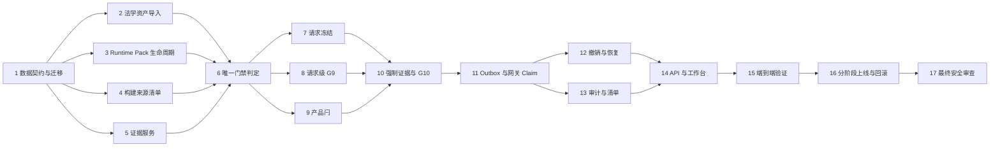

# Implementation Plan: formal-outbound-release

## Overview

以 Python 为后端实现语言，按现有设计和需求增量实现失败关闭、请求哈希绑定、最多一次消费的正式外发能力。计划保持仓库 pack、当前十案评估结论和正式外发阻断状态不变；所有实现步骤复用现有法学资产与唯一 `outbound_gate` G 表，并通过自动化测试逐步验证。

> 默认原则：每个阶段结束时正式外发仍为 blocked，除非精确 LA-001 三元组在最终阶段持有全部真实收据。不得以测试夹具、空表、工程基线或口述条件替代真实证据。

## Tasks

- [ ] 1. 建立增量数据契约与迁移
  - [x] 1.1 在 `lexaegis/contracts.py` 增加 `LegalSourceRecord`、`CitationMapping`、`EvidenceArtifact`、`GateEvidenceReceipt`、`ReleaseBuildManifest`、`FormalReleasePolicy`、`FrozenFormalRequest`、`GateDecision`、`IsolationReceipt`、`OneTimeDispatchGrant` 和 `FormalReleaseState` 契约
    - 所有枚举默认使用 unknown/pending/blocked，不提供隐式 pass。
    - G ID 只允许现有 outbound_gate 集合。
    - _Requirements: 1.1, 2.4, 5.1, 8.1, 9.2, 11.3_
  - [x] 1.2 添加 additive 存储迁移与唯一索引
    - 为 request hash、grant nonce、gateway request ID、policy 单次 slot 建唯一约束。
    - 保持旧 records 聚合可读，迁移前备份与失败回滚沿用现有机制。
    - _Requirements: 11.5, 12.1, 12.4, 16.7_
  - [x] 1.3 编写契约和迁移回归测试
    - 验证未知缺省、非法通配 scope、非法 G ID、重复 nonce、升级/回滚。
    - _Requirements: 5.1, 9.4, 12.5_

- [ ] 2. 实现现有法学资产的内容寻址导入
  - [x] 2.1 扩展 `scripts/import_legal_assets.py` 或建立等价服务，读取现有 140 行合并目录、规则正文、法计交接模板、审批设计稿、劳动争议草稿包和模板
    - 不访问外部法学服务，不要求新增法源文件。
    - 空栏导入为 unknown；设计稿标记 design_only。
    - 任一法源行缺少来源资产标识或源内容哈希时，原子拒绝整次导入且不持久化部分注册表更新。
    - _Requirements: 2.1, 2.2, 2.4, 2.5, 3.8_
  - [x] 2.2 实现确定性去重与冲突分组
    - exact duplicate 合并索引但保留每个来源指针；文本冲突保留全部版本并标 pending。
    - _Requirements: 3.1, 3.2, 3.3_
  - [x] 2.3 实现律师法第 38/41 条显式时态映射
    - 保留旧第 38 条历史记录；第 41 条映射记录 basis 和有效期；顺序推算不得标 verified full text。
    - _Requirements: 3.4, 3.5, 3.6_
  - [~] 2.4 加严法源引用校验
    - 规则至少有条款级 statutory 依据；instrument_scope、推荐性国标和项目控制只能补充。
    - 未解析引用或当前条号冲突阻断 G5。
    - _Requirements: 3.6, 3.7_
  - [ ]* 2.5 编写法源导入属性测试
    - 用 Hypothesis 随机化行顺序、重复和冲突，证明来源不丢失且结果顺序无关。
    - _Requirements: 3.1, 3.2, 3.3_

- [ ] 3. 分离仓库草稿与运行库 pack 生命周期
  - [x] 3.1 实现从 `labor_v2_draft` 哈希派生运行库 draft 的命令/服务
    - 不修改仓库 pack；记录 source pack hash 和导入报告 hash。
    - _Requirements: 1.2, 4.1, 4.4_
  - [x] 3.2 加严运行库 review/publish 验证
    - 要求 reviewed legal state、精确 published_scope、五类权重、既有法 05 证据、法源与内容哈希。
    - 首发 scope 只能是 LA-001 × R × D。
    - _Requirements: 4.2, 4.3_
  - [x] 3.3 实现 retire/change 的依赖失效传播
    - 使未 claim 请求、证据快照和 grant 失效，不删除历史。
    - _Requirements: 4.5, 13.2_
  - [~] 3.4 扩展 pack integrity 和 overtime disclosure 回归测试
    - 断言仓库 pack 始终 draft/dispatch_allowed=false，运行库发布独立。
    - _Requirements: 1.2, 4.4_

- [x] 4. 实现构建与部署来源清单
  - [x] 4.1 建立 `ReleaseBuildVerifier`
    - 采集 commit、clean flag、source/docs/frontend/wheel/lockfile/runtime-pack/image/migration/validation hashes。
    - dirty tree 只生成 pending manifest。
    - _Requirements: 10.1, 10.2_
  - [x] 4.2 在 API、worker 和 gateway 暴露不含秘密的 runtime identity hash
    - 三者必须匹配冻结 build manifest。
    - _Requirements: 10.3, 10.4_
  - [x] 4.3 增加工作树/制品漂移测试和发布候选验证命令
    - 覆盖源文件、文档、前端 dist、wheel、pack、镜像和 lockfile 任一变化。
    - _Requirements: 10.2, 10.4, 16.1_

- [ ] 5. 建立证据接入、状态和撤销服务
  - [x] 5.1 实现内容寻址 Evidence Store
    - 受控库保存文件，业务库保存 hash、media type、来源提示和访问引用；审计不复制正文。
    - _Requirements: 2.4, 14.3, 14.4_
  - [x] 5.2 实现既有法计模板到 `GateEvidenceReceipt` 的结构化映射
    - G1/G2/G3/G5 绑定精确三元组和版本；G6-G10 绑定 request hash。
    - 空签署、空证据、未知/过期/撤销不能 pass。
    - _Requirements: 6.1, 6.2, 6.4, 7.4_
  - [x] 5.3 实现具名角色校验和证据撤销
    - 法学确认、工程记录、approver 分开留痕；同人换角色如实记录。
    - _Requirements: 6.6, 6.7, 13.2, 14.5_
  - [~] 5.4 增加恶意/错误证据输入测试
    - 文件名伪造、空白扫描件、口述字段、客户端直接 pass、过期证据和 hash 替换均阻断。
    - _Requirements: 2.5, 5.5, 6.1_

- [ ] 6. 把 `validate_formal_gate` 收敛为完整唯一判定
  - [~] 6.1 在 `lexaegis/outbound_gate.py` 实现 `FormalGateContext` 和完整 `GateDecision`
    - 纳入 G0/G1/G2/G3/G5/G6/G7/G8/G9/G10/G-product，不新增编号。
    - unknown/pending/fail/expired/stale/revoked 全阻断。
    - _Requirements: 5.1, 5.2, 5.5, 5.6_
  - [~] 6.2 定义 evaluate/approve 与 enqueue/send/gateway 阶段语义
    - 前者计算 approval_eligible 且不循环要求 G10；后者要求 G10 并计算 dispatch_allowed。
    - _Requirements: 5.3, 5.4_
  - [~] 6.3 将公开 `governance.validate_formal_gate` 改为完整上下文 API
    - 把旧子集重命名为明确的 non-authoritative 内部诊断函数。
    - 旧四参数调用失败关闭，不能返回可放行空列表。
    - _Requirements: 5.7, 5.8, 5.9_
  - [~] 6.4 更新 `policy.assess` 以消费完整 evaluator，同时保持现有 blocker 条件
    - disposition 与 readiness 继续正交，但都参与阻断。
    - _Requirements: 5.6, 5.10_
  - [~] 6.5 扩展 blocker 等价与调用图测试
    - 证明批准、入队、worker、gateway 无路径调用子集 validator；现有 blocker 不减少。
    - _Requirements: 5.8, 5.10_
  - [ ]* 6.6 编写 gate 组合属性测试
    - 任一强制 gate 非 pass 时 dispatch_allowed 恒 false。
    - _Requirements: 5.5_

- [ ] 7. 实现规范请求冻结和失效
  - [~] 7.1 扩展 RequestFreezer 和 ApprovedRequest 依赖
    - 覆盖 wire、prompt、D 主槽、model、provider、runtime pack、材料/规则/任务/mapping/ledger、组合、协议、build manifest。
    - 任一强制冻结依赖缺失或无法规范化时，拒绝冻结且不持久化请求或 request hash。
    - _Requirements: 7.1, 7.2, 7.7_
  - [~] 7.2 保持 wire v2 最小披露契约
    - 继续禁止 mapping、original_value、local_text、anchors 和原始材料。
    - _Requirements: 7.5_
  - [~] 7.3 强制主槽唯一且备用关闭
    - 目标、模型或接收方变化必须重冻。
    - _Requirements: 7.6, 12.6_
  - [~] 7.4 实现 dependency diff 与 G7-G10/grant 失效传播
    - _Requirements: 7.4, 13.3, 13.4_
  - [ ]* 7.5 编写请求哈希属性测试
    - 任一冻结依赖随机变异都使旧 grant 失效；相同规范输入产生相同 hash。
    - _Requirements: 7.3, 7.4_

- [ ] 8. 用请求级收据替换 G9 全局布尔放行
  - [~] 8.1 实现 request/build/environment challenge
    - 仅 isolated 部署可运行；native 明确拒绝。
    - _Requirements: 8.1, 8.2, 8.5_
  - [~] 8.2 扩展 `check-isolation` 产出绑定挑战的五项原名结果
    - 同时绑定 Compose、image、宿主机防火墙和供应链证据 hash。
    - _Requirements: 8.2, 8.3, 8.4_
  - [~] 8.3 接入法 10 具名确认
    - 技术收据先 pending；法 10 对同 request hash 确认后才能 valid。
    - _Requirements: 6.4, 8.6_
  - [~] 8.4 移除正式 gate 对全局 `isolation_verified` 的授权语义
    - 保留能力展示兼容字段，但单独存在必然阻断 G9。
    - _Requirements: 8.1, 8.7_
  - [~] 8.5 编写 G9 集成和负向测试
    - 覆盖历史 bool、native、五项任一 false、hash mismatch、过期、撤销、宿主/供应链缺失。
    - _Requirements: 8.4, 8.5, 8.7_

- [ ] 9. 把产品闩升级为多层强制的单次 policy
  - [~] 9.1 实现 `FormalReleasePolicy` 安装、状态、撤销和消费
    - 缺省 blocked；只接受 LA-001 × R × D、一个 build/provider/target/model、限时、maximum=1。
    - _Requirements: 9.2, 9.3, 9.4_
  - [~] 9.2 保持无上下文 `product_dispatch_state()` 的保守兼容行为
    - 新权威方法按 scope 评估 armed_once，不提供全局 enabled。
    - _Requirements: 9.7_
  - [~] 9.3 在 API approve/enqueue、worker send、gateway dispatch 全部执行 G-product
    - _Requirements: 9.1, 12.2, 12.3_
  - [~] 9.4 实现 claim 后自动 consumed/blocked
    - _Requirements: 9.6, 16.5_
  - [~] 9.5 编写 scope、过期、撤销、并发消费和无 policy 测试
    - _Requirements: 9.2, 9.4, 9.6_

- [ ] 10. 实现 G1-G9 强制证据与 G10 单次批准
  - [~] 10.1 把 G1 来源人审、G2 本次授权/组织授权、G3 服务商/PIPIA、G5 规则、G7/G8/G9 法学确认接入完整 evaluator
    - 九案层 B 关闭常量不得改弱。
    - _Requirements: 6.1, 6.2, 6.3, 6.4_
  - [~] 10.2 保持 `ManualApprovalRecord` 只作为法学复核记录
    - 任意结论都不创建 G10、不翻转 dispatch_allowed、不生成 grant。
    - _Requirements: 6.5_
  - [~] 10.3 实现事务性 `approve_once`
    - 要求当前 request/snapshot、具名 approver、G0-G9/G-product pass、无现存 grant；签发 30 分钟随机 nonce。
    - _Requirements: 11.1, 11.2, 11.3, 11.5_
  - [~] 10.4 加严 `authorize_dispatch` 的 approve/enqueue/send 重验
    - 不删除现有依赖检查；enqueue/send 要求有效 G10 grant。
    - _Requirements: 5.10, 11.6, 13.1_
  - [~] 10.5 编写人工复核非批准、并发批准、过期、撤销和 stale hash 测试
    - _Requirements: 6.5, 11.4, 11.5, 11.6_

- [ ] 11. 实现事务 outbox 与网关原子 claim
  - [~] 11.1 在应用库中原子写 dispatch intent、outbox、ledger version 和 grant reserved
    - _Requirements: 12.1_
  - [~] 11.2 在网关库中原子 claim request ID、grant nonce 和 product policy slot，并先写 sending 再调用 provider
    - _Requirements: 12.4, 12.5_
  - [~] 11.3 网关独立重验 HMAC、hash、grant、evidence/build、target/model、wire 和完整 gate snapshot
    - 禁止 redirect；只允许 D 主槽。
    - _Requirements: 12.3, 12.6_
  - [~] 11.4 实现 complete/unknown/failed-before-disclosure 的严格状态
    - claim 后任何可能披露失败均 unknown/possible 并消费 slot；不自动重发或切接收方。
    - _Requirements: 7.6, 11.7, 12.7, 12.8_
  - [~] 11.5 保持 reconcile 只读网关账本
    - _Requirements: 12.9_
  - [ ]* 11.6 编写并发/崩溃调度属性测试
    - 随机化 approve、reserve、worker retry、gateway restart 和 response failure，证明每 nonce 网络 attempt ≤ 1。
    - _Requirements: 12.4, 12.5, 12.7_

- [ ] 12. 实现撤销传播和防重发恢复
  - [~] 12.1 建立证据、pack、provider、build、policy 到请求/grant/intent 的反向依赖索引
    - _Requirements: 13.1, 13.2_
  - [~] 12.2 实现 claim 前同步撤销和 intent 取消
    - _Requirements: 13.2, 13.3_
  - [~] 12.3 实现 claim 后历史保护和 cancellation-requested/unknown 语义
    - 不删除发送事实，不将撤销写成未披露证明。
    - _Requirements: 13.5, 13.6_
  - [~] 12.4 编写撤销竞态测试
    - 覆盖 approve 前、reserve 后、claim 事务中、网络后和 unknown 后。
    - _Requirements: 13.2, 13.5, 13.6_

- [ ] 13. 完成审计链和证据清单
  - [~] 13.1 扩展 append-only audit event 和前序 hash
    - 覆盖 import/review/register/evaluate/freeze/invalidate/approve/reserve/claim/outcome/revoke/reconcile/consume。
    - 审计追加或前序哈希校验失败时，回滚关联状态推进，并保持批准、预留、claim、policy 消费和网络 attempt 计数不变。
    - _Requirements: 14.1, 14.2, 14.7_
  - [~] 13.2 实现按 request hash 导出证据 manifest
    - 只导出引用和 hash，不复制保护内容进 git。
    - _Requirements: 14.3, 14.4_
  - [~] 13.3 保留停用用户的稳定历史身份并细分状态
    - _Requirements: 14.5, 14.6_
  - [~] 13.4 编写日志泄漏和审计链篡改测试
    - 密钥、mapping、真名、原文、完整请求、provider body 不得出现。
    - _Requirements: 14.3_

- [ ] 14. 接入 API 与工作台
  - [~] 14.1 增加 asset/evidence/gate-snapshot/isolation-receipt/release-policy/approve-once/revoke/reconcile API
    - 写操作继续校验本地会话、Origin、Host 和角色。
    - 409 返回现有 G ID、状态、reason code 和下一证据动作。
    - _Requirements: 1.5, 14.2, 15.4_
  - [~] 14.2 修改前先读取 `.cursor/skills/lexaegis-workbench-ui/SKILL.md`
    - _Requirements: 15.2_
  - [~] 14.3 更新 RiskWorkspace 和 ApprovalWorkspace
    - 分开显示 disposition、readiness、approval eligibility、dispatch allowance、product latch 和 grant state。
    - 明示法学复核不授予发送权，409 为正常门禁。
    - _Requirements: 6.5, 15.2, 15.3, 15.6_
  - [~] 14.4 防止界面误述
    - 不写当前已开通、十案已通过、pack 已发布、工程攻击已法学 resisted、Compose 历史探测可替 G9。
    - _Requirements: 15.5_
  - [~] 14.5 保持 demo/local 路径兼容并增加 UI/e2e 测试
    - _Requirements: 15.1, 15.6_

- [ ] 15. 完成端到端验证与发布守护
  - [~] 15.1 增加逐门负向集成矩阵
    - 逐一留空 G1/G2/G3/G5/G7/G8/G9/G10/G-product，断言 409 且 attempt=0。
    - _Requirements: 1.5, 1.6, 5.5_
  - [~] 15.2 增加九案层 B 与 LA-001 单 scope 测试
    - 即使其他证据齐全，LA-002 至 LA-010 仍 G2 阻断。
    - _Requirements: 6.3, 9.3, 16.8_
  - [~] 15.3 增加 isolated staging 假 provider 全流程
    - 覆盖 request-bound G9、一次 grant、一次 claim、complete/unknown 和自动回闭；标记 synthetic，不计真实发送。
    - _Requirements: 12.5, 16.3, 16.5_
  - [~] 15.4 运行目标 Python 测试、类型检查、前端 build、关键 e2e、wheel/迁移/备份恢复和镜像摘要验证
    - 不运行 watch 或长期服务命令；测试使用单次运行参数。
    - _Requirements: 10.1, 16.1_
  - [~] 15.5 生成 verified release build manifest
    - 仅干净提交和全部目标验证通过时生成；否则保持 pending/blocked。
    - _Requirements: 10.1, 10.2_

- [ ] 16. 分阶段上线、回滚与首次尝试 runbook
  - [~] 16.1 上线 Phase 0：仅 schema/evaluator/evidence/build 能力，policy 不安装
    - 实现阶段前置顺序守卫：任一较早 Phase 的失败关闭检查未完成时，阻断进入所有后续 Phase。
    - _Requirements: 16.1, 16.9_
  - [~] 16.2 上线 Phase 1：现有资产只读导入和 shadow diff
    - 不改变 task、approval、grant 或 dispatch 状态。
    - _Requirements: 16.2_
  - [~] 16.3 执行 Phase 2：隔离 staging 合成演练
    - _Requirements: 16.3_
  - [~] 16.4 准备 Phase 3：仅在真实既有模板收据和 verified build 齐备时安装 LA-001 armed-once policy
    - 任一事实为空即保持 blocked；不得代填。
    - _Requirements: 2.4, 16.4_
  - [~] 16.5 编写并演练回滚
    - 先撤销 policy 和 unclaimed grant，再部署旧版本；保留 claimed/unknown gateway ledger。
    - _Requirements: 10.5, 16.7_
  - [~] 16.6 编写 Phase 4 首次单次执行清单
    - 仅当十门同哈希全过才允许 approver 批准；真实结果只由网关账本写入现有配05，不预填成功。
    - _Requirements: 16.5, 16.6_
  - [~] 16.7 执行后 Phase 5 自动回闭并复盘
    - 不扩大到九案，不继承本次 grant 或 policy。
    - _Requirements: 9.6, 16.8_

- [ ] 17. 最终安全审查
  - [~] 17.1 进行授权路径调用图审查
    - 证明所有正式网络调用都经过完整 outbound_gate、authorize_dispatch、G-product 和 gateway claim。
    - _Requirements: 5.1, 5.8, 9.1, 12.3_
  - [~] 17.2 进行数据泄漏审查
    - 检查 wire、审计、错误、evidence manifest 和 build manifest 不含原文、mapping 或密钥。
    - _Requirements: 7.5, 14.3_
  - [~] 17.3 进行语义回归审查
    - 确认没有把 formal release 描述为当前已开通，没有把 evaluate/Compose/工程攻击写成真实发送、请求级隔离或法学结论。
    - _Requirements: 1.3, 1.4, 15.5_

## Notes

- 任务按现有设计增量推进；每个任务均应继续保留既有 blocker，不得削弱 `validate_formal_gate`、`authorize_dispatch` 或网关校验。
- 标记为 `*` 的测试子任务可选，可在快速 MVP 中跳过；未标记任务均为核心实施内容。
- 属性测试使用 Hypothesis，并逐项对应设计中的 Correctness Properties；单元、集成和端到端验证只使用合成材料或本地假 provider。
- 不要求新增法学资源，不发布仓库 pack，不代填签署、合同、服务商事实、审批或法学结论。
- 每个阶段完成时先确保自动化测试通过；如出现需求或设计歧义，再向用户确认。

## Task Dependency Graph



```json
{
  "waves": [
    { "id": 0, "tasks": ["1.1"] },
    { "id": 1, "tasks": ["1.2"] },
    { "id": 2, "tasks": ["1.3"] },
    { "id": 3, "tasks": ["2.1", "3.1", "4.1", "5.1"] },
    { "id": 4, "tasks": ["2.2", "3.2", "4.2", "5.2"] },
    { "id": 5, "tasks": ["2.3", "3.3", "4.3", "5.3"] },
    { "id": 6, "tasks": ["2.4", "3.4", "5.4"] },
    { "id": 7, "tasks": ["2.5"] },
    { "id": 8, "tasks": ["6.1"] },
    { "id": 9, "tasks": ["6.2"] },
    { "id": 10, "tasks": ["6.3"] },
    { "id": 11, "tasks": ["6.4"] },
    { "id": 12, "tasks": ["6.5"] },
    { "id": 13, "tasks": ["6.6"] },
    { "id": 14, "tasks": ["7.1", "8.1", "9.1"] },
    { "id": 15, "tasks": ["7.2", "8.2", "9.2"] },
    { "id": 16, "tasks": ["7.3", "8.3", "9.3"] },
    { "id": 17, "tasks": ["7.4", "8.4", "9.4"] },
    { "id": 18, "tasks": ["7.5", "8.5", "9.5"] },
    { "id": 19, "tasks": ["10.1"] },
    { "id": 20, "tasks": ["10.2"] },
    { "id": 21, "tasks": ["10.3"] },
    { "id": 22, "tasks": ["10.4"] },
    { "id": 23, "tasks": ["10.5"] },
    { "id": 24, "tasks": ["11.1"] },
    { "id": 25, "tasks": ["11.2"] },
    { "id": 26, "tasks": ["11.3"] },
    { "id": 27, "tasks": ["11.4"] },
    { "id": 28, "tasks": ["11.5"] },
    { "id": 29, "tasks": ["11.6"] },
    { "id": 30, "tasks": ["12.1", "13.1"] },
    { "id": 31, "tasks": ["12.2", "13.2"] },
    { "id": 32, "tasks": ["12.3", "13.3"] },
    { "id": 33, "tasks": ["12.4", "13.4"] },
    { "id": 34, "tasks": ["14.1"] },
    { "id": 35, "tasks": ["14.2"] },
    { "id": 36, "tasks": ["14.3"] },
    { "id": 37, "tasks": ["14.4"] },
    { "id": 38, "tasks": ["14.5"] },
    { "id": 39, "tasks": ["15.1"] },
    { "id": 40, "tasks": ["15.2"] },
    { "id": 41, "tasks": ["15.3"] },
    { "id": 42, "tasks": ["15.4"] },
    { "id": 43, "tasks": ["15.5"] },
    { "id": 44, "tasks": ["16.1"] },
    { "id": 45, "tasks": ["16.2"] },
    { "id": 46, "tasks": ["16.3"] },
    { "id": 47, "tasks": ["16.4"] },
    { "id": 48, "tasks": ["16.5"] },
    { "id": 49, "tasks": ["16.6"] },
    { "id": 50, "tasks": ["16.7"] },
    { "id": 51, "tasks": ["17.1", "17.2", "17.3"] }
  ]
}
```
