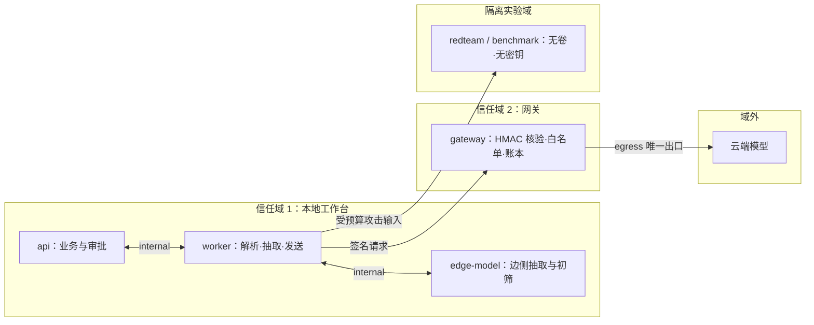
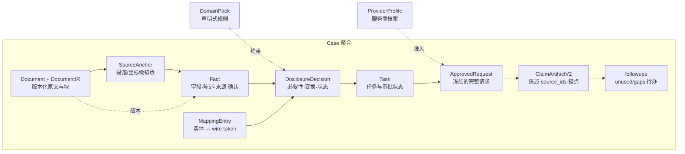
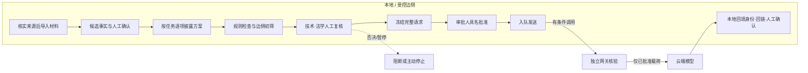
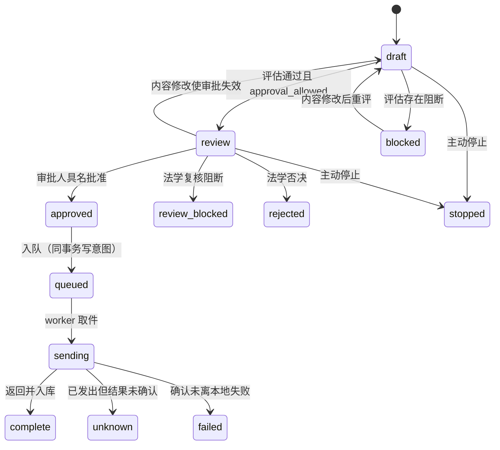
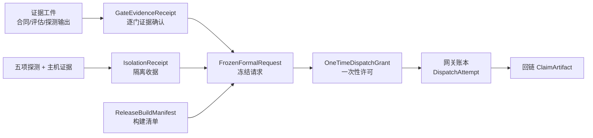

# LexAegis · 案隐盾

**面向劳动争议材料的信息最小披露与受控外发工作台**

[English version](README_EN.md)

版本 **V1.0**（`1.0.0`），非正式发行。合成演示 ≠ 真实案件外发验收：正式外发仍失败关闭（`formal_dispatch=blocked`），规则包均为草稿，既有十案仅完成层 A 评估、0 案真实发送。

## 这一版改了什么

相对已入库的 7 节说明（现在能做什么、怎么跑、技术栈、目录、评测、验证、文档）。本文给评审读产品说明。它不是实施清单，也不是发送授权。

1. **这一版写进正文：** 设计取舍、被否决的四条路、门禁、状态机、证据链、四类攻击、四条演示路径。旧文只在开头列功能。
2. **这一版写进正文：** 快速体验仍是 `lexaegis start --profile demo`，工作台 http://127.0.0.1:48765。`production` 为 38765，`integration` 为 58765。
3. **这一版要做：** 走通已设计的三链路。边侧判断不能发；边侧判断能发、人工复核判断不能发；边侧和人工复核都认为能发。第三条成功就是这一次请求的真实发送：在 `integration` 上 `transport=cloud`，结果 `provenance=cloud`。`demo` 禁止 cloud。今天 `formal_dispatch` 仍是 `blocked`，十案 0 案真实发送。
4. **这一版不做：** 不在本文写一条当前测试通过数。旧文的 2026-09-19「520 过 / 3 跳过」仍只记在 [docs/VALIDATION.md](docs/VALIDATION.md)。
5. **这一版不做：** 不把 G1 写成已落码。法源人工复核仍是纸面。

## 目录

- [这一版改了什么](#这一版改了什么)
- [这是什么](#这是什么)
- [设计动机与取舍](#设计动机与取舍)
- [适用场景与使用人员](#适用场景与使用人员)
- [信任边界与分域架构](#信任边界与分域架构)
- [领域模型](#领域模型)
- [系统如何工作](#系统如何工作)
- [门禁体系](#门禁体系)
- [生命周期与状态机](#生命周期与状态机)
- [证据链与收据](#证据链与收据)
- [威胁模型与四类攻击](#威胁模型与四类攻击)
- [核心功能与边界](#核心功能与边界)
- [可演示的流程](#可演示的流程)
- [技术实现与扩展机制](#技术实现与扩展机制)
- [非功能约束与运行限额](#非功能约束与运行限额)
- [当前状态与边界](#当前状态与边界)
- [快速体验](#快速体验)
- [项目结构](#项目结构)
- [文档导航](#文档导航)

## 这是什么

案隐盾是一套**管理"案件材料如何被模型接触"的法律工作台**，而不是一个模型本身。法律工作者把隐私敏感的案件材料交给它后，原文留在本地（边侧）被整理成带来源的事实；针对一个具体任务，系统逐项决定披露什么、如何处理；经技术检查与人工专业复核后，由审批人对一次冻结的完整请求具名批准，独立网关才可向云端模型发起调用；返回结果回到本地核对、回填身份并回链到原文出处。

本仓库发货的完整规则、提示词与验证材料以**劳动争议**为首个落地领域；"按任务最小披露 → 确定性检查 → 人工复核 → 受控外发 → 结果回链"这套控制框架设计为领域无关，后续拓展到其他法律领域时，换的是声明式案由包、法源对照与任务定义，而不是控制框架本身（见[技术实现与扩展机制](#技术实现与扩展机制)）。

理解这套系统，先分清它管理的三样东西：

- **材料的存放**：原始文书、身份映射、内部复核理由永不出边侧；云端拿到的只是经批准的假名化事实载荷。
- **决定的归属**：每一项披露、每一次放行、每一句结果确认都对应一个具名的角色与一条可审计的记录；没有任何一步由模型自己宣告通过。
- **请求的单位**：外发的最小单位不是"一个案件"，而是"一次冻结的完整请求"——内容、接收方、模型、规则与材料版本一起哈希绑定，批准只对它有效。

它不是把整份材料交给大模型的问答工具，也不替代仲裁员、律师或法务作法律判断。**系统决定不了"该不该发"，只能保证"没经允许发不出去"。**

### 要解决的问题

劳动争议材料分散且敏感，这是"能不能用模型"必须过的第一道坎：

- 合同、工资流水、考勤、聊天记录、解除通知来源各异，时间、金额、主体、证据关系需要逐项核对，矛盾陈述不能只保留一个版本。
- 材料同时含有身份信息、收入明细、联系方式和单位内部信息，并非全部对当前任务必要。
- 简单替换姓名不足以消除岗位、日期、事件等组合识别线索；而一味全删又会损伤摘要或证据整理的用途。
- 模型输出必须能回到原文验证，不能凭一句"看起来没问题"就外发。

案隐盾把这个过程变成四个可追溯的问题：**哪些信息对本次任务必要 → 发给谁 → 由谁批准 → 结果如何核对。** 后续每一章——边界、模型、门禁、证据链——都是对其中一个问题的展开回答。

## 设计动机与取舍

本项目的核心矛盾是**效率与责任边界**：模型确实能把分散的劳动材料整理成结构化事实，但"这条信息能不能发给外部模型""这份摘要依据何在"必须由具名的人承担，不能由模型自己宣称。整个架构可以概括为一句：**让模型做建议，让确定性代码做控制，让具体的人做决定。**

工程上这一点落在三处。边侧审核模型的协议写死"你只能决定该候选是否可进入人工复核，绝不授予发送或外发权限"（`providers.py` 的 `EDGE_REVIEW_PROMPT`）；任务能否走到批准，取决于 `risk["approval_allowed"]` 这个由确定性检查写出的布尔值，而不是模型输出（`service.py`）；网关发送前再独立核验具名审批、依赖版本、有效期与目标白名单（`gateway.py`）。模型、业务代码、网关三层各自只能放行它有权放行的那一段。

### 被否决的四个方案

| 方案 | 为什么否决 | 代码依据 |
| --- | --- | --- |
| 整案材料直接上传 | 披露范围无边界，无法按任务回答"这一条为什么必要"；等于把决定权交给外部服务的默认行为 | 披露是逐项 `DisclosureDecision`；wire 载荷禁带 `mapping` / `original_value` / `local_text` / `anchors`；跨轮外发另有字符与条数预算 |
| 只做姓名打码 | 岗位、地点、日期、事件等组合线索仍可再识别；把"去标识化"误当"匿名化" | 门禁 G7 检查准标识与组合线索（`outbound_gate.combination_blockers`）；边侧审核协议把"唯一岗位 + 公开事件"列为必须 `block_external` 的组合 |
| 模型自动放行 | 语义判断不稳定、不可审计，不能替代权限、状态与审批这些确定性控制 | 边侧初筛只能产出 `block_external` 或 `allow_human_review`；所有门禁命中分四类（禁止／待核实／需最小化／工程），工程类不产出法律结论 |
| 一开始全微服务 | 多数模块不需要独立网络权限，拆开只增加一致性与运维负担，不改善真实信任边界 | 只把"持有密钥 + 对外网络权限"的网关拆出（`compose.yaml` 分网段）；其余为模块化单体，SQLite WAL 单实例即可支撑团队规模 |

四个否决都不是"功能不够好"，而是**把该由人或确定性控制承担的责任让渡了出去**。这是架构书后文所有机制的共同判据。

### 为什么是云边混合，而不是全本地

产品上想让系统"在任何情况下都能跑"与"在有条件时能用上更强模型"兼得；工程上本地设备装不下也没必要装下一个大模型。真实约束写在代码里：边侧模型按 2B 级容量设计，GPU 阶段锁串行 OCR、转写与抽取，注释明确"不要依赖 Windows 共享显存"（`gpu_runtime.py`）；单次抽取限 40 条事实、3072 token（`providers.py`）。

于是分工变成：边侧负责需要原文的语义工作（候选事实抽取、外发候选初筛），云端只处理**经批准的、已经假名化的窄任务**。全本地仍是有效降级路径——任务可在任一环节主动停止，不因云端不可用而假装完成。需要强调：**选择云边混合是能力分工决定，不等于云端调用已获法律授权**；生产环境的每一次真实调用仍须通过全部门禁并消费一次性许可。

### 为什么是模块化单体 + 独立网关

拆分的依据只有一个：**信任边界，而不是代码规模**。网关是唯一同时持有"外发密钥"与"对外网络权限"的组件，因此只有它被拆到独立网段——API 与 worker 在内网且可以移除默认路由，网关独占出口（`compose.yaml`）。其余模块留在单体与同一存储内：案件版本、事实、披露决策与审批之间存在强一致性需求，拆成服务反而要引入分布式事务才能表达"内容变了审批即失效"。

这套取舍的成本是承认单体边界内模块互相信任；换来的是**唯一出口可核查**——发送与否只看网关账本一处，失败关闭只需要在一个地方实现。规模上来以后网关可以再拆，单体可以演进为服务，但"拆什么由信任域决定"这条原则不变。

## 适用场景与使用人员

系统面向**法律工作者处理案件材料**的场景，当前落地范围是**劳动争议方向的各类法律材料**——合同、工资记录、考勤、沟通记录、解除通知、证据清单等。后续将沿同一控制框架拓展到其他法律领域：合同、家事、知产等领域共用"按任务最小披露 → 人工复核 → 受控外发"的机制，需要补齐的是各自的案由包、法源对照与任务定义（均为声明式资产），而不是重写系统。

下表是劳动争议方向的通用业务示意——**不等于这些子场景的规则均已审核适配**：

| 常见争议 | 典型材料 | 系统辅助 |
| --- | --- | --- |
| 劳动关系确认 | 合同、履职沟通、入职记录 | 归集关系相关事实与证据线索，保留双方不同陈述 |
| 工资 / 加班报酬 | 工资表、考勤、银行流水 | 整理金额、时间与来源，**不自动认定应付数额** |
| 解除 / 终止 | 解除通知、往来函件 | 梳理事件顺序与双方主张，**不自动判断合法性或赔偿** |

### 支持的四个任务

"按任务披露"落到四个具体任务上，只有事实摘要可能进入云端分支：

| 任务 | 执行方式 | 是否可能外发 |
| --- | --- | --- |
| `fact_summary` 事实摘要 | 本地确定性拼草稿；云端生成为**已批准的窄任务** | 可能——须经全部门禁与批准 |
| `timeline` 时间线 | 本地确定性，筛选含日期的事实 | 否 |
| `evidence_inventory` 证据整理 | 本地确定性，归集证据类事实 | 否 |
| `issue_extraction` 争点提取 | 本地确定性，按字段分组候选 | 否 |

也就是说：**多数日常工作根本不发生外发**。云端只被用来承担一个任务——在已批准的假名化事实上生成事实摘要，而连这个任务也有不联网的本地草稿路径。这个比例是刻意的：能本地确定完成的，不交给模型；必须交给模型的，只剩一件事。

### 使用人员与职责分离

本地角色按职责分离，绑定具名会话，管理员不能隐式代行：

| 角色 | 职责 |
| --- | --- |
| 案件操作 | 导入材料、核对解析、编辑事实与披露方案、可主动停止 |
| 技术复核 | 补充组合线索等风险疑点，可提请暂停当前请求 |
| 法学复核 | 对当前请求出具允许、待核实或否决意见，否决不可绕过 |
| 审批人 | 仅对一次冻结的完整请求具名批准，30 分钟内有效 |
| 管理员 | 建立账户与放行策略，不能代替上述复核或批准 |

分离的用意不是形式合规，而是**让每个决定都有独立视角**：技术员看到的是组合线索，法学复核看到的是实体风险，审批人看到的是完整冻结请求——三者看到的材料不同，谁也替不了谁。否决在代码里是真实状态（`rejected` / `stopped` / `review_blocked`），不是一句提示语。

### 不适用的情况

正式案件外发当前**整体阻断**（`formal_dispatch=blocked`），合成演示之外的任何真实发送都不可用；系统也不面向需要即时法律意见、裁判预测或赔偿计算的场景。真实启用条件见[当前状态与边界](#当前状态与边界)。

## 信任边界与分域架构

系统按"**谁必须信任谁**"划成三个信任域，每个域只拿到完成职责所需的最小集合：

| 域 | 持有什么 | 网络权限 |
| --- | --- | --- |
| **本地工作台**（api + worker + 前端） | 原文、身份映射、事实、披露决策、审批、审计库 | 仅内网；可移除默认路由，无对外出口 |
| **独立网关** | 云端密钥、外发白名单、发送账本 | 唯一接 egress 网段；**不挂载案件卷** |
| **云端模型** | 只收到经批准的假名化载荷 | 被调用方，不属于本系统部署 |

另有两个隔离的辅助域：**边侧模型**只在内网受 OpenAI 兼容接口调用，白名单限定；**红队与评测**挂在独立网段、不挂载任何卷、不持有网关密钥——攻击者看不到原文、映射与真值。



### 边界如何被验证

隔离不是声明出来的，而是由部署拓扑与探测脚本共同验证：

- **网段划分**（`compose.yaml`）：`internal`、`redteam` 为内网（`internal: true`），`egress` 只给网关；`isolate-api-route` 在 API 网络命名空间里删除默认路由。
- **五项隔离探测**（`lexaegis check-isolation` → `diagnostics.compose_isolation_report`）：API 与 worker 不可达外网、网关未挂载案件卷、红队与评测无网关密钥且无案件库。
- **密钥分离**：云端密钥只进网关环境变量；网关签名密钥与红队签名密钥各自独立（`LEX_GATEWAY_SECRET` / `LEX_REDTEAM_SECRET`）。
- **容器基线**：全部服务只读根文件系统、丢弃全部 capability、`no-new-privileges`。

### 边界在什么时候不成立

这是必须说清的一半：

- **native 模式不能自证隔离**：同一进程/本机网络下，"没出网"只能靠部署事实，代码里直接拒绝写入 `isolation_verified`（`diagnostics.py`）。
- **探测通过 ≠ 本请求收据**：`check-isolation` 形成的是一次部署自检记录；逐请求的隔离证据由 `IsolationReceipt`（见[证据链与收据](#证据链与收据)）承载，探测只是其来源之一。
- **主机防火墙与供应链在探测之外**：探测不验证宿主机防火墙规则，也不验证镜像来源——这两项在收据里有独立字段，当前均无证据。

## 领域模型

全部业务对象沿一条可回溯链条组织：**原文锚点 → 事实 → 披露决策 → 外发内容 → 摘要陈述 → 校核结论**。链条上每一环都是独立版本化对象，前一环变化会使后一环标记失效而不是静默沿用。



### 九个核心对象

| 对象 | 职责 | 关键不变量 |
| --- | --- | --- |
| `Case` | 案件聚合：材料、事实、任务、映射、待办 | 编辑并发冲突使任务标记 `stale`，不静默继续 |
| `Document` + `DocumentIR` | 版本化原文与解析块 | `ocr`/`scan`/`transcript` 未复核不得进入抽取与批准 |
| `SourceAnchor` | 段落/表格/页/坐标级来源定位 | 带回原解析器 id 与版本；锚点失效即事实来源失效 |
| `Fact` | `field`/`value`/`source_ids`/`origin`/`confirmed`/`stale` | 未确认或来源版本过期的事实不得外发；矛盾陈述并存不覆盖 |
| `MappingEntry` | 实体 ↔ `[[LEX:P0001]]` 线 token、原值、别名 | 只存在边侧；永不进入 wire 载荷 |
| `DisclosureDecision` | 单项披露决定 | 三维独立：必要性／变换／外发状态；同时记录 `retain_reason`、`information_loss`、`block_reasons` 与依据 `legal_source_ids` |
| `ApprovedRequest` | 冻结的完整外发请求 | 目标、模型、消息、材料/配置/规则版本共同哈希；内容变化即失配 |
| `ClaimArtifactV2` | 云端返回的每条陈述 | 必须带 `source_ids`；`local_text` 只在边侧生成 |
| `followups` | 未用事实与缺口待办 | 云端回写不一致只记 `feedback_issues`，不整单作废 |

治理侧另有两个对象：**`DomainPack`**（声明式案由规则，任务—字段—必要性矩阵、禁止词、风险权重、法源指针，发布即冻结内容哈希）与 **`ProviderProfile`**（服务商档案，处理区域、留存、训练用途、人工接触、分包、合同与影响评估引用，任一关键字段缺失即不可复核）。

### 字段决策的三个独立维度

每一项 `DisclosureDecision` 不是单个"脱敏/不脱敏"开关，而是三个正交问题的答案：

1. **必要性**：必要／条件必要／不必要／不确定——回答"这个字段对本次任务是否需要"。
2. **变换方式**：保留／假名化／泛化／删除——回答"需要的话以什么粒度给"。"保留劳动者-用人单位关系"不意味着保留双方真实姓名。
3. **外发状态**：候选可外发／硬性禁止／待复核受限——回答"现在能不能走"。条件未知时按 `restricted` 限制输出，**不默许进入披露候选**。

决策对象同时记录为什么保留、损失了什么信息、被什么理由阻断——这三列正是人工复核的界面内容，也是"可解释判断"的落点。

## 系统如何工作



1. **核实前提**：导入前先确认材料来源、处理依据与保密限制；收集、存储本身就是处理个人信息，不是外发才需要。
2. **本地整理**：解析材料并保留段落/坐标级来源锚点；候选事实经人工确认才可用，OCR 与转写未复核不得进入外发。
3. **按任务披露**：事实摘要、时间线、证据整理、争点候选各自需要不同信息，逐项选择保留、替换、泛化或删除，并说明必要性。
4. **检查与人审**：确定性规则检查直接标识与组合线索；边侧模型初筛仅决定"能否进入人工复核"，不能放行。技术、法学两个角色分序把关，任何一环问题即暂停、否决或停止。
5. **冻结与批准**：拟外发的接收方、模型、消息、材料与规则版本共同构成请求哈希，批准只对该哈希有效；任一内容变化即失效重审。批准有期限，发送前网关再次核验并入账；生产环境云端调用另须消费一次性许可。
6. **回链核对**：返回的每条陈述带 `source_ids`，本地回填身份并回链原文；未引用的事实与缺口进入待办，人工逐条确认才算完成。

本地确定性任务（时间线、证据整理、争点候选、本地摘要草稿）**不调用任何外部模型**，不上走云端分支。

### 每一步的责任与失败去向

流程的价值不在"能走通"，而在**任何一步走不通时系统去哪**。每一步都有确定的承担者和确定的失败语义：

| 环节 | 谁承担 | 走不通时 |
| --- | --- | --- |
| 材料核实与导入 | 案件操作 | 来源/处理依据未核实 → 不进入解析；解析失败或低质量 OCR → 修正或人工复核，不计完成 |
| 候选事实抽取 | 边侧模型提议 | 候选不进入可用集——事实必须人工确认才生效 |
| 披露方案 | 案件操作编辑，规则约束 | 硬性禁止项只能删除；条件未知默认 `restricted`；方案任何修改 → 回 draft、旧审批失效 |
| 规则检查 + 边侧初筛 | 确定性检查 + 边侧模型 | 任何阻断命中 → 任务 `blocked`/`review_blocked`，不进入批准 |
| 人工复核 | 技术 → 法学分序 | 暂停、待核实、否决、主动停止都是一等终态；否决后重新检验不能让原请求复活 |
| 冻结与批准 | 审批人 | 内容/接收方/版本任何变化 → 哈希失配、审批作废；30 分钟过期自动失效 |
| 入队与发送 | worker + 网关 | 意图与入队同事务写入，重启不重复外发；网关先持久化 sending 再调用，超时未确认记 `unknown` 不盲目重发 |
| 结果核对 | 案件操作 + 人工确认 | 无来源陈述标问题不算完成；未用事实与缺口进 `followups` |

两条贯穿性的工程保证：**副作用只发生一次**（请求 ID 去重、同一事务写意图与入队、超时记 `unknown` 而不是重发）、**任何内容变化都会让上游结论作废**（材料或配置修改标记旧任务 `stale`、审批哈希失配即拒绝）。前者防止"发两遍"，后者防止"发出去的和批准的不是一回事"——这两条合在一起才是"受控"的全部含义。

## 门禁体系

正式云端外发的所有拦截条件集中在单一执行路径：`lexaegis/outbound_gate.py` 的 `collect_outbound_blockers` 收集 G2/G3/G5/G7/G8/G9，G0 留在 `policy.assess`，G1/G6/G10 属纸面或其他阶段，外加恒阻断的产品闩 `G-product`。**不另编第二套门禁编号**——批准与网关只核冻结哈希与 wire 契约，不重评法学条件，保证"评估一次、核验一致"。

编号沿用法学法源编号，故无 G4（法 03/04 合并入 G3）。

| 门 | 在防什么 | 执行位置 | 性质 |
| --- | --- | --- | --- |
| G0 请求卫生 | 未确认事实、OCR/转写未复核、残留直接标识、超预算、硬性禁止四要件未确认 | `policy.assess` | 逐请求评估 |
| G1 法源人工复核 | 法源未经人工逐条确认 | 纸面流程，尚未落码 | 计划项 |
| G2 层 B 关闭名单 | 已知必须关闭的信息类别被发出 | `d_path.layer_b_blockers` | 逐请求评估 |
| G3 服务商与 PIPIA | 服务商档案缺关键字段、无合同/影响评估引用 | `governance.provider_checks` | 逐请求评估 |
| G5 规则发布 | 案由包未发布、法学状态/外发许可/适用范围未冻结、五类风险权重未冻结、内容哈希不符 | `collect_outbound_blockers` | 逐请求评估 |
| G6 请求冻结 | 批准对象与实际发送内容不一致 | `evaluate` 生成 `request_hash` | 冻结点 |
| G7 组合风险 | 准标识、组合线索、禁止词残留 | `combination_blockers` + `forbidden_terms` | 逐请求评估 |
| G8 四类攻击 | 任一冻结攻击未达 `resisted` | `attacks_all_resisted` | 逐请求评估 |
| G9 隔离 | 隔离部署自检未通过 | `isolation_verified` 字段 | 部署自检 |
| G10 技术批准 | 无具名审批、审批过期、依赖失配 | `authorize_dispatch` + 网关核验 | 批准点 |
| G-product 产品闩 | 无论单案条件如何，正式外发整体阻断 | `product_dispatch_state()` 恒 `blocked` | 全局闩 |

### 处置与就绪度是两个轴

门禁命中按 kind 分四类：`prohibition`（禁止）、`verification`（待核实）、`minimization`（需最小化）、`engineering`（工程未就绪）。`derive_disposition` 把它们合成两个独立结果：

- **法律处置** `disposition`：`prohibited` > `needs_verification` > `needs_minimization` > `allowed`——只由前三类决定。
- **系统就绪度** `readiness`：任何 `engineering` 命中即 `not_ready`——它**不产生法律结论**，只说明系统这一侧还没准备好。

这个分离防止两类常见的口径偷换：包未发布、攻击未跑完、隔离未验证是"系统没就绪"，不能写成"该请求非法"；反之"法律上待核实"也不能用工程就绪来覆盖。

### 失败关闭的确切语义

失败关闭不是一句口号，而是每一处"不确定"的默认去向：

- 不确定的必要性 → `restricted`，不默许进入候选；
- 未跑完/超时/错误的攻击 → `not_run`/`error`，不计 `resisted`；
- 服务档案缺字段 → `status != pass`，不可复核；
- 发送结果不明 → `unknown`，不自动重发；
- 任一检查无法完成 → 该检查不算通过，而不是默认通过。

### 发送侧的独立复核

请求到达网关后，网关**不重评法学条件**，但独立核验机械事实：具名审批人与 `approver` 角色、审批依赖版本与请求一致、有效期未过、wire 契约合法、正式案 `risk_completion=complete`、目标在白名单且与批准槽位一致、正式首发仅限主槽、一次性许可的适用范围与消费、请求 ID 去重。法学判断在 `evaluate` 阶段评一次，发送路径只回答一个问题：**"现在要发的，就是当时被批准的那一个吗？"**

## 生命周期与状态机

系统里共有**五套独立状态机**——任务、案由包、服务商、一次性许可、隔离收据——各自管自己的生命周期，不互相借用状态。它们共享同一条原则：**任何使结论失效的事件都显式落到一个状态上，而不是让旧状态继续成立。**

### 任务状态机



- `unknown` 不是错误也不是成功：确认未离本地才允许切已批准备用；云端已收包后的超时记 `unknown`，不自动重发。
- `rejected` 后重新检验不能复活原请求——否决是对那一次请求的终态。
- 内容修改回 `draft`；材料/配置修改把在途任务标 `stale`；`queued`/`sending` 中拒绝案件编辑；`complete` 不可重发。

### 其余四套状态机

| 对象 | 状态链 | 关键规则 |
| --- | --- | --- |
| `DomainPack` 案由包 | `draft → pending_review → reviewed → published`，可 `retired` | 发布即冻结 `content_hash`；同版本不可覆盖；退役不影响已冻结任务但拒新发 |
| `ProviderProfile` 服务商 | `draft → reviewed → expired` | 修改即回 `draft` 待复核；`valid_until` 过期即拒用；退役/缺字段/超期均不可放行 |
| `OneTimeDispatchGrant` 一次性许可 | `pending → issued → reserved → claimed → consumed`，可 `revoked` / `expired` | 绑定 `request_hash` 与适用范围；生产云端调用消费一次；demo/integration 不可消费正式许可 |
| `IsolationReceipt` 隔离收据 | `pending_legal_confirmation → valid`，或 `failed` / `revoked` / `expired` | 五项探测通过只是输入；须法学确认才 `valid`；探测失败直接 `failed` |

四套状态机与任务状态机的咬合点是**发送路径**：`approved` 的任务要真正出网，必须同时满足——案由包 `published`、服务商 `reviewed` 未过期、许可 `issued` 未消费、收据 `valid`。任一不满足，任务停在原地，没有"部分发送"这一说。

`FormalReleaseState` 另有一条**正式放行状态链**（`blocked → evidence_pending → frozen → approval_eligible → approved_once → reserved → claimed → consumed_complete / consumed_unknown / failed_before_disclosure / revoked / expired`），用于首次正式外发的整体放行管理——当前停在 `blocked`，这是 `formal_dispatch=blocked` 的直接来源。

## 证据链与收据

"受控外发"要能回答的问题不是"有没有发"，而是"**当时凭什么发、发的是什么版本的东西**"。答案分散在一条证据链上：每个环节产出自己的凭证对象，凭证之间用哈希互相指认，任何一环与记录不符都能被查出来。



### 每类凭证证什么、不证什么

| 凭证 | 证什么 | 不证什么 |
| --- | --- | --- |
| `GateEvidenceReceipt` | 某门（`gate_id`）由具名角色（`confirmed_by`/`confirmed_role`）在特定证据工件版本上作出过结论；带有效期、可 supersede 与撤销 | 不证明该法律结论本身正确——只证明"谁在什么证据上作过结论" |
| `IsolationReceipt` | 五项探测结果、主机防火墙与供应链证据哈希、 attestor、经法学确认后 `valid` | 不是单次请求保证书；探测失败即 `failed`，无证据字段空着即待确认 |
| `OneTimeDispatchGrant` | 绑定 `request_hash` + 门禁快照 + 证据清单 + 构建清单 + 放行策略的**一次**发送许可 | 不是普遍授权；`consumed`/`expired`/`revoked` 后不可复用 |
| `FrozenFormalRequest` | 冻结对象全貌：wire 载荷、提示词、目标、模型、服务商哈希、材料/规则/任务/映射/账本版本、攻击协议哈希 | 不是发送动作本身——冻结只界定"被批准的对象" |
| `ReleaseBuildManifest` | 这次发送跑在什么构建上：源码提交、树哈希、wheel/前端/锁文件哈希、镜像摘要、迁移版本 | 不证明构建安全，只证明"发的是哪一份" |
| `DispatchAttempt`（网关账本） | 运行时实际选用的槽位、逐次发送记录 | 不改 `request_hash`；重试不产生新授权 |

### 链条的两个性质

- **互相指认**：许可里存的不是"允许发"，而是"允许发哈希为 X 的请求、在快照为 Y 的门禁结论下、用构建 Z"——任何一项对不上，网关拒绝。
- **各自有限**：没有一张收据自称"全链路安全"。证据链的设计意图恰好相反——**每一环只证自己那一环**，整体可信度来自链条完整而非某一环的宣称。当前仓库内这些收据字段存在但**无一签发到 `valid`**，这正是 `formal_dispatch=blocked` 在证据层的对应状态。

## 威胁模型与四类攻击

最小披露的有效性要靠攻击来检验，而不能靠设计者的自信。威胁模型的边界是：**攻击者可以看到实际外发的请求与协议允许的既往披露、以及声明为攻击者可见的辅助数据；看不到原文、身份映射、映射键与评分真值。**

### 四类冻结攻击

| 攻击 | 攻击者目标 | 成功判据（简化） |
| --- | --- | --- |
| `identity` 身份恢复 | 从外发事实推断当事人真实身份 | 提出的身份候选命中真值 |
| `candidate_set` 候选集合缩小 | 把当事人的可能集合缩到协议阈值以下 | 候选集合大小低于阈值 |
| `sensitive_inference` 敏感事实推断 | 推断未披露的属性（身份线索、联系方式、金额区间） | 属性预测命中真值 |
| `cross_round` 跨轮关联 | 用既往披露与本轮组合重建身份或事实 | 可关联轮次占比超过阈值 |

每类攻击由一份 `RiskProtocol` 冻结协议定义：攻击者可见资料、查询预算（`query_budget`）、成功判据与阈值。协议未冻结或内容哈希不符 → 结果 `not_run`，不能运行更不能计为通过。

### 隔离与执行结构

- **攻击者视图隔离**：红队服务对入参做白名单断言，`mapping` / `original_value` / `local_text` / `anchors` / `raw_text` / `truth` 等键一律拒收（`attacks.assert_isolated_payload`）；红队容器无卷、无网关密钥、独立 `LEX_REDTEAM_SECRET` 签名。
- **攻击器与评分器分离**：攻击器只产出候选、排序、属性预测与检索证据；评分器独立拿真值对照。无候选记 `uncertain`，不得直接 `resisted`。
- **阳性对照**：内置一份已知泄漏的合成请求（含姓名与身份证号），评分器必须判身份恢复 `succeeded`——阳性对照不通过说明评分器坏了，而不是攻击被防住了。

### 结果口径

结果四值：`succeeded`（攻击成功）、`resisted`（未成功）、`uncertain`（无法判定）、`error`（执行错误）。**只有 `resisted` 计为通过**；超时、契约错误、中断、内容变化一律不算。

当前执行器版本标记为 `0.2-baseline`，代码注释明确写"工程基线执行器，不是正式攻击结论，不能作为法学背书"。它证明的是**检测管线与隔离结构可用**，不证明四类攻击在法学意义上已被抵抗——后者需要冻结协议、真实攻击执行与法学承认的评分，这正是正式外发缺口的组成部分。

## 核心功能与边界

前面各章讲了机制原理，本章按工作台能力重新归拢。**右列"边界"不是免责条款，而是设计的一部分**——每条边界对应一个失败关闭的去向：

| 能力 | 用途 | 边界 | 展开章节 |
| --- | --- | --- | --- |
| 材料与来源管理 | DOCX/PDF/表格/扫描件解析，段落级锚点 | OCR/转写须人工复核；格式支持有限 | [领域模型](#领域模型) |
| 事实整理 | 边侧模型抽取候选事实，字段受限、须带原文引文 | 候选不是认定事实，须人工确认 | [系统如何工作](#系统如何工作) |
| 逐项披露 | 按必要性选择 keep / pseudonymize / generalize / delete | 硬性禁止项只能删除，不可绕过 | [领域模型](#领域模型)·[门禁体系](#门禁体系) |
| 风险检查 | 正则直接标识 + 准标识组合 + 边侧审核 | 规则覆盖有限，不保证无漏检 | [威胁模型与四类攻击](#威胁模型与四类攻击) |
| 人工复核链 | 技术暂停 → 法学否决/允许 → 审批人批准 | 否决后重新检验不能让原请求继续 | [生命周期与状态机](#生命周期与状态机) |
| 请求绑定 | 内容、接收方、模型、版本一并冻结成哈希 | 一次批准仅一次发送，不继承 | [证据链与收据](#证据链与收据) |
| 结果核对 | 身份回填、来源回链、unused/gaps 待办 | 回链不是证据真实性认证 | [系统如何工作](#系统如何工作) |
| 治理与审计 | 规则包、服务商档案、角色、操作留痕 | 服务商 `reviewed` 须人工实质登记，口述不算 | [门禁体系](#门禁体系) |

### 工作台表面

能力在界面上分成五个表面，每个表面只暴露它职责内的操作：

| 表面 | 内容 |
| --- | --- |
| 登录与案件 | 本地口令登录（绑定具名角色）、案件列表、新建正式案 |
| 四步工作台 | 事实与证据 → 逐项披露方案 → 风险冻结与审批 → 摘要与回链 |
| 治理四页 | 法学规则中心、服务商治理、隔离实验、本地用户 |
| 运行配置 | 边侧地址、云端双槽回显；**密钥不进 API 层** |
| 复原页 | 云端假名化句、本地回填句、外发支持事实、版本化锚点逐条并列 |

界面信息设计有一条硬规则（见 `docs/DESIGN.md`）：技术实现、运行能力、法学规则、攻击协议、当前案件状态**五种事实分开展示，不合成一个"安全"或"合规"绿灯**——阻断必须写明原因，未知、错误、未运行都不能显示为通过。

## 可演示的流程

`demo` 环境内置固定合成场景，展示的是**系统的四种行为**，而不是讲一个案件故事——评审应该观察的是"系统在每种情况下做了什么决定"，而不是"这个案子结果如何"：

| 路径 | 评审可观察的行为 |
| --- | --- |
| 完整流程 | 披露方案 → 初检 → 法学允许 → 审批 → **模拟调用** → 回链确认：正常链路每一环都留痕 |
| 人工否决 | 技术员补充线索提请暂停 → 法学否决 → 批准与发送均不可用：否决是代码状态，不是提示语 |
| 组合风险 | 保留唯一岗位/公开事件等线索时系统自动阻断：没有人点"否"，系统自己拦下 |
| 材料不足 | 材料未核实即停止任务；停止的是本次系统任务，**不是对实体权利的判断** |

四条路径合起来回答的是同一个问题的四个面：**能走通时留痕、该否决时可否决、有风险时自动拦、不够条件时主动停**。演示用的是模拟调用（`mock` transport），返回结果保留来源标识，不产生真实外发。

### 三种环境

| 环境 | 用途 | 与真实外发的关系 |
| --- | --- | --- |
| `demo` | 内置合成材料 + 模拟调用 | 无真实密钥；`mock` transport 仅在 demo 可用 |
| `integration` | 同批合成材料联调真实模型 | 验证集成可用性；**不能消费正式许可** |
| `production` | 正式案件 | 需要全部门禁 + 一次性许可；当前 `formal_dispatch=blocked` |

三者在代码层面就互相隔离：`demo` 需要 `demo_exception` 策略标记，正式许可在 demo/integration 中会被网关拒绝消费（`gateway.py`），密钥与数据目录各自独立。**环境存在 ≠ 环境已验收**——demo 能跑通证明流程可用，不证明 production 已获授权。

### 演示不证明什么

合成演示验证的是**系统的行为**：流程能否走完、阻断是否生效、否决是否被尊重、结果能否回链。它不验证材料本身的合法性、规则的法源正确性、模型的生成质量，也不是真实案件外发的验收记录。真实启用的条件清单见[当前状态与边界](#当前状态与边界)。

## 技术实现与扩展机制

### 分层与模块

| 层 | 实现 |
| --- | --- |
| 工作台 | React 19 / TypeScript / Vite（`frontend/`），五个表面见[核心功能与边界](#核心功能与边界) |
| 后端 | Python 3.12+ / FastAPI / SQLAlchemy；SQLite WAL 单实例存储，Alembic 迁移 |
| 边侧模型 | OpenAI 兼容 `/v1` 接口，本地或受控内网白名单；事实抽取与外发初筛 |
| 云端 | 网关内主/备双槽，目标白名单；密钥只进网关 |
| 隔离 | Docker Compose：api / worker / gateway 分网段，`edge` / `redteam` / `benchmark` profile |

后端代码按职责分五组（`lexaegis/`）：

| 组 | 模块 | 职责 |
| --- | --- | --- |
| 入口 | `cli.py`、`launcher.py`、`api.py` | CLI、进程拉起、HTTP API 与会话/SSE |
| 案件 | `service.py`、`storage.py`、`parsing.py` | 案件版本、事实与任务状态、材料解析 |
| 门禁 | `policy.py`、`outbound_gate.py`、`governance.py`、`detection.py`、`d_path.py` | 披露评估、单一外发门禁、服务商治理、PII 检测 |
| 外发 | `gateway.py`、`cloud.py`、`worker.py`、`providers.py` | 网关核验与账本、云端双槽、队列、边侧客户端 |
| 评测 | `experiments.py`、`redteam.py`、`attacks.py`、`task_engine.py` | 隔离实验、红队服务、攻击执行器、本地确定性任务 |

### 扩展机制

系统的领域知识不写在代码里，而写在两类**声明式资产**里：

- **`DomainPack`（案由包）**：版本化 JSON，含任务—字段—必要性矩阵、直接标识模式、禁止词、五类风险权重、法源指针、条件披露规则。发布即冻结 `content_hash`，同版本不可覆盖；一案选一个案由，不自动合并多案由规则。**案由包只允许声明式数据，不能携带可执行逻辑或注入前端代码。**
- **`TaskDefinitionV2`（任务定义）**：受限 JSON Schema 声明输入/输出、校验器、transport 与 UI 渲染器；渲染器只能从契约白名单选择。

扩展当前的真实状态：本地确定性任务内置在 `lexaegis/task_engine.py`（见[四个任务](#支持的四个任务)）；`lexaegis.tasks` entry point 的插件发现机制已写进 `task_engine`，但**尚未在 `pyproject.toml` 声明**，仓库内没有已安装的任务插件。也就是说，"扩一个领域"今天意味着写一份新案由包并通过它的审核发布流程，而不是装一个插件。

默认 demo **不需要模型权重或云端密钥**。模型资产、GRPO 适配与离线交付见 [docs/MODELS.md](docs/MODELS.md)、[docs/EDGE_MODEL_INTERFACE.md](docs/EDGE_MODEL_INTERFACE.md)、[docs/DELIVERY_EDITIONS.md](docs/DELIVERY_EDITIONS.md)。

## 非功能约束与运行限额

### 容量与限额

| 约束 | 数值 / 机制 | 来源 |
| --- | --- | --- |
| 单文件上传 | 20MB | `api.py` |
| 单 PDF | 200 页，超限请拆分 | `parsing.py` |
| 边侧单任务抽取 | 5 万字 | `api.py` |
| 跨轮披露预算 | 默认 5 万字 / 20 条（`LEX_DISCLOSURE_BUDGET_*`） | `policy.py` |
| 边侧单次抽取产出 | 40 条事实 / 8 事件 / 3072 token | `providers.py` |
| GPU 调度 | 阶段锁串行；OCR/转写前卸载边侧模型，不依赖共享显存 | `gpu_runtime.py` |
| 存储 | SQLite WAL，单实例，不可置于网络共享盘 | `storage.py` |
| 会话 | 浏览器会话 8 小时；重启 API 后需重新登录 | `api.py` |

**容量假设**：系统按小团队单机/受控内网设计，不按高并发多租户设计。SQLite 单实例意味着一个部署只有一个写入者；worker 是单进程队列，吞吐以"每案每任务串行"为单位。这些不是待修的缺陷，而是与"小团队本地处理敏感案件材料"目标一致的取舍——并发从来不在威胁模型的优化方向里。

### 备份、恢复与升级

- `lexaegis backup` / `restore` 提供整机备份恢复；数据全部落在 `.data/`（不入库）。
- 存储迁移（当前 `0002_v2_contracts`）升级前自动生成并校验备份，失败保持旧版本不回写。
- 发布清单 `ReleaseBuildManifest` 记录源码提交、树哈希、wheel/前端/锁文件哈希与镜像摘要——"跑的是哪份构建"可核对（见[证据链与收据](#证据链与收据)）。

### 可观测性

- **业务审计**：关键操作写入具名操作者的审计事件（`service.audit`），案件事件经 SSE 推送（`/cases/{id}/events`）。
- **发送账本**：网关逐次 `DispatchAttempt` 持久化实际槽位与结果；`reconcile` 只读账本、不主动重发。
- **健康与隔离自检**：`lexaegis doctor` 汇总数据目录、前端构建、边侧、OCR/转写、隔离与宿主发布能力；`lexaegis check-isolation` 跑五项 Compose 探测并落库。

日志只记标识与引用，不记录不必要的原文与密钥——这一条与威胁模型一致：日志本身不能成为新的泄漏面。

## 当前状态与边界

诚实的状态表述要分三层：**代码里实现了什么**、**运行验证过什么**、**正式外发还缺什么**。三层不能互相替代——代码存在不等于跑过，跑过不等于法学承认，法学承认还需要逐请求证据。

### 这一版的目标

走通已经设计好的三链路。前两条停在不能发。第三条成功就是这一次请求的真实发送。这不是把十案改成真实发送。

1. 边侧模型判断不能发：`block_external`，人工复核 `not_reached`，最终 `blocked`。没有发送。
2. 边侧模型判断能发，人工复核判断不能发：`allow_human_review`，人工 `reject_current_request`，最终 `rejected`。没有发送。
3. 边侧和人工复核都认为能发：`allow_human_review`，人工 `allow_processing`，最终 `complete`。这一条成功就是真实发送：在 `integration` 上 `transport=cloud`，结果 `provenance=cloud`。

今天 `formal_dispatch` 仍是 `blocked`，十案 0 案真实发送。三链路实测记录仍要求 `formal_dispatch=blocked`。第三条的执行已改为 integration 上的 cloud。`demo` 禁止 cloud。离线模拟不再算第三条成功。云端槽位未配置时，这一条停在门禁，不会退回本地模拟。

### 已实现（代码层）

工作台全流程、五角色职责分离、单一外发门禁（G0–G10 + 产品闩）、处置/就绪度两轴、网关签名核验与账本、四类工程基线攻击执行器、隔离 Compose 拓扑与五项探测、迁移备份、`FormalReleaseState` 放行链与三类收据的**数据结构**。

### 可演示（运行层）

- 四条合成路径端到端闭环（含人工否决与组合风险阻断）；
- `integration` 环境可对真实模型联调同批合成材料；
- Compose 隔离探测与工程基线攻击探针在本机跑过；
- 既有十案完成**层 A 评估**（evaluate），记录在 [docs/VALIDATION.md](docs/VALIDATION.md)。

### 未完成（验收层）

| 缺口 | 对应门禁/收据 | 现状 |
| --- | --- | --- |
| 案由包发布 | G5 | `labor_v2_draft` 等仍为 `draft` / `pending_legal_review` / `dispatch_allowed=false` |
| 法源人工复核 | G1 | 纸面流程，尚未落码 |
| 服务商与影响评估 | G3 | 无 `reviewed` 档案、无合同与影响评估引用 |
| 四类攻击法学承认 | G8 | 工程基线已跑，无一 `resisted` |
| 隔离收据 | G9 / `IsolationReceipt` | 探测机制在，无 `valid` 收据 |
| 真实材料授权 | — | 无真实案件材料的处理授权证据 |
| 真实外发记录 | G-product | 0 案真实发送；放行链停在 `blocked` |

因此今天正式外发仍失败关闭。上表每一项都还缺证据。这一版要走通的是上面三条链路：前两条停住，第三条成功就是这一次请求的真实发送。不把十案写成真实发送。常规生产的每一次请求都须独立过门、独立批准、独立消费许可。

### 必须分清的概念

- 假名化（`[[LEX:P0001]]`）**不是匿名化**——保留映射与组合线索时仍是个人信息。
- 批准是发送控制，**不是**《个人信息保护法》第 13 条处理依据；本地导入与存储本身也是处理。
- Compose 探测通过 ≠ 本请求隔离收据；工程基线红队 ≠ 法学 `resisted`；D 路径 `evaluate` ≠ HTTP 发送。
- 代码测试通过 ≠ 部署验收；本文档对机制的说明 ≠ 这些机制在某次部署中真的生效。
- 系统**不提供**裁判预测、赔偿计算或法律咨询；候选摘要、争点均须人工专业判断。

## 快速体验

需要 Python 3.12+、Node.js 22+、pnpm 11。demo 环境只使用内置合成材料。

**Windows（PowerShell）**

```powershell
python -m venv .venv
.\.venv\Scripts\Activate.ps1
python -m pip install -e ".[test]"
cd frontend; pnpm install --frozen-lockfile; pnpm build; cd ..
python scripts/make_examples.py
lexaegis start --profile demo
```

**Linux / macOS**

```bash
python3 -m venv .venv
source .venv/bin/activate
python -m pip install -r requirements.lock
python -m pip install -e ".[test]"
cd frontend && pnpm install --frozen-lockfile && pnpm build && cd ..
python scripts/make_examples.py
lexaegis start --profile demo
```

工作台：**http://127.0.0.1:48765**（demo；production 38765、integration 58765，以启动输出为准）。口令见终端。正式案件环境与部署排错见 [docs/DEPLOY.md](docs/DEPLOY.md) 与 [docs/DUAL_TRACK_DEPLOY.md](docs/DUAL_TRACK_DEPLOY.md)。

## 项目结构

| 路径 | 内容 |
| --- | --- |
| `lexaegis/` | 后端：api、service、worker、gateway、policy、detection、edge/runtime 等 |
| `frontend/` | React 工作台源码与 e2e |
| `tests/` | 后端测试 |
| `packs/` | 案由知识包（demo/draft，无一 published） |
| `data/` | 仓库评测语料（当前仅合成 `mock_labor_v1`） |
| `legal/` | 法源对照表与标注模板 |
| `docs/` | 规格、验证、部署、法学入口（详见 `docs/README.md`） |
| `scripts/` | 装配、导出、验证与演示脚本 |
| `prompts/` `training/` | 运行时提示词快照；GRPO 合成训练投影（无 checkpoint） |
| `.data/` | 运行库、密钥、真实案件（gitignore，不入库） |
| `deliverables/` | 比赛交付物与截图（gitignore，仅 README 入库） |

仓库不分发模型权重、真实案件或效果数字。

## 文档导航

| 主题 | 文档 |
| --- | --- |
| 入口地图 | [docs/PROJECT_MAP.md](docs/PROJECT_MAP.md) |
| 架构与接口（字段级工程详本） | [docs/ARCHITECTURE.md](docs/ARCHITECTURE.md) |
| 验证记录 | [docs/VALIDATION.md](docs/VALIDATION.md) |
| 来源与许可 | [docs/PROVENANCE.md](docs/PROVENANCE.md)、[NOTICE](NOTICE) |
| 部署与隔离 | [docs/DEPLOY.md](docs/DEPLOY.md)、[docs/DUAL_TRACK_DEPLOY.md](docs/DUAL_TRACK_DEPLOY.md) |
| 验收边界 | [docs/DUAL_TRACK_ACCEPTANCE.md](docs/DUAL_TRACK_ACCEPTANCE.md) |
| 边侧模型接口 | [docs/EDGE_MODEL_INTERFACE.md](docs/EDGE_MODEL_INTERFACE.md) |
| 法学入口 | [docs/legal/README.md](docs/legal/README.md) |
| 文档索引 | [docs/README.md](docs/README.md) |
| Agent 边界 | [AGENTS.md](AGENTS.md) |
| English README | [README_EN.md](README_EN.md) |
