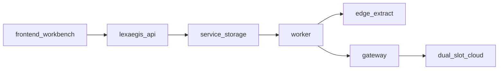

# LexAegis · 案隐盾

本地优先的法律材料披露工作台：原文与身份映射留在边侧；律师对**一次完整冻结请求**具名批准后，独立网关才可调用云端大模型 API；回包在边侧校核、回链。分词 `[[LEX:P0001]]` **不是**匿名。批准是发送控制，**不是**《个人信息保护法》第 13 条处理依据。

| | |
| --- | --- |
| 版本 | **V1.0**（`1.0.0`）。非正式发行 |
| 代码更新日 | 2026-09-19；下方十案证据盘点仍为 2026-09-14，未据代码更新改写真实验收结论 |
| 正式外发 | **失败关闭。** `formal_dispatch=blocked`。真实云端 API 成功外发：**从未有过** |
| 十案 | **层 A 评估完成，0 案真实发送。** D 路径「走一遍」= `evaluate`，不是 HTTP 发送 |
| 仓库包 | 原 `2.0.0-draft.3` 与新增产品 `3.0.0-product-draft.1` 均为草稿，`dispatch_allowed=false`。无一 `published` |

不要写成「已通过」「外发已开通」「10 案可发」。细则与禁写句见 [docs/LOCAL_STATUS.md](docs/LOCAL_STATUS.md) 第八节；法学只走 [docs/legal/README.md](docs/legal/README.md)。

现行规格三角：[架构](docs/ARCHITECTURE.md) · [验证](docs/VALIDATION.md) · [来源](docs/PROVENANCE.md)。入口地图：[docs/PROJECT_MAP.md](docs/PROJECT_MAP.md)。文档索引：[docs/README.md](docs/README.md)。Agent 边界：[AGENTS.md](AGENTS.md)。

本轮双线实现与操作入口：[三环境与 Windows 交付](docs/DUAL_TRACK_DEPLOY.md)、[人工否决、常规逐请求放行及验收](docs/DUAL_TRACK_ACCEPTANCE.md)、[产品规则草稿准备](docs/legal/PRODUCT_RULE_PREPARATION.md)。产品版可对不同案件和后续新请求分别审批；规则、请求、证据、许可各自绑定版本，不再以全库一次试点额度代替常规授权。

---

## 1. 现在能做什么、还缺什么

### 已在代码里（工程落地 ≠ 法学通过）

- 工作台四步：事实与证据 → 逐项披露 → 风险冻结/审批 → 摘要回链。治理四页：法学规则、服务商、隔离实验、本地用户。
- 本地角色：`admin` / `case_operator` / `technical_reviewer` / `legal_reviewer` / `approver`。技术提请暂停、法学否决和发送批准分别校验角色，管理员不能隐式代行这三个动作。密钥只进网关，不进 API/worker。
- 正式 wire 只走稳定 token；`mapping` / 原文 / `anchors` / `local_text` 不上云。
- 正式门禁失败关闭：`validate_formal_gate` + `authorize_dispatch`。评估、批准、入队、发送时重验冻结哈希。409 是门禁，不是产品 bug。
- 四个固定合成场景：成功、人工复核否决、系统组合风险、材料不足停止。`demo` 离线模拟；`integration` 使用同批合成材料联调真实模型，分别标注结果来源。
- D 路径试点：可收紧为仅 `api.deepseek.com`，备槽不纳入批准目标。DeepSeek 密钥不得指向百炼。
- 本机 pytest（2026-09-14）：**283 过 / 3 跳过**。远端 CI 本轮未取，不能写成已通过。

### 十案与十层门禁（2026-09-14）

试点三元组默认写法：`LA-001` × `R_fact_summary` × `D_DeepSeek_official_API`。换案或换接收方须另印一套十门，不得涂改沿用。

| 案 | 层 A | 层 B | 真实 HTTP |
| --- | --- | --- | --- |
| LA-001 | 已评估（cloud → blocked） | 一对一已写「本次可用」句；**运行** `LAYER_B_CLOSED_IDS` 未改，不等于门 3–10 已过 | 0 |
| 其余九案 | 已评估（3 案 local_only，6 案 cloud blocked） | **关闭**。工程不得改 `LAYER_B_CLOSED_IDS` 放行 | 0 |

双方交接空表在 [docs/legal/法计交接/00_先读.md](docs/legal/法计交接/00_先读.md)。填表 ≠ `pass` ≠ 可发送。交付包在 `.data/outbound_packets/LA001_D_外发交付包_20260914/`（gitignore）；`gate_status.json` 仍是 v1.0，**十门均非 `pass`**。

| 门 | 名称 | 暂时缺失（保持阻断） |
| --- | --- | --- |
| 1 | 来源/人审 | 正式发布页 2026-09-14 检索未命中。一对一已勾「人审完成」，**不是**运行 `pass` |
| 2 | 层 B 本次授权 | 仅 LA-001 有必写句；九案仍关。本句有效 ≠ 可发送 |
| 3 | D 服务商档案 | 运行库 **0 条**服务商档案。草案 `docs/legal/D路径-DeepSeek档案草案.json` 仍 `draft`。口述 TOS ≠ `reviewed` |
| 4 | PIPIA | 对本三元组的事前评估未签。`impact_assessment_reference` 空 |
| 5 | 运行规则发布 | 仓库包未 `published`，`legal_status` 未 `reviewed`，`dispatch_allowed=false` |
| 6 | 冻结请求 | 可有草案 facts；**未**对可发送哈希冻结。改提示词/facts/模型/地址后须重冻 |
| 7 | 组合判断 | 未对门 6 同一哈希作法学 `pass`。`uncertain` 按阻断 |
| 8 | 四类攻击 | 隔离栈已跑**工程基线**。阳性对照 `identity=succeeded`。空辅助不是四绿。**非法学** `resisted` |
| 9 | 隔离收据 | Compose 五项探测可为真。探测 ≠ 本请求收据。`native` 不能自证隔离 |
| 10 | 哈希批准 | 门 1–9 未齐时签署无效，系统应 409。无成功发送记录 |

打开**一次**哈希绑定的 D 发送之前，上表缺一不可。一案成功不扩到十案。

### 打开正式外发之前（现在全空）

1. 劳动争议 V2 法学发布：必要性矩阵、条件规则、法源版本、具名签署；才能谈 `dispatch_allowed`。
2. 实际启用的接收方档案 `reviewed` 且未过期：合同/主体、训练、人工访问、留存、删除、分包、影响评估引用。查不到写未知；未知则阻断。不得发明合同或审批人。
3. 四类攻击达到**法学承认**的 `resisted`（绑定门 6 哈希）。工程基线不能代填。
4. 目标环境隔离：当次收据 + 防火墙/镜像供应链；不只是容器内探测。
5. 真实材料组织授权、试点范围、双人标注/仲裁。本机 `.data/real_cases/` 为 `sourced` ≠ 已授权外发或入库。
6. 五类风险权重冻结。
7. 至少一条经门禁允许的真实云端成功记录（现在没有）。

### 工程侧暂时缺失（不替代上表）

| 项 | 现状 |
| --- | --- |
| 服务商运行库 | 无档案。设置槽 `provider_id` 均为空。治理页无删除按钮；`reviewed` / 在用档案不能物理删 |
| OCR / 转写 | 默认 RapidOCR + whisper.cpp，须本地资产。声明就绪但库不在时不要写成 available。无识别率/转写准确率结论 |
| 边侧抽取 | 生产声明 MiniCPM5-2B Q4_K_M（`edge-small`）。磁盘有权重 ≠ 进程已起。`probe-edge` 工程指标无法学分 |
| 半合成语料 | `.data/semi_labor_v1` 脚手架可在；未进 `data/catalog.json`。未标注完整材料不 `promote-semi` |
| 前端 / CI | `App.tsx` 未拆。e2e 演示 03、治理四页、五视口、`pnpm walk:ui` 未进 CI。远端 Actions 本轮未取 |
| wheel | 仓库号 `1.0.0`；归档里仍可能是旧 `0.2.0` wheel，未重打本号 |
| 任务插件 | `lexaegis.tasks` entry point **未**在 `pyproject.toml` 声明 |

---

## 2. 怎么跑

源码运行需要 Python 3.12+、Node.js 22+ 和 pnpm 11。工作台默认地址为 `production` **http://127.0.0.1:38765**、`demo` **http://127.0.0.1:48765**、`integration` **http://127.0.0.1:58765**，以终端实际地址为准。演示只接受内置合成材料。客户 Windows 固定镜像交付见[维护说明](docs/DUAL_TRACK_DEPLOY.md)；以下为源码开发方式。

### Linux / macOS

`requirements.lock` 用环境标记排除 Windows 不支持的 `uvloop`。

```bash
python3 -m venv .venv
source .venv/bin/activate
python -m pip install -r requirements.lock
python -m pip install -e ".[test]"
cd frontend && pnpm install --frozen-lockfile && pnpm build && cd ..
python scripts/make_examples.py
lexaegis start --profile demo
```

### Windows（PowerShell）

```powershell
python -m venv .venv
.\.venv\Scripts\Activate.ps1
python -m pip install -e ".[test]"
cd frontend
pnpm install --frozen-lockfile
pnpm build
cd ..
python scripts/make_examples.py
lexaegis start --profile demo
```

若激活脚本被拦截：`Set-ExecutionPolicy -Scope CurrentUser RemoteSigned`。端口占用或文件锁失败时，先结束旧进程，见 [部署说明](docs/DEPLOY.md)。

`Ctrl+C` 停止本次启动的 API、网关和 worker。不配置模型、不下边侧权重，即可在 `demo` 环境走四个固定合成场景：

1. 生成披露方案。
2. 检验风险并查看完整请求。四类攻击显示「未运行」不得当作正式通过。
3. 法学复核允许后，由审批人批准并执行模拟调用（模拟器组装已披露事实）；人工否决场景则展示技术暂停和法学否决。
4. 逐项回链并确认最终结果。

「组合线索风险」和「主动停止」默认阻断审批。正式材料在独立 `production` 环境上传；`demo`、`integration` 不接受任意上传。OCR/转写结果须人工复核后才能抽取。边侧未监听时 `lexaegis start` 会提示，或运行 `lexaegis edge --start`。

隔离栈：先停 native，再 Compose（宿主机默认 `LEX_COMPOSE_API_PORT` 或 **38765**）。`lexaegis check-isolation` 五项为真 ≠ 本请求隔离收据，≠ 可发送。

---

## 3. 技术栈与运行时

| 层 | 内容 |
| --- | --- |
| 后端 | Python 3.12+ / FastAPI / SQLAlchemy。包 `lexaegis/` |
| 前端 | React + Vite，`frontend/`。改 UI 先读 `.cursor/skills/lexaegis-workbench-ui` |
| 进程 | `lexaegis start` = launcher 拉起 API + worker + gateway |
| 隔离 | Docker Compose：api / worker / gateway，另有 `edge` / `redteam` / `benchmark` profile |
| 边侧 | 只做正式案事实抽取。OpenAI 兼容 `/v1`。演示不调边侧 |
| 云端 | 目录默认主槽 DeepSeek V4 Flash、备槽百炼 Qwen3.8-Flash。有目录 ≠ 已审档案。D 试点关备槽 |
| 密钥 | `.env`：`LEX_CLOUD_PRIMARY_KEY`（兼容 `LEX_CLOUD_API_KEY`）、`LEX_CLOUD_STANDBY_KEY`。只进网关 |
| D 试点 | `LEX_CLOUD_PILOT_PATH=D` 且将 `LEX_CLOUD_ALLOWED_HOSTS` 收紧为 `api.deepseek.com` |



---

## 4. 目录

根目录中文文件只做跳转。东西放哪：

| 找什么 | 去哪 |
| --- | --- |
| 规格 / 下一步 | `docs/PROJECT_MAP.md`；三角：ARCHITECTURE + VALIDATION + PROVENANCE |
| 本机盘点与完成清单 | `docs/LOCAL_STATUS.md`（不是规格，不替代 VALIDATION） |
| 法学现行 5 读、法计交接空表 | `docs/legal/README.md` |
| 法源表、标注 xlsx/docx | `legal/sources/`、`legal/templates/` |
| 代码 / 测试 / 包 | `lexaegis/`、`tests/`、`packs/` |
| 仓库评测语料 | `data/`（当前仅 `mock_labor_v1` 8 条全合成，`dispatch_allowed=false`） |
| 运行库、真案、交付包 | `.data/`（不入库）。交付包：`.data/outbound_packets/` |
| 边侧声明（无权重） | `models/catalog/` |

仓库不分发模型权重、真实案件或效果数字。

---

## 5. 评测、边侧与云端（摘要）

| 项 | 现状 |
| --- | --- |
| `data/` | 与运行期 `.data/` 分开。`lexaegis dataset list \| validate \| show \| probe-edge`；`generate-mock \| freeze \| run` 仍写到指定路径。`probe-edge` 只记工程指标 |
| 边侧 | 现行本机单模型声明：MiniCPM5-2B Q4_K_M，服务别名 `edge-small`。这是部署方案，不是已装或已跑通结论 |
| 云端双槽 | 流式只在网关拼完整 JSON。备用仅当已审核且确认请求未离开本地时可用。一旦有 token，失败记 `unknown`，禁止自动换模、禁止自动重发。思考关闭 |
| 工作台 | 运行配置可填主/备并回显；外发目标仍走网关冻结双槽与白名单 |

更多：[docs/MODELS.md](docs/MODELS.md)、[data/README.md](data/README.md)、`.env.example`。

---

## 6. 验证

```bash
python -m pytest -q
cd frontend && pnpm build && pnpm exec playwright test
```

本机后端测试以 `python -m pytest -q` 为准（2026-09-14：283 项通过、3 项跳过）。[VALIDATION.md](docs/VALIDATION.md) 另记 2026-09-08/09 的前端构建与 `desktop-1280` Playwright（含 D 路径的工作树本轮未重跑 e2e）。远端 CI 未取得 / 本轮不跑。容器隔离宿主机发布、真实云端 API 仍待目标环境取证。

---

## 7. 文档与配置

| 主题 | 文档 |
| --- | --- |
| 边侧、云端双槽、OCR | [docs/MODELS.md](docs/MODELS.md) |
| 数据目录、备份、Compose | [docs/DEPLOY.md](docs/DEPLOY.md) |
| 案由包、任务、API | [docs/ARCHITECTURE.md](docs/ARCHITECTURE.md) |
| 来源与许可 | [docs/PROVENANCE.md](docs/PROVENANCE.md)、[NOTICE](NOTICE) |
| 界面规范 | [docs/DESIGN.md](docs/DESIGN.md) |
| 历史计划 | [docs/archive](docs/archive/README.md)，不当现行规格 |

下一步（法学）：补齐十门真收据后，才能对 **一次** 哈希绑定的 D 发送谈批准。工程侧不要削弱 `validate_formal_gate` / `authorize_dispatch`，不要发布仓库 pack，不要把口述标成服务商 `reviewed`。
