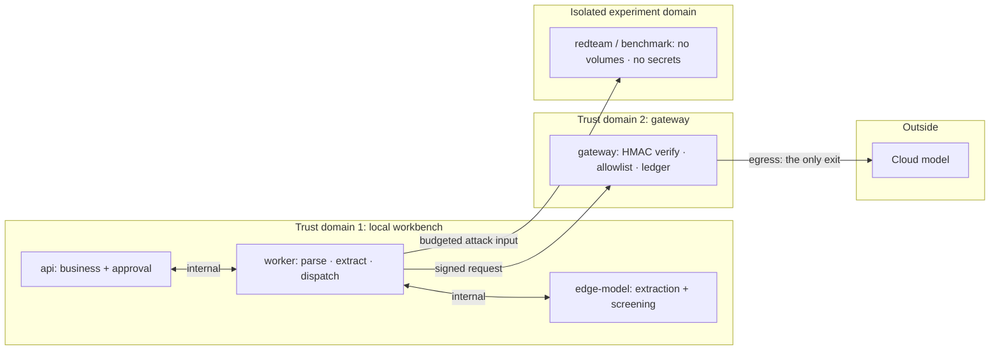
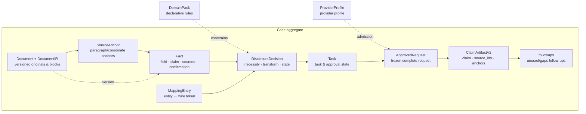
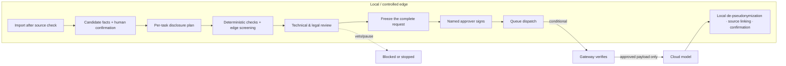
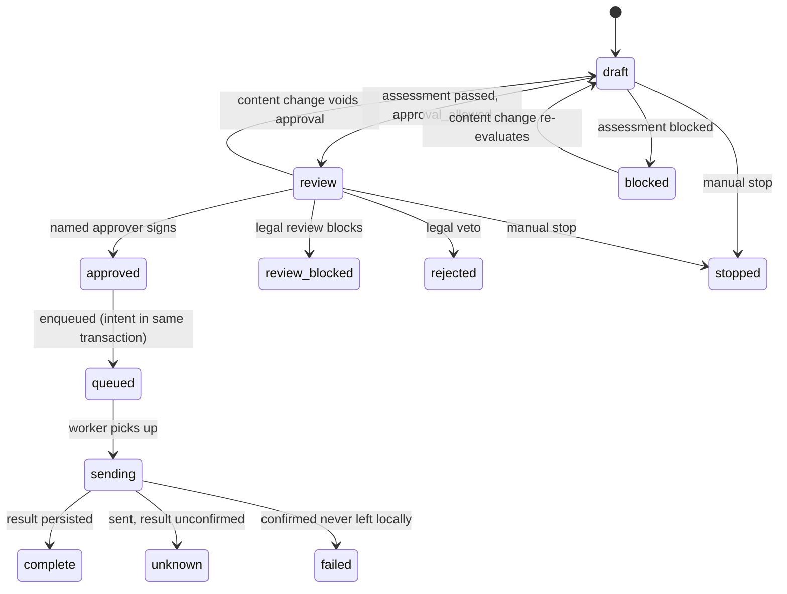
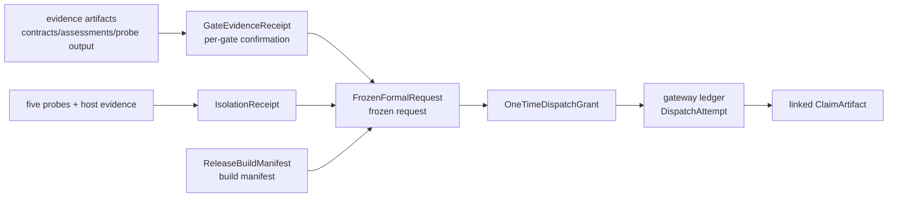

# LexAegis · CaseShield

**A local-first workbench for minimum-necessary disclosure and controlled outbound requests on labor-dispute materials.**

[中文版](README.md)

Version **V1.0** (`1.0.0`), informal release. A synthetic demo ≠ real-case dispatch acceptance: formal dispatch remains fail-closed (`formal_dispatch=blocked`), all rule packs are drafts, and across the ten recorded cases only layer-A evaluation has run — 0 real dispatches.

## Contents

- [What this is](#what-this-is)
- [Design motivations and trade-offs](#design-motivations-and-trade-offs)
- [Scenarios, tasks and roles](#scenarios-tasks-and-roles)
- [Trust boundaries and domain architecture](#trust-boundaries-and-domain-architecture)
- [Domain model](#domain-model)
- [How it works](#how-it-works)
- [The gate system](#the-gate-system)
- [Lifecycles and state machines](#lifecycles-and-state-machines)
- [Evidence chain and receipts](#evidence-chain-and-receipts)
- [Threat model and the four attacks](#threat-model-and-the-four-attacks)
- [Capabilities and limits](#capabilities-and-limits)
- [Demonstration paths](#demonstration-paths)
- [Implementation and extensibility](#implementation-and-extensibility)
- [Non-functional constraints and runtime limits](#non-functional-constraints-and-runtime-limits)
- [Status and boundaries](#status-and-boundaries)
- [Quick start](#quick-start)
- [Project structure](#project-structure)
- [Documentation](#documentation)

## What this is

LexAegis is a **legal workbench that governs how case materials are exposed to models** — it is not a model itself. A legal professional feeds it privacy-sensitive case materials; the raw documents stay on the edge side and are organized into facts with source anchors. For a specific task, the system decides item by item what may be disclosed and how; deterministic checks and human review gate the request; a named approver signs one frozen, complete request; and only then may a separate gateway call a cloud model. Results return to the edge, are de-pseudonymized locally, and are traced back to their sources.

This repository ships its complete rules, prompts and validation materials for **Chinese labor disputes** as the first landing domain. The control framework — task-scoped minimum disclosure → deterministic checks → human review → controlled dispatch → result tracing — is designed domain-agnostic; extending to other legal areas means writing new declarative domain packs, legal-source mappings and task definitions, not rebuilding the framework (see [Implementation and extensibility](#implementation-and-extensibility)).

To understand the system, separate the three things it governs:

- **Where materials live**: raw documents, identity mappings and internal review notes never leave the edge; the cloud receives only an approved pseudonymized fact payload.
- **Who owns each decision**: every disclosure, every release and every result confirmation maps to a named role and an auditable record; no step is self-declared by a model.
- **The unit of dispatch**: the smallest outbound unit is not "a case" but "one frozen, complete request" — content, recipient, model, rule and material versions hashed together; approval binds to exactly that.

It is not a "paste the whole case into an LLM" tool, and it does not make legal decisions. **The system does not decide whether something may leave — it only guarantees that nothing leaves without authorization.**

### The problem

Labor-dispute materials are scattered and sensitive — the first hurdle any "can we use a model here" question must clear:

- Contracts, payroll, attendance, chat logs and termination notices come in different forms; dates, amounts, parties and evidence must be reconciled item by item, and conflicting statements must be preserved rather than flattened.
- Materials mix identities, salary details, contacts and internal company information — not all of it is needed for the task at hand.
- Replacing names alone does not remove combination clues (role, dates, events), yet deleting everything destroys the usefulness of a summary or evidence list.
- Model output must be verifiable against the source text; "looks fine" is not a disclosure decision.

LexAegis turns this into four auditable questions: **what is necessary for this task → who receives it → who approves it → how is the result checked.** Each following chapter — boundaries, domain model, gates, evidence chain — expands one of these answers.

## Design motivations and trade-offs

The core tension of this project is **efficiency versus accountability**: a model can genuinely turn scattered labor-dispute materials into structured facts, but "may this item leave for an external model" and "what is this summary based on" must be owned by named people, not asserted by the model itself. The architecture condenses to one line: **let models propose, let deterministic code control, let specific people decide.**

In code this lands in three places. The edge review protocol hard-codes "you may only decide whether a candidate enters human review — you never grant dispatch authority" (`EDGE_REVIEW_PROMPT` in `providers.py`). Whether a task may reach approval depends on `risk["approval_allowed"]`, a boolean written by deterministic checks rather than model output (`service.py`). The gateway independently re-verifies the named approver, dependency versions, expiry and target allowlist before any dispatch (`gateway.py`). Each of the three layers — model, business code, gateway — can only release the segment it is authorized to release.

### The four rejected alternatives

| Alternative | Why rejected | Code basis |
| --- | --- | --- |
| Upload the whole case | unbounded disclosure; cannot answer "why is this item necessary" per task; hands the decision to the external service's defaults | disclosure is per-item `DisclosureDecision`; the wire payload forbids `mapping` / `original_value` / `local_text` / `anchors`; cumulative dispatch is additionally capped by char/entry budgets |
| Name-masking only | combination clues — role, location, dates, events — still re-identify; conflates de-identification with anonymization | gate G7 checks quasi-identifiers and combination clues (`outbound_gate.combination_blockers`); the edge protocol lists "unique position + public event" as a combination that must return `block_external` |
| Model auto-release | semantic judgment is unstable and unauditable; it cannot replace deterministic permissions, state and approval | edge screening can only emit `block_external` or `allow_human_review`; gate hits fall into four kinds (prohibition / verification / minimization / engineering) — engineering hits produce no legal conclusion |
| Microservices from day one | most modules need no independent network rights; splitting them adds consistency and ops burden without improving the real trust boundary | only the gateway — the component holding keys + egress — is split onto its own network (`compose.yaml`); the rest is a modular monolith where a single SQLite WAL instance serves a team |

Each rejection is not "the feature was not good enough" — it is **a transfer of responsibility that belongs to people or deterministic controls**. This is the common criterion behind every mechanism later in this document.

### Why cloud/edge, not fully local

The product wants to both "run under any conditions" and "use a stronger model when conditions allow"; engineering-wise, a local device cannot and need not host a large model. The real constraints are in code: the edge model is sized at 2B-class, a GPU phase lock serializes OCR, transcription and extraction, and the comment says plainly "do not rely on Windows shared VRAM" (`gpu_runtime.py`); a single extraction run is capped at 40 facts and 3072 tokens (`providers.py`).

The split therefore is: the edge owns semantic work that needs raw text (candidate-fact extraction, outbound-candidate screening); the cloud handles only **approved, already-pseudonymized narrow tasks**. Fully local remains a valid degradation path — a task can be stopped at any stage rather than pretending completion when the cloud is unavailable. To be explicit: **choosing the cloud/edge split is a capability division, not a legal authorization for cloud calls**; every real dispatch in production still passes all gates and consumes a one-time grant.

### Why a modular monolith plus a separate gateway

There is exactly one splitting criterion: **trust boundaries, not code size**. The gateway is the only component holding both dispatch keys and egress rights, so it is the only piece split onto its own network — API and worker sit on internal networks and can lose their default route, the gateway alone owns the exit (`compose.yaml`). Everything else stays in the monolith and one store: case versions, facts, disclosure decisions and approvals need strong consistency — expressing "content changed ⇒ approval void" across services would require distributed transactions.

The cost of this trade-off is admitting that modules inside the monolith trust each other; what it buys is **a single auditable exit** — whether something was sent is answered by one gateway ledger, and fail-closed only has to be implemented in one place. At scale the gateway can split further and the monolith can evolve into services, but "trust domains decide what to split" stays the rule.

## Scenarios, tasks and roles

The system serves **legal professionals working with case materials**, currently landing on **the full range of legal materials in labor disputes** — contracts, payroll records, attendance, communications, termination notices, evidence lists and more. Future expansion follows the same control framework into other legal areas — contract, family, IP and so on share the "task-scoped minimum disclosure → human review → controlled dispatch" mechanism; what each new area needs is its own domain pack, legal-source mapping and task definitions (all declarative assets), not a rewrite of the system.

The table below is an illustrative business sketch for labor disputes — **not** a claim that rules for every sub-scenario are already reviewed:

| Common dispute | Typical materials | What the system assists with |
| --- | --- | --- |
| Employment-relation confirmation | contracts, work communications, onboarding records | collects relation facts and evidence leads; preserves conflicting statements |
| Wages / overtime | payroll, attendance, bank statements | organizes amounts, dates and sources; **does not decide sums owed** |
| Termination | notices, correspondence | orders events and parties' positions; **does not judge legality or damages** |

### The four supported tasks

"Task-scoped disclosure" lands on four concrete tasks, of which only fact-summary can ever enter the cloud branch:

| Task | Execution | Can it dispatch? |
| --- | --- | --- |
| `fact_summary` | local deterministic draft; cloud generation is an **approved narrow task** | yes — through all gates and an approval |
| `timeline` | local deterministic; selects dated facts | no |
| `evidence_inventory` | local deterministic; collects evidence facts | no |
| `issue_extraction` | local deterministic; groups candidates by field | no |

In other words: **most day-to-day work never dispatches at all**. The cloud is used for exactly one thing — generating a fact summary over already-approved pseudonymized facts — and even that task has an offline local-draft path. The ratio is deliberate: whatever can be completed deterministically and locally is not given to a model; whatever must go to a model is reduced to one task.

### Roles and separation of duties

Local roles are separated, bound to named sessions, and the administrator cannot silently act for them:

| Role | Duty |
| --- | --- |
| Case operator | imports materials, verifies parsing, edits facts and the disclosure plan, may stop a task |
| Technical reviewer | raises combination-clue concerns, can pause the current request |
| Legal reviewer | issues allow / needs-verification / veto for the current request; a veto cannot be worked around |
| Approver | signs one frozen request, valid for 30 minutes |
| Admin | creates accounts and release policies; cannot substitute for review or approval |

The point of separation is not procedural formality — it is **giving every decision an independent viewpoint**: the technical reviewer sees combination clues, the legal reviewer sees substantive risk, the approver sees the complete frozen request. They look at different material; none can stand in for another. Vetoes are real states in code (`rejected` / `stopped` / `review_blocked`), not a warning string.

### Where it does not apply

Formal-case dispatch is currently **blocked product-wide** (`formal_dispatch=blocked`); no real send beyond synthetic demos is possible. The system is also not built for instant legal opinions, adjudication prediction or damages calculation. The conditions for real enablement are under [Status and boundaries](#status-and-boundaries).

## Trust boundaries and domain architecture

The system is divided into three trust domains by "who must trust whom"; each domain receives only the minimum its duty requires:

| Domain | Holds | Network rights |
| --- | --- | --- |
| **Local workbench** (api + worker + frontend) | raw documents, identity mappings, facts, disclosure decisions, approvals, audit store | internal network only; default route removable, no egress |
| **Separate gateway** | cloud keys, outbound allowlist, dispatch ledger | the only member of the `egress` network; **no case volume mounted** |
| **Cloud model** | only the approved pseudonymized payload | called party, not part of this deployment |

Two auxiliary domains sit apart: the **edge model** is reachable only over an OpenAI-compatible interface on the internal network behind a host allowlist; **red-team and benchmark** run on their own network with no volumes and no gateway secret — the attacker cannot read raw text, mappings or ground truth.



### How the boundary is verified

Isolation is not asserted — it is verified jointly by deployment topology and probe scripts:

- **Network split** (`compose.yaml`): `internal` and `redteam` are internal-only (`internal: true`); `egress` belongs to the gateway alone; `isolate-api-route` deletes the default route inside the API network namespace.
- **Five isolation probes** (`lexaegis check-isolation` → `diagnostics.compose_isolation_report`): api and worker cannot reach the internet; the gateway has no case volume mounted; red-team and benchmark hold neither the gateway secret nor the case store.
- **Key separation**: cloud keys exist only in the gateway's environment; the gateway signing key and the red-team signing key are independent (`LEX_GATEWAY_SECRET` / `LEX_REDTEAM_SECRET`).
- **Container baseline**: every service runs read-only root filesystem, drops all capabilities and sets `no-new-privileges`.

### When the boundary does not hold

This half must be stated as clearly as the other:

- **Native mode cannot self-certify isolation**: under a single host network, "nothing left the machine" can only be a deployment fact — the code refuses to write `isolation_verified` in native mode (`diagnostics.py`).
- **Probes passed ≠ a per-request receipt**: `check-isolation` produces a one-time deployment self-check; per-request isolation evidence is carried by the `IsolationReceipt` (see [Evidence chain and receipts](#evidence-chain-and-receipts)), of which probes are only one input.
- **Host firewall and supply chain are outside the probes**: the probes verify neither host firewall rules nor image provenance — both are separate fields in the receipt and currently have no evidence.

## Domain model

All business objects sit on one traceable chain: **source anchor → fact → disclosure decision → outbound content → summary claim → verification outcome**. Every link is an independently versioned object; when an earlier link changes, later links are marked stale rather than silently reused.



### The nine core objects

| Object | Duty | Key invariant |
| --- | --- | --- |
| `Case` | case aggregate: materials, facts, tasks, mappings, follow-ups | an editing conflict marks tasks `stale` — never silently continues |
| `Document` + `DocumentIR` | versioned original and parsed blocks | `ocr`/`scan`/`transcript` unreviewed ⇒ no extraction, no approval |
| `SourceAnchor` | paragraph/table/page/coordinate-level source locator | carries the recognizer id + version; a broken anchor breaks the fact's provenance |
| `Fact` | `field`/`value`/`source_ids`/`origin`/`confirmed`/`stale` | unconfirmed or stale-sourced facts cannot dispatch; conflicting statements coexist |
| `MappingEntry` | entity ↔ `[[LEX:P0001]]` wire token, original value, aliases | edge-only; never enters the wire payload |
| `DisclosureDecision` | the per-item disclosure decision | three independent dimensions (necessity / transform / dispatch state); also records `retain_reason`, `information_loss`, `block_reasons` and `legal_source_ids` |
| `ApprovedRequest` | the frozen, complete outbound request | target, model, messages and material/config/rule versions hashed together; any change mismatches the hash |
| `ClaimArtifactV2` | each claim returned by the cloud | must carry `source_ids`; `local_text` is generated only on the edge |
| `followups` | unused facts and gap follow-ups | inconsistent cloud feedback is recorded as `feedback_issues`, never voids the whole run |

Two governance objects sit beside them: **`DomainPack`** (declarative domain rules — task-field-necessity matrix, forbidden terms, risk weights, legal-source pointers; publishing freezes its content hash) and **`ProviderProfile`** (processing regions, retention, training use, human access, subprocessors, contract and impact-assessment references — any missing key field makes it unreviewable).

### The three independent dimensions of a field decision

A `DisclosureDecision` is not a single "mask/don't mask" switch but answers three orthogonal questions:

1. **Necessity**: necessary / conditionally necessary / unnecessary / uncertain — "is this field needed for this task".
2. **Transform**: keep / pseudonymize / generalize / delete — "at what granularity". Keeping the worker-employer relation does not imply keeping real names.
3. **Dispatch state**: dispatchable candidate / hard-prohibited / restricted pending review — "may it leave now". Unknown conditions default to `restricted` output, **never silently entering the dispatch candidates**.

The decision object also records why it was retained, what information was lost, and what blocked it — these three columns are exactly what the human review surface shows, and where "explainable judgment" actually lives.

## How it works



1. **Preconditions first**: before import, confirm the source, the legal basis for processing and confidentiality limits — collection and storage are themselves processing of personal information.
2. **Local organization**: parse materials with paragraph/coordinate-level source anchors; candidate facts must be confirmed by a person; unreviewed OCR or transcripts cannot be dispatched.
3. **Task-scoped disclosure**: summary, timeline, evidence inventory and candidate issues each need different information; each item is kept, pseudonymized, generalized or deleted with a stated reason.
4. **Checks and review**: deterministic rules catch direct identifiers and combination clues; the edge-model screening may only decide whether a request enters human review — it cannot release anything. Technical and legal roles act in sequence; a veto, pause or stop is a first-class outcome.
5. **Freeze and approve**: recipient, model, messages, material and rule versions together form the request hash; approval binds to that hash and expires. The gateway re-verifies before dispatch and records the send; production cloud dispatch additionally consumes a one-time grant.
6. **Trace and confirm**: every returned statement carries `source_ids`; identities are filled back locally and linked to the source text. Unused facts and gaps become follow-ups; a human confirms each item before the task counts as done.

Local deterministic tasks (timeline, evidence inventory, candidate issues, local draft summary) **call no external model** and never enter the cloud branch.

### Responsibility and failure semantics per step

The value of the flow is not that it can succeed — it is **where the system goes when any step cannot**. Every step has a named owner and a defined failure path:

| Stage | Owned by | When it cannot proceed |
| --- | --- | --- |
| Source check & import | case operator | unverified source/processing basis → no parsing; parse failure or low-quality OCR → correct or human-review, never counts as done |
| Candidate extraction | edge model proposes | candidates never enter the usable set — a fact only takes effect after human confirmation |
| Disclosure plan | case operator edits, rules constrain | hard-prohibited items may only be deleted; unknown conditions default to `restricted`; any plan change → back to `draft`, old approval void |
| Deterministic checks + edge screening | checks + edge model | any blocker → task `blocked`/`review_blocked`, approval never reached |
| Human review | technical → legal, in order | pause, needs-verification, veto and manual stop are first-class outcomes; re-evaluation cannot resurrect a vetoed request |
| Freeze & approval | approver | any change in content/recipient/versions → hash mismatch, approval void; 30-minute expiry auto-invalidates |
| Queue & dispatch | worker + gateway | intent and enqueue written in one transaction so restarts cannot re-dispatch; gateway persists `sending` before calling, unconfirmed timeouts become `unknown` not blind retries |
| Result verification | operator + human confirm | source-less claims are flagged, not accepted; unused facts and gaps land in `followups` |

Two engineering guarantees run through the whole flow: **side effects happen at most once** (request-id dedup, intent+enqueue in one transaction, timeouts recorded as `unknown` rather than resent) and **any content change voids upstream conclusions** (material/config edits mark old tasks `stale`; an approval whose hash no longer matches is refused). The first prevents "sent twice"; the second prevents "what was sent is not what was approved" — together they are the entire meaning of *controlled*.

## The gate system

All formal-cloud dispatch blockers live in a single enforcement path: `collect_outbound_blockers` in `lexaegis/outbound_gate.py` collects G2/G3/G5/G7/G8/G9, G0 stays in `policy.assess`, G1/G6/G10 belong to paper or other phases, and the product latch `G-product` blocks unconditionally. **No second gate numbering exists** — approval and the gateway only verify the frozen hash and wire contract, never re-evaluate legal conditions: evaluate once, verify consistency.

The numbering follows the legal-source numbering, which is why there is no G4 (legal items 03/04 merged into G3).

| Gate | What it defends | Enforcement | Nature |
| --- | --- | --- | --- |
| G0 request hygiene | unconfirmed facts, unreviewed OCR/transcripts, residual direct identifiers, over-budget, incomplete prohibition confirmations | `policy.assess` | per-request |
| G1 legal-source human review | legal sources not confirmed item by item | paper process, not yet in code | planned |
| G2 layer-B closed list | information classes that must stay closed being emitted | `d_path.layer_b_blockers` | per-request |
| G3 provider & PIPIA | provider profile missing key fields, no contract/impact-assessment references | `governance.provider_checks` | per-request |
| G5 rule publication | pack unpublished, legal status/dispatch/scope unfrozen, five risk weights unfrozen, content-hash mismatch | `collect_outbound_blockers` | per-request |
| G6 request freeze | the approved object diverging from what is actually sent | `evaluate` produces `request_hash` | freeze point |
| G7 combination risk | quasi-identifiers, combination clues, forbidden terms remaining | `combination_blockers` + `forbidden_terms` | per-request |
| G8 four attacks | any frozen attack not `resisted` | `attacks_all_resisted` | per-request |
| G9 isolation | isolation deployment self-check failing | `isolation_verified` field | deployment self-check |
| G10 technical approval | no named approver, expired approval, dependency mismatch | `authorize_dispatch` + gateway checks | approval point |
| G-product product latch | formal dispatch blocked regardless of per-case conditions | `product_dispatch_state()` always `blocked` | global latch |

### Disposition and readiness are two axes

Gate hits fall into four kinds: `prohibition`, `verification`, `minimization`, `engineering`. `derive_disposition` folds them into two independent results:

- **Legal disposition** `disposition`: `prohibited` > `needs_verification` > `needs_minimization` > `allowed` — determined only by the first three kinds.
- **System readiness** `readiness`: any `engineering` hit means `not_ready` — it **produces no legal conclusion**, it only says this side of the system is not prepared.

This separation prevents two common conflations: an unpublished pack, unrun attacks or unverified isolation means "the system is not ready" — never "the request is illegal"; and conversely, "legally needs verification" cannot be covered by engineering readiness.

### The exact meaning of fail-closed

Fail-closed is not a slogan — it is the default destination of every "uncertain":

- uncertain necessity → `restricted`, never silently entering candidates;
- unrun / timed-out / errored attacks → `not_run`/`error`, never counted as `resisted`;
- a provider profile missing fields → `status != pass`, unreviewable;
- an unclear dispatch result → `unknown`, never auto-retried;
- any check that cannot complete → that check does not count as passed.

### Independent verification on the dispatch side

At the gateway, the request's **legal conditions are not re-evaluated** — but mechanical facts are verified independently: the named approver holds the `approver` role, approval dependencies match the request, expiry has not passed, the wire contract is valid, a formal case has `risk_completion=complete`, the target is on the allowlist and matches its approved slot, a formal first release may use the primary slot only, the one-time grant's scope and consumption hold, and the request id deduplicates. Legal judgment happens once at `evaluate`; the dispatch path answers exactly one question: **"is what is about to leave the very thing that was approved?"**

## Lifecycles and state machines

The system has **five independent state machines** — task, domain pack, provider, one-time grant and isolation receipt — each governing its own lifecycle without borrowing states from another. They share one principle: **any event that voids a conclusion lands on an explicit state rather than letting the old state stand.**

### The task state machine



- `unknown` is neither error nor success: only a failure confirmed never to have left locally may switch to the approved standby; a timeout after the cloud received the request is `unknown`, never auto-retried.
- After `rejected`, re-evaluation cannot resurrect the same request — a veto is terminal for that request.
- Content changes return to `draft`; material/config edits mark in-flight tasks `stale`; case edits are refused while `queued`/`sending`; `complete` cannot be resent.

### The other four state machines

| Object | State chain | Key rules |
| --- | --- | --- |
| `DomainPack` | `draft → pending_review → reviewed → published`, may be `retired` | publishing freezes `content_hash`; same version cannot be overwritten; retirement does not affect frozen tasks but refuses new ones |
| `ProviderProfile` | `draft → reviewed → expired` | any edit returns to `draft` pending review; `valid_until` expiry refuses dispatch; retired / missing-field / expired profiles cannot pass |
| `OneTimeDispatchGrant` | `pending → issued → reserved → claimed → consumed`, may be `revoked` / `expired` | bound to `request_hash` and scope; a production cloud call consumes one; demo/integration profiles cannot consume a formal grant |
| `IsolationReceipt` | `pending_legal_confirmation → valid`, or `failed` / `revoked` / `expired` | passing the five probes is only an input; legal confirmation makes it `valid`; a probe failure is `failed` outright |

The four machines mesh with the task machine at exactly one point — **the dispatch path**: an `approved` task can only leave when the pack is `published`, the provider is `reviewed` and unexpired, the grant is `issued` and unconsumed, and the receipt is `valid`. If any condition fails, the task stays put; there is no "partial dispatch".

A separate `FormalReleaseState` chain (`blocked → evidence_pending → frozen → approval_eligible → approved_once → reserved → claimed → consumed_complete / consumed_unknown / failed_before_disclosure / revoked / expired`) manages the first formal release end-to-end — it currently sits at `blocked`, which is the direct source of `formal_dispatch=blocked`.

## Evidence chain and receipts

"Controlled dispatch" must answer not "was something sent" but "**on what evidence was this sent, and which exact version of everything left**". The answer lives on an evidence chain: every stage emits its own credential object, credentials point at each other by hash, and any link that no longer matches is detectable.



### What each credential proves — and does not

| Credential | Proves | Does not prove |
| --- | --- | --- |
| `GateEvidenceReceipt` | a named role (`confirmed_by`/`confirmed_role`) concluded on a gate (`gate_id`) against specific evidence-artifact versions; has a validity window, supersession and revocation | the legal conclusion's correctness — only "who concluded on what evidence" |
| `IsolationReceipt` | five probe results, host-firewall and supply-chain evidence hashes, attestor; `valid` only after legal confirmation | not a per-request guarantee; a failed probe is `failed`, empty evidence fields mean pending |
| `OneTimeDispatchGrant` | a **one-time** permit bound to `request_hash` + gate snapshot + evidence manifest + build manifest + release policy | not a general authorization; unusable once `consumed`/`expired`/`revoked` |
| `FrozenFormalRequest` | the full frozen object: wire payload, prompt, target, model, provider hash, material/rule/task/mapping/ledger versions, attack-protocol hashes | not the dispatch act itself — freezing only defines "what was approved" |
| `ReleaseBuildManifest` | which build dispatched: source commit, tree hash, wheel/frontend/lockfile hashes, image digests, migration revision | not that the build is safe — only "which one it was" |
| `DispatchAttempt` (ledger) | which slot actually ran, per-attempt records | does not alter `request_hash`; a retry grants no new authorization |

### Two properties of the chain

- **Mutual reference**: a grant does not store "may send" but "may send request X under gate-snapshot Y on build Z" — if any reference fails to match, the gateway refuses.
- **Each link is bounded**: no receipt claims "the whole chain is safe". The design is deliberately the opposite — **every link proves only its own link**, and the chain's credibility comes from completeness, not from any single link's claim. In this repository the receipt fields exist but **none has been issued to `valid`** — that is the evidence-layer counterpart of `formal_dispatch=blocked`.

## Threat model and the four attacks

Minimum disclosure must be validated by attacks, not by the designer's confidence. The threat model's boundary: **the attacker sees the dispatched request, the protocol-permitted disclosure history, and auxiliary data declared attacker-visible — never the raw text, identity mappings, mapping keys or scoring truth.**

### The four frozen attacks

| Attack | Attacker's goal | Success criterion (simplified) |
| --- | --- | --- |
| `identity` identity recovery | infer a party's real identity from dispatched facts | a proposed identity candidate hits the truth |
| `candidate_set` candidate narrowing | shrink the possible-party set below the protocol threshold | candidate-set size below threshold |
| `sensitive_inference` sensitive-fact inference | infer undisclosed attributes (identity hints, contacts, amount ranges) | an attribute prediction hits the truth |
| `cross_round` cross-round linkage | combine prior disclosures with this round to rebuild identity or facts | linked-round ratio above threshold |

Each attack is defined by a frozen `RiskProtocol`: attacker-visible data, query budget (`query_budget`), success criteria and thresholds. An unfrozen protocol or a mismatched content hash → outcome `not_run` — it cannot run, let alone count as passed.

### Isolation and execution structure

- **Attacker-view isolation**: the red-team service allowlist-asserts its input — keys like `mapping` / `original_value` / `local_text` / `anchors` / `raw_text` / `truth` are rejected (`attacks.assert_isolated_payload`); the red-team container has no volumes, no gateway secret, and its own `LEX_REDTEAM_SECRET` signature.
- **Attacker/scorer separation**: the attacker only produces candidates, rankings, attribute predictions and retrieval evidence; the scorer independently compares against truth. No candidates means `uncertain`, never a direct `resisted`.
- **Positive control**: a built-in synthetic request known to leak (name + ID number) must be scored identity-recovery `succeeded` — if the positive control fails, the scorer is broken, not the attack resisted.

### Outcome vocabulary

Four outcomes: `succeeded` (attack worked), `resisted` (it did not), `uncertain` (indeterminate), `error` (execution error). **Only `resisted` counts as passed**; timeouts, contract errors, interruptions and content changes never do.

The current executor is versioned `0.2-baseline`, and the code comment says it plainly: "engineering-baseline executor, not a formal attack conclusion, no legal endorsement". What it proves is that **the detection pipeline and isolation structure work** — not that the four attacks are legally resisted. The latter needs frozen protocols, real attack execution and legally accepted scoring, which is part of the formal-dispatch gap.

## Capabilities and limits

Earlier chapters explained the mechanisms; this chapter re-collects them by workbench capability. **The "Boundary" column is not a disclaimer — it is part of the design**: every boundary corresponds to a fail-closed destination:

| Capability | Use | Boundary | Expanded in |
| --- | --- | --- | --- |
| Material & source management | DOCX/PDF/spreadsheets/scans, paragraph-level anchors | OCR/transcripts need human review; format support is bounded | [Domain model](#domain-model) |
| Fact organization | edge model proposes facts with constrained fields and verbatim quotes | candidates are not established facts | [How it works](#how-it-works) |
| Per-item disclosure | keep / pseudonymize / generalize / delete per necessity | hard-prohibited items may only be deleted | [Domain model](#domain-model)·[Gates](#the-gate-system) |
| Risk checks | regex identifiers + quasi-identifier combinations + edge screening | coverage is finite, no leakage-free guarantee | [Threat model](#threat-model-and-the-four-attacks) |
| Human review chain | technical pause → legal veto/allow → approver sign-off | re-evaluation cannot resurrect a vetoed request | [Lifecycles](#lifecycles-and-state-machines) |
| Request binding | content, recipient, model and versions frozen into one hash | one approval serves one dispatch, never inherited | [Evidence chain](#evidence-chain-and-receipts) |
| Result verification | local de-pseudonymization, source links, unused/gaps follow-ups | linking is not a certification of evidence truth | [How it works](#how-it-works) |
| Governance & audit | rule packs, provider profiles, roles, audit trail | a `reviewed` provider requires real registration, not hearsay | [The gate system](#the-gate-system) |

### Workbench surfaces

The capabilities are laid out across five surfaces, each exposing only the operations of its own duty:

| Surface | Contents |
| --- | --- |
| Login & cases | local password login bound to a named role, case list, new formal case |
| Four-step workbench | facts & evidence → per-item disclosure plan → risk freeze & approval → summary & source tracing |
| Governance pages | legal rule center, provider governance, isolation experiments, local users |
| Runtime settings | edge endpoint, cloud dual-slot display; **keys never enter the API layer** |
| Restoration page | cloud pseudonymized sentence, local de-pseudonymized sentence, dispatched supporting facts, versioned anchors — item by item |

The interface follows one hard information-design rule (see `docs/DESIGN.md`): five facts — technical implementation, runtime capability, legal rules, attack protocols, current-case status — are **shown separately and never merged into a single green "safe" or "compliant" light**; a block must name its reason, and unknown, error or not-run can never render as passed.

## Demonstration paths

The `demo` profile ships fixed synthetic scenarios that show **four behaviors of the system**, not a case story — a reviewer should watch *what the system decided in each situation*, not *how the case turned out*:

| Path | The behavior to observe |
| --- | --- |
| Complete flow | disclosure plan → checks → legal allow → approval → **simulated call** → traced confirmation: every link in a healthy run leaves a trace |
| Human veto | technician flags clues and pauses → legal vetoes → approval and dispatch are both unavailable: a veto is a code state, not a warning |
| Combination risk | retaining a unique-position or public-event clue triggers an automatic block: no one pressed "no" — the system stopped itself |
| Insufficient material | the task is stopped before verification completes; stopping a task **is not a ruling on the merits** |

Together the four paths answer one question from four sides: **when it can proceed it leaves a trail; when it must veto it can veto; when risk remains it blocks itself; when conditions are unmet it stops.** The demo uses a simulated call (`mock` transport); results keep a provenance marker and no real dispatch occurs.

### The three profiles

| Profile | Purpose | Relation to real dispatch |
| --- | --- | --- |
| `demo` | bundled synthetic materials + simulated calls | no real keys; `mock` transport exists only here |
| `integration` | the same synthetic materials against real models | verifies integration; **cannot consume a formal grant** |
| `production` | formal cases | needs all gates + a one-time grant; currently `formal_dispatch=blocked` |

The three are separated in code, not just convention: `demo` requires the `demo_exception` policy flag, the gateway refuses formal grants inside demo/integration (`gateway.py`), and keys and data directories are independent per profile. **A configured profile ≠ an accepted environment** — a working demo proves the flow runs, not that production is authorized.

### What the demo does not prove

A synthetic demo validates **system behavior**: whether the flow completes, whether blocks engage, whether vetoes are honored, whether results link back. It validates nothing about the legality of materials, the correctness of legal sources, or model output quality — and it is not an acceptance record of a real dispatch. The conditions for real enablement are under [Status and boundaries](#status-and-boundaries).

## Implementation and extensibility

### Layers and modules

| Layer | Implementation |
| --- | --- |
| Workbench | React 19 / TypeScript / Vite (`frontend/`); five surfaces under [Capabilities and limits](#capabilities-and-limits) |
| Backend | Python 3.12+ / FastAPI / SQLAlchemy; single-instance SQLite WAL, Alembic migrations |
| Edge model | OpenAI-compatible `/v1` endpoint restricted to a local/trusted allowlist; fact extraction and outbound screening |
| Cloud | primary/standby slots inside the gateway, endpoint allowlist; keys never leave the gateway |
| Isolation | Docker Compose: api / worker / gateway on separate networks; `edge` / `redteam` / `benchmark` profiles |

Backend modules fall into five groups (`lexaegis/`):

| Group | Modules | Duty |
| --- | --- | --- |
| Entry | `cli.py`, `launcher.py`, `api.py` | CLI, process launching, HTTP API, sessions/SSE |
| Case | `service.py`, `storage.py`, `parsing.py` | case versions, facts & task states, material parsing |
| Gates | `policy.py`, `outbound_gate.py`, `governance.py`, `detection.py`, `d_path.py` | disclosure assessment, the single outbound gate, provider governance, PII detection |
| Dispatch | `gateway.py`, `cloud.py`, `worker.py`, `providers.py` | gateway verification & ledger, cloud dual slots, queue, edge client |
| Evaluation | `experiments.py`, `redteam.py`, `attacks.py`, `task_engine.py` | isolation experiments, red-team service, attack executors, local deterministic tasks |

### Extensibility

Domain knowledge does not live in code — it lives in two kinds of **declarative assets**:

- **`DomainPack`**: versioned JSON containing the task-field-necessity matrix, direct-identifier patterns, forbidden terms, five risk weights, legal-source pointers and conditional disclosure rules. Publishing freezes its `content_hash` and a version can never be overwritten; a case selects one domain — rules from different domains are not auto-merged. **Packs carry declarative data only — no executable logic, no frontend injection.**
- **`TaskDefinitionV2`**: a constrained JSON Schema declaring input/output, validator, transports and UI renderer; renderers come from a contract allowlist.

The honest state of extension today: local deterministic tasks are built into `lexaegis/task_engine.py` (see [the four tasks](#the-four-supported-tasks)); the `lexaegis.tasks` entry-point discovery is written in `task_engine` but **not yet declared in `pyproject.toml`**, and no installed task plugins exist in this repo. Extending to a new domain today means writing a new domain pack and putting it through its review-and-publish flow — not installing a plugin.

The default demo **needs no model weights or cloud keys**. Model assets, GRPO adaptation and delivery builds: [docs/MODELS.md](docs/MODELS.md), [docs/EDGE_MODEL_INTERFACE.md](docs/EDGE_MODEL_INTERFACE.md), [docs/DELIVERY_EDITIONS.md](docs/DELIVERY_EDITIONS.md).

## Non-functional constraints and runtime limits

### Capacity and limits

| Constraint | Value / mechanism | Source |
| --- | --- | --- |
| Single file upload | 20 MB | `api.py` |
| Single PDF | 200 pages; split larger files | `parsing.py` |
| Per-task edge extraction | 50,000 chars | `api.py` |
| Cross-round disclosure budget | 50,000 chars / 20 entries by default (`LEX_DISCLOSURE_BUDGET_*`) | `policy.py` |
| Per-extraction output | 40 facts / 8 events / 3072 tokens | `providers.py` |
| GPU scheduling | phase lock serializes stages; OCR/transcription unload the edge model first — no reliance on shared VRAM | `gpu_runtime.py` |
| Storage | SQLite WAL, single instance, must not sit on a network share | `storage.py` |
| Session | browser session 8 h; restarting the API requires re-login | `api.py` |

**Capacity assumptions**: the system is designed for a small team on one machine or a controlled intranet — not for high-concurrency multi-tenancy. A single-instance SQLite means one writer per deployment; the worker is a single-process queue, so throughput is measured in serial per-case tasks. These are not defects to fix but trade-offs aligned with "a small team handling sensitive case materials locally" — concurrency was never in the threat model's optimization direction.

### Backup, restore and upgrade

- `lexaegis backup` / `restore` provide whole-store backup and restore; all runtime data lives under `.data/` (gitignored).
- Storage migrations (currently `0002_v2_contracts`) generate and verify a backup before upgrading; on failure the old version is kept untouched.
- The `ReleaseBuildManifest` records the source commit, tree hash, wheel/frontend/lockfile hashes and image digests — "which build ran" is auditable (see [Evidence chain and receipts](#evidence-chain-and-receipts)).

### Observability

- **Business audit**: key operations write audit events with the named operator (`service.audit`); case events stream over SSE (`/cases/{id}/events`).
- **Dispatch ledger**: the gateway persists each `DispatchAttempt` with the actual slot and result; `reconcile` only reads the ledger and never resends.
- **Health and isolation self-checks**: `lexaegis doctor` aggregates the data directory, frontend build, edge model, OCR/transcription, isolation and host-publish capability; `lexaegis check-isolation` runs the five Compose probes and records the result.

Logs carry identifiers and references only — never unnecessary raw text or keys. This matches the threat model: the log itself must not become a new leak surface.

## Status and boundaries

An honest status report has three tiers: **what is implemented in code**, **what has been demonstrated running**, and **what formal dispatch still lacks**. The tiers cannot substitute for each other — code existing is not evidence it ran, running is not legal acceptance, and legal acceptance still needs per-request evidence.

### Implemented (code)

The full workbench flow, five-role separation, the single outbound gate (G0–G10 + product latch), the disposition/readiness two-axis split, gateway signature verification and ledger, four engineering-baseline attack executors, the isolation Compose topology with five probes, migration/backup, and the **data structures** of `FormalReleaseState` and the three receipts.

### Demonstrable (running)

- The four synthetic paths complete end to end, including human veto and combination-risk blocking;
- the `integration` profile can run the same synthetic materials against real models;
- the Compose isolation probes and engineering-baseline attack probes have run on this machine;
- the ten recorded cases completed **layer-A evaluation** (`evaluate`), documented in [docs/VALIDATION.md](docs/VALIDATION.md).

### Not done (acceptance)

| Gap | Gate / receipt | Current state |
| --- | --- | --- |
| Domain-pack publication | G5 | `labor_v2_draft` etc. remain `draft` / `pending_legal_review` / `dispatch_allowed=false` |
| Legal-source human review | G1 | paper process, not yet in code |
| Provider & impact assessment | G3 | no `reviewed` profile, no contract or impact-assessment references |
| Legally recognized attacks | G8 | engineering baseline ran; none `resisted` |
| Isolation receipt | G9 / `IsolationReceipt` | probe mechanism exists; no `valid` receipt |
| Real-material authorization | — | no evidence of authorization to process real case materials |
| Real dispatch record | G-product | 0 real dispatches; the release chain sits at `blocked` |

Formal dispatch therefore **stays fail-closed**: this is not "a switch left off" — every row above still lacks evidence. One case passing does not extend to others; every production request must pass its own gates, earn its own approval and consume its own grant.

### Distinctions that must not be blurred

- Pseudonymization (`[[LEX:P0001]]`) **is not anonymization** — with mappings and combination clues retained, the data remains personal information.
- Approval is dispatch control, **not** a legal basis under Article 13 of the Personal Information Protection Law; local import and storage are themselves processing.
- Compose probes passing ≠ a per-request isolation receipt; engineering red-team baselines ≠ legally recognized `resisted`; a D-path `evaluate` ≠ an HTTP send.
- Code tests passing ≠ deployment acceptance; this document describing a mechanism ≠ that mechanism being effective in a given deployment.
- The system offers **no** adjudication prediction, damages calculation or legal advice; summaries and candidate issues always require professional judgment.

## Quick start

Requirements: Python 3.12+, Node.js 22+, pnpm 11. The demo profile uses bundled synthetic materials only.

**Windows (PowerShell)**

```powershell
python -m venv .venv
.\.venv\Scripts\Activate.ps1
python -m pip install -e ".[test]"
cd frontend; pnpm install --frozen-lockfile; pnpm build; cd ..
python scripts/make_examples.py
lexaegis start --profile demo
```

**Linux / macOS**

```bash
python3 -m venv .venv
source .venv/bin/activate
python -m pip install -r requirements.lock
python -m pip install -e ".[test]"
cd frontend && pnpm install --frozen-lockfile && pnpm build && cd ..
python scripts/make_examples.py
lexaegis start --profile demo
```

Workbench: **http://127.0.0.1:48765** (demo; production 38765, integration 58765 — actual ports are printed at startup). The local password is printed in the terminal. For the formal profile and deployment troubleshooting see [docs/DEPLOY.md](docs/DEPLOY.md) and [docs/DUAL_TRACK_DEPLOY.md](docs/DUAL_TRACK_DEPLOY.md).

## Project structure

| Path | Content |
| --- | --- |
| `lexaegis/` | backend: api, service, worker, gateway, policy, detection, edge runtime, etc. |
| `frontend/` | React workbench source and e2e |
| `tests/` | backend tests |
| `packs/` | domain packs (demo/draft; none published) |
| `data/` | evaluation corpus in-repo (currently only synthetic `mock_labor_v1`) |
| `legal/` | legal-source tables and annotation templates |
| `docs/` | specs, validation, deploy, legal entry (see `docs/README.md`) |
| `scripts/` | packaging, export, verification and demo scripts |
| `prompts/` `training/` | runtime prompt snapshot; GRPO synthetic training projection (no checkpoint) |
| `.data/` | runtime databases, keys, real cases (gitignored) |
| `deliverables/` | competition artifacts and screenshots (gitignored except its README) |

The repository ships no model weights, real cases or performance claims.

## Documentation

Detailed documents are primarily in Chinese; field-level engineering details live in [docs/ARCHITECTURE.md](docs/ARCHITECTURE.md) (Chinese):

| Topic | Doc |
| --- | --- |
| Project map | [docs/PROJECT_MAP.md](docs/PROJECT_MAP.md) |
| Architecture & contracts (field-level engineering detail, Chinese) | [docs/ARCHITECTURE.md](docs/ARCHITECTURE.md) |
| Validation record | [docs/VALIDATION.md](docs/VALIDATION.md) |
| Provenance & licenses | [docs/PROVENANCE.md](docs/PROVENANCE.md), [NOTICE](NOTICE) |
| Deploy & isolation | [docs/DEPLOY.md](docs/DEPLOY.md), [docs/DUAL_TRACK_DEPLOY.md](docs/DUAL_TRACK_DEPLOY.md) |
| Acceptance boundaries | [docs/DUAL_TRACK_ACCEPTANCE.md](docs/DUAL_TRACK_ACCEPTANCE.md) |
| Edge model interface | [docs/EDGE_MODEL_INTERFACE.md](docs/EDGE_MODEL_INTERFACE.md) |
| Legal entry | [docs/legal/README.md](docs/legal/README.md) |
| Doc index | [docs/README.md](docs/README.md) |
| Agent rules | [AGENTS.md](AGENTS.md) |
| 中文 README | [README.md](README.md) |
