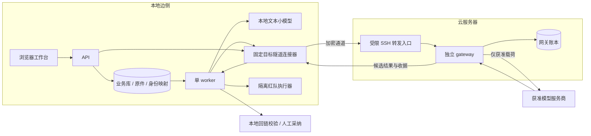

# LexAegis 云端网关部署与低成本边侧模型方案

本方案面向显存不超过 8GB 的本地设备，以“原件留本地、小模型做抽取、云网关受控调用”构建法律披露工作台。边侧掌握材料、身份映射与人工复核，云端承担请求核验、服务商调用和账本管理，将本地数据控制与云端推理能力衔接起来。

2026-11-01 已在 D 盘完成 `demo/native` 模拟部署：本地小模型真实推理，独立网关返回 mock 预置结果，合成流程、拒绝路径和同机备份恢复已实测。真实云联调、生产隔离和正式构建仍待验收。模型扩展短样例有 5/8 抽取失败，因此当前配置用于受控合成试用，交付模型须继续比较与评测。问题、修复文件及对方案的调整见第 15 章；逐项记录见[完整测评报告](LOCAL_DEPLOYMENT_EVALUATION_2026-11-01.md)及[Excel 测评表](../deliverables/outputs/01a19508-ba86-70d2-a9b3-4f623ce1fb75/LOCAL_DEPLOYMENT_EVALUATION_2026-11-01.xlsx)。

## 1. 推荐决策

推荐采用“本地工作台与小模型 + 单实例云网关 + 获准模型服务商”的部署方式。资源投入集中在两个环节：本地用小参数模型完成可回链的事实抽取，云端用普通 CPU 服务器运行独立网关。每次调用经最小披露、人工复核和哈希绑定批准后执行，结果回到本地校核与采纳。

| 项目 | 首期选择 | 选择依据 |
| --- | --- | --- |
| 云运行方式 | Docker Compose，单实例 gateway | 与当前单机存储、一次性许可和账本机制相适应 |
| 边侧已运行原型 | MiniCPM5-2B Q4_K_M | 已在 RTX 4060 Laptop 8GB 跑通接口及合成流程；复杂短样例仍有失败 |
| 4GB 显存目标 | MiniCPM5-2B Q4_K_M，待目标机测试 | 当前没有 4GB 实机或模型独占峰值证据，不能直接认定可交付 |
| 6–8GB 显存档 | 比较 MiniCPM5-2B Q8_0 与 Q4_K_M | Q8 尚未实测；按抽取质量、整份材料耗时和显存占用选择量化档 |
| 质量对照 | Qwen3.5-4B，适配的 4bit 文本推理版本 | 衡量额外资源投入带来的中文材料处理收益 |
| 边云链路 | 首期 SSH 固定端口隧道；需要组网时再选 WireGuard | 加密、限定目标，便于低成本部署和故障定位 |
| 已完成的本机验证 | demo + 内置合成材料 + mock 网关 | 验证业务流程和工程拒绝行为，0 次真实服务商调用 |
| 下一轮链路验收 | integration + 已登记合成材料 | 验证真实跨机器调用，再准备生产证据 |

不超过 8GB 显存的交付范围聚焦 MiniCPM5-2B 与 Qwen3.5-4B，Qwen3-14B 用于高配质量对照。表中配置作为起步规格，最终交付档位由目标设备评测确定。

## 2. 部署架构与数据边界

### 2.1 物理架构



云端 gateway 统一执行服务商调用，本地连接器承担固定目标的加密传输并保持信封字节不变。审批由应用与具名人员完成；连接器不重试 HTTP POST，保持每次发送的账本语义。

### 2.2 数据归属

| 数据 | 存储位置 | 云端处理约束 |
| --- | --- | --- |
| 原始 DOCX / PDF / 图片 / 音视频 | 边侧受控存储 | 不挂载、不同步到云服务器 |
| 业务数据库与本地用户 | 边侧 | 不作为云网关数据卷 |
| `mapping`、`original_value`、`local_text`、本地 `anchors` | 边侧 | 按现有 wire 契约禁止进入外发载荷 |
| 已冻结、已批准的最小披露请求 | 边侧生成，云网关核验 | 按敏感业务数据管理；令牌化不等于匿名化 |
| 云端候选结果 | 网关处理，回边侧 | 按敏感结果管理，普通访问日志排除正文 |
| 网关账本与一次性消费记录 | 云端持久卷 | 保留去重与对账连续性，不挂载原件目录 |
| 云 API Key | 仅云网关 | 不进入边侧 API、worker、前端、模型容器和红队 |
| 网关 HMAC 密钥 | 边侧 API / worker 与云网关 | 每个部署独立；与红队密钥、SSH 私钥分离 |
| SSH 私钥 | 边侧连接器 | 仅允许固定网关端口转发 |

云网关处理的获准载荷和候选结果纳入服务商治理、留存与接收方审核，原件和身份映射由边侧独立管理。

### 2.3 端口约定

| 端口 | 用途 | 暴露方式 |
| --- | --- | --- |
| 本地 38765 | production 工作台 | 仅 `127.0.0.1` |
| 本地 48765 | demo 工作台 | 仅 `127.0.0.1` |
| 本地 58765 | integration 工作台 | 仅 `127.0.0.1` |
| 本地 18080 | 本轮 native 小模型 | 仅 `127.0.0.1`；原有 8080 服务保留；容器模式仅内部网络 |
| 本地 48766 | demo 模拟网关 | 仅 `127.0.0.1`，独立模拟账本 |
| 本地 58766 | native integration 隧道入口 | 仅 `127.0.0.1`，与启动器的 integration 网关端口对齐 |
| 云主机 8766 | gateway | 首期仅 `127.0.0.1`，由 SSH 服务端转发访问 |
| 云主机 SSH 端口 | 运维与加密转发 | 密钥认证，管理来源限制，转发账号限制目标 |

工作台通过宿主回环地址访问，沿用当前 Host / Origin 防护。远程工作台访问作为独立扩展，另行设计认证、受信 Host / Origin、Cookie 与代理边界。

18080 是本轮显式配置；代码中模型默认端口仍为 8080。更换端口时同步修改模型监听参数、API / worker 的模型 URL 和模型健康检查。开始前检查占用，不停止不属于本次部署的服务。

## 3. 资源与成本规划

### 3.1 云服务器

数据落在本地块存储。推理、OCR 和语音转写在边侧运行，云端算力用于网关核验与调用管理。

镜像可由构建机或 CI 生成，云服务器加载固定制品，减少在线构建对服务资源的占用。镜像缓存、账本、日志和备份分别设置容量预算，按增长情况扩容持久盘。

SQLite 使用本地块存储，排除 NFS、SMB、对象存储挂载盘及未经验证的代理文件系统。单实例网关在重启后复用同一账本卷，维持去重与许可消费记录的连续性。多实例扩展另行设计事务协调和故障恢复。

### 3.2 边侧

| 档位 | 建议内存 | 模型起点 | 初始参数 |
| --- | --- | --- | --- |
| 约 4GB 显存，待测 | 16GB 起 | MiniCPM5-2B Q4_K_M | context 8192，parallel 1，batch 512，ubatch 128；须在目标机验证 |
| 6–8GB 显存 | 16GB 起，材料较多时 32GB | MiniCPM5-2B Q8_0 / Q4_K_M 对照 | 同上，测试后再增上下文 |
| 8GB 且质量收益明确 | 32GB 更便于处理大文件 | Qwen3.5-4B 4bit 对照 | 单模型、文本模式、短上下文起步 |
| 无独显 | 16–32GB | MiniCPM5-2B Q4_K_M CPU | 保留人工录入路径，单任务测试实际耗时 |

显存预算同时覆盖权重、KV cache、计算缓冲、驱动和桌面占用。先确保整份材料稳定处理，再增加上下文或吞吐。

本轮唯一实测硬件为 RTX 4060 Laptop，8188MiB 显存、约 16GB 内存。早期整卡采样约 3–3.4GiB，其他图形负载同时运行时收尾采样为 6851MiB；这两个数值均不能用作模型独占峰值或 4GB 设备的交付依据。

### 3.3 费用计算

月度总成本 = 云主机 + 持久盘与云侧备份 + 带宽 + 服务商 token 费用 + 运维投入。

边侧成本 = 现有电脑或一次性设备投入 + 模型资产存储 + 电费。首期复用现有 4–8GB 显存设备；是否换卡由抽取质量、整份材料耗时和峰值资源实测决定。

采购按相同地域、计费周期和续费口径比较当日报价。服务商处理地区按其审核档案单独核验。

## 4. 边侧模型选型

### 4.1 候选范围

| 模型 | 官方信息与部署特点 | 本项目定位 |
| --- | --- | --- |
| MiniCPM5-2B | 总参数约 2.52B，纯文本；有官方 GGUF | 低成本主候选 |
| Qwen3.5-4B | 文本部分标称 4B，完整发布还含视觉编码器；支持文本专用服务模式 | 质量对照 |
| Qwen3-14B | 总参数约 14.8B | 高配质量基线；8GB 内默认不采用 |
| 比赛包 Qwen3-4B-GRPO | 仓库有交付说明和独立资产约定 | 既有交付回归基线，与新候选使用同一任务集比较 |

官方依据：[MiniCPM5-2B 模型卡](https://huggingface.co/openbmb/MiniCPM5-2B)、[Qwen3.5-4B 模型卡](https://huggingface.co/Qwen/Qwen3.5-4B)、[Qwen3-14B 模型卡](https://huggingface.co/Qwen/Qwen3-14B)。Qwen3.5 按实际加载的组件计算资源预算，并验证文本模式下视觉组件的加载情况。

### 4.2 MiniCPM5 的量化决策

固定 revision `2079a22f3beaa4e306449978533478fe0522f4b3` 的官方 GGUF 中，Q4_K_M 文件约 1.56GB、Q8_0 约 2.68GB；运行预算还需计入缓存与计算空间。[官方权重目录](https://huggingface.co/openbmb/MiniCPM5-2B-GGUF/tree/2079a22f3beaa4e306449978533478fe0522f4b3)

推荐评测顺序：

1. 以 Q4_K_M 建立目标设备上的抽取、回链与资源基线。
2. 在 6–8GB 档比较 Q8_0，统计主体、金额、日期和引文的质量变化。
3. 质量相当时选择 Q4；Q8 带来稳定收益且资源满足预算时选择 Q8。
4. 加入 Qwen3.5-4B 4bit 对照，按人工修订量与额外资源投入决定交付型号。

上下文从 8K 和来源分块起步；扩展到 16K 或 32K 时，同步检查显存、输入截断和长文后段召回，以整份材料的处理效果确定配置。

本轮 Q4_K_M 在内置 8 条材料上通过工程契约检查，新增 8 个短样例中有 3 个返回合法事实、5 个抽取失败。当前尚无人工金标准确率和 Q8 / Qwen 对照结果。先将冲突金额、否认、工资表、别名与文内指令纳入开发集，再建立独立保留集；模型接口通过后还要验证事实覆盖和人工修订量。

### 4.3 运行器与抽取协议

首选固定版本 llama.cpp，提供现有 `/v1/models` 与 `/v1/chat/completions` 接口。NVIDIA 使用匹配的 CUDA 构建；其他显卡单独验证对应后端，不沿用 CUDA 性能假设。llama.cpp 接口以[官方 server 文档](https://github.com/ggml-org/llama.cpp/blob/master/tools/server/README.md)为准。

固定生产服务别名 `edge-small`，模型升级时更新受控资产清单。`/v1/models` 的 ID 必须与 `LEX_EDGE_MODEL` 一致。

沿用当前应用契约：默认关闭 thinking，输出结构化 JSON，校核来源 ID 和原文引文，候选事实经人工确认后生效。以当前 `temperature=0` 抽取配置建立任务基线；参数调整与模型更换使用同一评测集验证。

`allow_human_review` 表示进入人工复核。放行、批准、门禁执行和许可消费继续由现有授权链管理。

### 4.4 OCR、转写与模型生命周期

native 路径沿用现有阶段锁与模型启停逻辑。独立 `edge-model` 容器需适配跨容器生命周期管理，覆盖加载、卸载和资源释放。

本轮实际启用文本材料与人工核校，`LEX_OCR_ENABLED=0`、`LEX_WHISPER_ENABLED=0`。CPU OCR 在固定资产安装并通过实际识别测试后启用；本机 PaddleOCR、RapidOCR 和 whisper 实际资产测试均未执行。GPU OCR / whisper 随生命周期适配启用，验收覆盖模型卸载、完成后重载、OOM 恢复及异常退出释放。容器管理权限交由专用组件，业务 worker 不挂载 Docker socket。

## 5. 模型质量与性能评测

### 5.1 数据集

评测分两层：仓库合成集验证接口与协议，本地授权材料集衡量抽取质量和实际工作量。任务评测集建议从 30–50 份材料、100–200 个来源块起步，按材料差异扩充。

材料覆盖劳动合同、工资表、聊天摘录和情况说明，重点设置否认、金额冲突、别名、表格及 OCR 噪声样本。首期聚焦中文；老挝文等语言单独建集、评测后纳入支持范围。

按材料划分开发集和保留评测集，同一案件的近重复材料归入同组。冻结评测样本后调试提示词，标准答案由有权限的人员校核。原文、标签与运行结果均保存在受控边侧。

### 5.2 评测指标

| 指标 | 评测方式 | 决策作用 |
| --- | --- | --- |
| 有依据事实的 precision / recall | 对照人工事实标签 | 衡量主要事实的准确性与覆盖率 |
| 主体、金额、日期错配 | 逐条核对人物归属、单位、币种、期间 | 核心质量指标 |
| 引文与来源 | 引文子串检查、来源块一致性 | 无效条不得进入可用事实集 |
| 否认与冲突保留 | 正反证据、争议状态并列检查 | 保持主张、否认与确定事实的区分 |
| 初筛误放与误拦 | 与人工标注逐条对照 | 分别统计误放、误拦及高风险漏检 |
| JSON 与协议合格率 | 记录原始响应及应用校验结果 | 识别 grammar、模板、截断兼容问题 |
| 延迟 | 首次加载、预填充、单块、整份材料 P50 / P95 | 决定用户是否可以接受 |
| 资源 | 峰值显存、内存、连续运行稳定性 | 判断目标机器能否交付 |
| 人工修改量 | 每份材料需删除、补录、纠正的事实数 | 衡量实际节省的工作量 |

事实采纳以来源有效、校核通过和人工确认为条件；模型或协议失败按现有机制阻断。项目在试评测后确定召回率、人工修订量与延迟目标，形成交付判据。

### 5.3 记录与选定

每次记录模型来源及 revision、GGUF SHA-256、量化方式、运行器版本、显卡与驱动、上下文与 batch、提示词版本和评测集版本。分别统计模型原始输出与程序校验后的结果，区分模型质量和规则拦截收益。

交付模型按“关键错误满足要求 → 人工修订量可接受 → 资源与耗时符合预算”的顺序选定。合成工程探测负责接口验证，真实材料评测负责业务质量，法学审核负责适用性结论。

## 6. 代码基线与部署适配

核对的远端提交为 `2aa5f967972ba7df13dd85be3a6b9ffc676d34f1`，本机测评的源码基线为 `263b2275091ef9ae1c8228eda553da6bf7ee69bc`；相关应用与部署代码一致。第 15 章所列修复目前保留在工作树，尚未提交。实际部署应冻结包含修复的新版本，原远端提交用作历史核对依据。

当前代码提供独立网关、签名信封、批准哈希和一次性许可机制。本方案在此基础上规划跨主机部署适配。

| 核查对象 | 实施基础 | 部署适配 |
| --- | --- | --- |
| `lexaegis/gateway.py` | 独立网关、HMAC、批准哈希、白名单、网关账本、生产一次性许可核验 | 云端单独部署及跨主机运行证据 |
| `compose.yaml` | api / worker / gateway 分服务、分卷、分网 | 当前默认同一主机；拆出边侧与云侧部署文件 |
| `LEX_GATEWAY_ROLE` | cloud 必须持有主槽凭据，edge 禁持云凭据 | 首期部署一个云端 gateway，边侧连接器负责传输 |
| `lexaegis/diagnostics.py` | 同机 Compose 五项隔离探测 | 补两端探测，兼容跨主机证据采集 |
| `models/catalog/` | MiniCPM5-2B Q4_K_M 声明 | 统一交付权重、量化档、运行器和模型别名 |
| `Dockerfile` | 可构建应用镜像 | 将比赛版 Qwen3-4B-GRPO、CPU 默认参数覆盖为选定模型与后端 |
| `deploy/k8s/` | 拓扑配置及本地演练记录 | 首期采用 Compose；Kubernetes / KubeEdge 留作后续集群部署验证 |
| `gpu_runtime.py` | 本机模型生命周期与阶段锁 | 为独立模型容器适配启停与资源释放 |
| `scripts/windows/local-cloud-trial.py` | 已实测的 demo/native 控制器，按角色收紧环境，核对 PID 与创建时间 | 仅管理本机模拟部署；其环境隔离修复不代表其他启动路径均已完成相同审计 |

当前验收基线：既有 10 案层 A 评估完成，0 案真实发送；仓库规则包为草稿，正式外发保持阻断。D 路径 evaluate 属于评估环节。跨主机工程验收见第 11 节，真实请求启用条件见第 12 节。

## 7. 发布制品与配置组织

### 7.1 配置目录

按以下布局创建配置目录。integration 与 production 分别使用独立目录、卷、密钥和隧道身份。

```text
云端 /etc/lexaegis/integration/       云端 /etc/lexaegis/production/
  compose.cloud.yaml                  compose.cloud.yaml
  image.env                          image.env
  gateway.env                        gateway.env
                                     release-build-manifest.json

边侧 %LOCALAPPDATA%/LexAegis/integration/
  edge.env
  tunnel/identity
  tunnel/known_hosts
  评测与运行数据根

边侧 production：独立配置与数据卷，不复用 integration 目录
```

密钥存入源码与构建上下文之外的专用配置目录，排除 Git、聊天和截图。Linux 设置最小可读权限；Windows 使用当前用户或服务账号专属 ACL。

### 7.2 固定制品

发布清单至少关联源码提交、锁文件、wheel、前端产物、运行规则包、应用镜像、隧道镜像、路由隔离镜像、存储修订、验证报告及模型资产清单。

生产使用已审核交付包的固定镜像与 verified 构建清单。OCI 仓库 digest、离线镜像配置 ID 和文件 SHA-256 按现有 manifest / delivery 契约分别登记，准确关联各类制品。

本轮 wheel 已构建并通过资源核验及全新虚拟环境安装检查，但 `release verify-candidate` 为 `pending`：运行包哈希、正式验证报告哈希及容器镜像身份未齐，API / worker / gateway 均为 `unconfigured`。JUnit、wheel 或本表存在，不会自动使构建成为 verified。

发布时冻结包含代码、文档和配置的新提交及制品，生成与该版本匹配的构建清单。

使用 `lexaegis release verify-candidate` 只读核查制品来源，参数以该版本 `--help` 为准。策略安装与发送授权沿用正式放行链。

## 8. 第一阶段：云网关与 native 边侧合成联调

本阶段使用 integration 和已登记合成材料，验证“本地模型 → 批准请求 → 云网关 → 服务商 → 本地回链”的完整链路。下列模板在准备镜像、凭据和权限后进行目标环境联调；生产隔离部署按第 9 节实施。

### 8.0 已完成的本机模拟入口

本机试用使用独立 `demo` 数据根，不需要云服务商密钥。在 `<checkout>` 执行：

```powershell
powershell.exe -NoProfile -File .\scripts\windows\local-cloud-trial.ps1 status
powershell.exe -NoProfile -File .\scripts\windows\local-cloud-trial.ps1 start
```

工作台为 `http://127.0.0.1:48765`，模型为 `http://127.0.0.1:18080/v1`，模拟网关为 `http://127.0.0.1:48766`。模型真实运行，云结果为 `provenance=simulation`；复核与批准使用标注清楚的合成测试账号。数据位于 `.data/local-cloud-trial/`，登录和停止方法见 [LOCAL_CLOUD_TRIAL.md](LOCAL_CLOUD_TRIAL.md)。

integration 使用另一套配置、凭据和账本，按下文新建；不将 demo 库改成真实云环境。切换前用控制脚本停止本机 demo，释放它占用的 18080 模型端口；其他服务保持原样。

### 8.1 安装与构建

云主机安装 Docker Engine 和 Compose 插件，操作按 [Docker Ubuntu 官方文档](https://docs.docker.com/engine/install/ubuntu/)执行。使用有仓库访问权限的账号，在干净构建目录检出固定提交：

```bash
git clone https://github.com/alanzhang66666/LexAegis.git /opt/lexaegis-src
cd /opt/lexaegis-src
LEX_SOURCE_REV='<填入包含本轮修复并经审核的完整提交 SHA>'
git checkout --detach "$LEX_SOURCE_REV"
docker build --label "org.opencontainers.image.revision=$LEX_SOURCE_REV" -t lexaegis:integration-candidate .
```

先将占位值替换为真实冻结提交；本轮尚未生成该提交。上述命令用于构建待验证联调镜像。生产镜像在部署适配合并后，从新冻结的提交构建，并按发布清单交付。Docker 引擎须先能正常响应 `docker info`；本机当前引擎启动超时，故这些容器命令尚无本机执行成功记录。

### 8.2 云端 Compose

将联调模板保存为 `/etc/lexaegis/integration/compose.cloud.yaml`：

```yaml
name: lexaegis-cloud-integration
services:
  gateway:
    image: ${LEX_RELEASE_IMAGE:?Set the reviewed application image}
    pull_policy: never
    command:
      - python
      - -m
      - uvicorn
      - lexaegis.gateway:create_gateway
      - --factory
      - --host
      - 0.0.0.0
      - --port
      - "8766"
      - --no-access-log
    env_file:
      - /etc/lexaegis/integration/gateway.env
    environment:
      LEX_RUN_PROFILE: integration
      LEX_DEPLOYMENT_MODE: isolated
      LEX_RUNTIME_ROLE: gateway
      LEX_GATEWAY_ROLE: cloud
      LEX_GATEWAY_DIR: /data/gateway
    ports:
      - "127.0.0.1:8766:8766"
    volumes:
      - gateway-data:/data
    read_only: true
    cap_drop: [ALL]
    security_opt: [no-new-privileges:true]
    tmpfs: [/tmp]
    restart: unless-stopped
    healthcheck:
      test: [CMD, python, -c, "import socket; socket.create_connection(('127.0.0.1', 8766), 2).close()"]
      interval: 15s
      timeout: 3s
      retries: 5
      start_period: 30s
    logging:
      driver: json-file
      options:
        max-size: "10m"
        max-file: "3"
volumes:
  gateway-data: {}
```

模板将健康检查改为网关端口探测，并在 `/data/gateway` 子目录绑定运行标记，与镜像的数据目录布局保持一致。凭据与构建身份由带签名的 `/health` 检查。

`image.env` 内容：

```dotenv
LEX_RELEASE_IMAGE=lexaegis:integration-candidate
```

`gateway.env` 内容：

```dotenv
LEX_GATEWAY_SECRET=<替换为本部署独立的长随机签名密钥>
LEX_CLOUD_PRIMARY_KEY=<替换为联调服务商密钥>
LEX_CLOUD_STANDBY_KEY=
LEX_CLOUD_ALLOWED_HOSTS=api.deepseek.com
```

示例采用仓库支持的 DeepSeek 主槽主机，实际账户、模型与处理地区按服务商档案配置和审核。白名单填写准确主机名，排除通配域名及任意转发 URL；首轮使用单主槽，便于定位链路问题。

使用不回显配置值的校验和启动命令：

```bash
docker compose --env-file /etc/lexaegis/integration/image.env -f /etc/lexaegis/integration/compose.cloud.yaml config --quiet
docker compose --env-file /etc/lexaegis/integration/image.env -f /etc/lexaegis/integration/compose.cloud.yaml up -d
docker compose --env-file /etc/lexaegis/integration/image.env -f /etc/lexaegis/integration/compose.cloud.yaml ps
```

云端通过模板中的独立 uvicorn 命令启动 gateway，挂载网关专属数据卷。`LEX_GATEWAY_ROLE=cloud` 在启动时检查主槽凭据配置，实际可用性通过联调调用验证。

### 8.3 受限 SSH 转发

创建独立转发账号 `lexforward`，由运维核验服务器 SSH host key 指纹并写入边侧 `known_hosts`。

将以下片段合入目标主机的 sshd 配置，先执行 `sshd -t`，再按目标系统方式 reload，并保留已有管理连接验证访问：

```text
Match User lexforward
    AuthenticationMethods publickey
    PasswordAuthentication no
    KbdInteractiveAuthentication no
    AllowTcpForwarding local
    PermitOpen 127.0.0.1:8766
    AllowStreamLocalForwarding no
    AllowAgentForwarding no
    X11Forwarding no
    PermitTTY no
    PermitTunnel no
    MaxSessions 0
Match all
```

`MaxSessions 0` 限制 shell / subsystem 会话，`PermitOpen` 将转发目标固定到网关端口。账号采用专属公钥，客户端启用 host key 校验、关闭 agent forwarding。[OpenSSH sshd_config 官方手册](https://man.openbsd.org/sshd_config)

边侧 PowerShell 前台建立隧道：

```powershell
$lexTunnelRoot = Join-Path $env:LOCALAPPDATA 'LexAegis\integration\tunnel'
ssh.exe -N -T -o BatchMode=yes -o ExitOnForwardFailure=yes -o ServerAliveInterval=30 -o ServerAliveCountMax=3 -o StrictHostKeyChecking=yes -o "UserKnownHostsFile=$lexTunnelRoot\known_hosts" -i "$lexTunnelRoot\identity" -L 127.0.0.1:58766:127.0.0.1:8766 "lexforward@<云服务器地址>"
```

连接器使用固定 `-L` 转发，排除 SOCKS 和任意目标代理。生产部署增加进程监督、固定目标约束与故障记录。[OpenSSH 转发参数说明](https://man.openbsd.org/ssh)

### 8.4 本地模型和工作台

本地安装仓库 Python 依赖并构建前端，按仓库运行说明操作。将固定版本 CUDA llama-server 及其依赖放入受控运行器目录；从官方模型仓库取得固定 revision 的权重，核验 SHA-256 后放入被忽略的 `models/`。

将下面配置写入 `%LOCALAPPDATA%\LexAegis\integration\edge.env`，按实际路径修改：

```dotenv
LEX_RUN_PROFILE=integration
LEX_LAUNCHER_ROLES=api,worker
LEX_DEPLOYMENT_MODE=native
LEX_DATA_DIR=<checkout>/.data/profiles/integration/app
LEX_GATEWAY_DIR=<checkout>/.data/profiles/integration/unused-local-gateway
LEX_GATEWAY_URL=http://127.0.0.1:58766
LEX_GATEWAY_PORT=58766
LEX_API_PORT=58765
LEX_GATEWAY_SECRET=<与云端相同的签名密钥>
LEX_LOCAL_PASSWORD=<独立的本地登录口令>
LEX_REDTEAM_SECRET=<与网关密钥不同的独立随机密钥>
LEX_EDGE_URL=http://127.0.0.1:18080/v1
LEX_EDGE_MODEL=edge-small
LEX_EDGE_ALLOWED_HOSTS=127.0.0.1
LEX_EDGE_OUTBOUND_REVIEW=1
LEX_EDGE_IDLE_UNLOAD_SECONDS=0
LEX_EDGE_BIN=<checkout>/.artifacts/llama-server/b12032-cuda12/llama-server.exe
LEX_EDGE_GGUF=<checkout>/models/MiniCPM5-2B-Q4_K_M.gguf
LEX_EDGE_CTX_SIZE=8192
LEX_EDGE_BATCH_SIZE=512
LEX_EDGE_UBATCH_SIZE=128
LEX_EDGE_N_GPU_LAYERS=99
LEX_EDGE_FLASH_ATTN=on
LEX_EDGE_PARALLEL=1
LEX_EDGE_SECOND_PASS_THINKING=0
LEX_EDGE_EXTRACT_MAX_TOKENS=3072
LEX_OCR_ENABLED=0
LEX_WHISPER_ENABLED=0
```

边侧配置保存本地登录与签名信息，`LEX_CLOUD_*_KEY` 保留在云端。测试 Q8 时替换权重路径并登记哈希。显式数据根将 integration 与其他环境分开；`unused-local-gateway` 是未启用本地 gateway 的配置占位路径。

模型进程不加载包含 HMAC / 登录口令的 `edge.env`。在新开的专用 PowerShell 终端中清理继承的 `LEX_*` 变量，再直接启动已核验的运行器；本终端保持前台运行：

```powershell
Set-Location <checkout>
Get-ChildItem Env: | Where-Object { $_.Name -like 'LEX_*' } | ForEach-Object { Remove-Item -LiteralPath ('Env:' + $_.Name) }
& .\.artifacts\llama-server\b12032-cuda12\llama-server.exe --model .\models\MiniCPM5-2B-Q4_K_M.gguf --host 127.0.0.1 --port 18080 --alias edge-small --jinja --ctx-size 8192 --batch-size 512 --ubatch-size 128 --parallel 1 --n-gpu-layers 99 --flash-attn on --threads 4
```

确认该端口的 `/v1/models` 包含 `edge-small` 后，在另一个专用终端加载边侧应用配置。通用启动器会尝试读取当前目录 `.env`，因此改在专属配置目录运行，显式拒绝该目录存在额外 `.env`，并清理继承的 `LEX_*` 变量：

```powershell
$lexIntegrationRoot = Join-Path $env:LOCALAPPDATA 'LexAegis\integration'
$lexEdgeEnvFile = Join-Path $lexIntegrationRoot 'edge.env'
Set-Location $lexIntegrationRoot
if (Test-Path -LiteralPath '.env') { throw '请将额外 .env 移出此专属配置目录，再启动。' }
Get-ChildItem Env: | Where-Object { $_.Name -like 'LEX_*' } | ForEach-Object { Remove-Item -LiteralPath ('Env:' + $_.Name) }
& '<checkout>\.venv\Scripts\python.exe' -c "import os,sys; from dotenv import load_dotenv; load_dotenv(sys.argv.pop(1), override=True); any(k.startswith('LEX_CLOUD_') and v for k,v in os.environ.items()) and sys.exit('边侧配置不得包含云凭据或云服务配置'); from lexaegis.cli import main; main()" $lexEdgeEnvFile start --profile integration
```

在另一个终端，使用相同专属配置目录与显式配置运行抽取工程探测：

```powershell
$lexEdgeEnvFile = Join-Path $env:LOCALAPPDATA 'LexAegis\integration\edge.env'
Set-Location (Split-Path -Parent $lexEdgeEnvFile)
Get-ChildItem Env: | Where-Object { $_.Name -like 'LEX_*' } | ForEach-Object { Remove-Item -LiteralPath ('Env:' + $_.Name) }
& '<checkout>\.venv\Scripts\python.exe' -c "import os,sys; from dotenv import load_dotenv; load_dotenv(sys.argv.pop(1), override=True); any(k.startswith('LEX_CLOUD_') and v for k,v in os.environ.items()) and sys.exit('边侧配置不得包含云配置'); from lexaegis.cli import main; main()" $lexEdgeEnvFile dataset probe-edge --dataset-id mock_labor
```

启动模型、隧道和工作台后，访问 `http://127.0.0.1:58765`。网关 `/health` 使用签名鉴权，检查时携带有效签名。普通 TCP 健康只证明进程可达，签名健康中的 available 只说明凭据已配置，真实调用仍由 integration 实测确认。

此处将模型保持驻留，并显式启用真实边侧初筛。模型退出时先停应用并恢复模型，再继续联调。通用 `edge_runtime` / GPU 自动拉起路径的凭据环境审计，以及独立容器的生命周期管理，纳入 T6；不能将本地 demo 控制器的修复直接推定为通用启动路径已经隔离。

执行红队环节时，另行启动受控 redteam 服务并配置独立密钥，按实际执行结果记录结论。

## 9. 第二阶段：生产边侧隔离部署

本节定义生产隔离拓扑，部署适配任务见第 10 节。边侧运行 API、worker、模型、红队和受控连接器，云端运行同构建的 gateway；两端按第 11 节完成实机隔离验收。第 8 节 native 联调记录用于链路验证。

### 9.1 边侧网络

| 网络或服务 | 连通范围 | 关键限制 |
| --- | --- | --- |
| 业务内部网 | API、worker、模型、连接器 | `internal: true`，业务进程没有普通互联网出口 |
| 红队网络 | worker 与红队，按能力最小连接 | 无原件卷、无网关密钥、无云凭据 |
| 工作台发布网 | API 与宿主回环发布 | 保留路由隔离辅助进程，重建后重新验证 |
| 连接器出口网 | 仅连接器访问固定云 SSH 地址和端口 | 宿主/虚拟机防火墙实施白名单，覆盖 IPv4 / IPv6 |
| 云网关出口 | 网关访问实际服务商 | 应用域名白名单 + 经验证的网络出口策略 |

连接器在内部网监听 `8766`，访问范围限定为业务内部网络。它持有 SSH 私钥及 known_hosts，与网关 HMAC、云 API Key 和业务卷分离，转发目标固定为云网关。

边侧 API 和 worker 均使用 `LEX_GATEWAY_URL=http://gateway-link:8766`。HTTP 限于边侧内部网与云端回环段，跨主机传输由 SSH 加密，原始应用信封继续通过 HMAC 核验。

部署模板中同时替换 API 和 worker 的固定网关 URL，并保持业务容器的内部网络约束。跨主机出口由连接器承担，worker 保持无普通互联网出口。

### 9.2 连接器实现约束

单独制作固定版本 OpenSSH 客户端镜像，非 root 运行、只读根文件系统、去除 capabilities，只读挂载专属私钥和 known_hosts。按第 8 节固定端口转发，容器内部绑定到内部接口，禁止宿主端口发布。

进程监督负责重建连接，连接器禁止缓存、重放请求或访问 Docker socket。出口策略落实到容器转发链或受控虚拟机，并在 Docker 重启后验证实际流量，覆盖宿主防火墙与容器网络的交互。[Docker 防火墙说明](https://docs.docker.com/engine/network/packet-filtering-firewalls/)

Windows / Docker Desktop 在目标设备上验证虚拟机网络、回环发布及出口限制。交付平台以隔离行为可稳定复现为条件，也可选择受控 Linux 边侧主机或虚拟机。

需要组网时可将 SSH 替换为 WireGuard，保留固定网关目标、HMAC、无通用出口和逐请求许可要求。传输方案切换后重新采集隔离证据。[WireGuard 官方说明](https://www.wireguard.com/quickstart/)

### 9.3 模型容器

使用固定 digest 的 llama.cpp GPU 服务镜像，挂载只读模型目录并连接内部网。GPU 运行同时配置设备授权与推理参数 `--n-gpu-layers 99`。

将以下 NVIDIA 设备授权片段合入完整 `edge-model` 服务，并验证驱动及 NVIDIA Container Toolkit：

```yaml
services:
  edge-model:
    deploy:
      resources:
        reservations:
          devices:
            - driver: nvidia
              count: 1
              capabilities: [gpu]
```

镜像选用支持对应 GPU 的运行器，与上述设备授权共同验证。[Docker GPU 官方说明](https://docs.docker.com/compose/how-tos/gpu-support/)

首期使用 8K、batch 512、ubatch 128、并发 1，按专用显存预算和目标机实测调整。

### 9.4 生产云网关

以第 8 节云模板为结构，单独创建 production 项目、账本卷、配置、SSH 身份及凭据。设置 `LEX_RUN_PROFILE=production`，只读挂载真实冻结的 `release-build-manifest.json`，设置 `LEX_RELEASE_BUILD_MANIFEST_PATH`，并检查三进程构建身份一致。

保留 role=cloud、固定镜像、回环端口和独立网关数据根。健康检查分为 TCP 进程存活检查，以及带签名的 `/health` 凭据与构建身份检查。

生产环境不复用 integration 账本。代码、模型、规则、服务商或网络策略变化后，按其影响重新冻结、评测、核验和取得相应授权。

## 10. 工程实施任务

T1–T8 用于组织工程交付；正式门禁沿用 outbound_gate 的 G 表。

| 任务 | 交付物 | 完成标准 |
| --- | --- | --- |
| T1 拆分部署文件 | 边侧、云侧 integration / production 模板及说明 | API / worker / 模型只在边侧，真实 gateway 只在云侧 |
| T2 统一模型资产 | 声明、哈希、别名、运行器和参数清单 | Dockerfile / native / Compose / 文档使用同一受控模型配置 |
| T3 固定隧道连接器 | 受限镜像、SSH 配置、重启与出口策略 | 仅到固定网关，无缓存重放、无业务卷、无云凭据 |
| T4 跨主机隔离探测 | 两端采集器与归并报告 | 覆盖两端服务的正向、负向与重启测试 |
| T5 健康与构建身份 | 网关健康检查覆盖、三进程身份报告 | 正确区分进程可达、凭据配置和构建 verified |
| T6 GPU 生命周期与角色环境 | 模型容器启停适配；审计通用模型拉起路径，模型不继承应用密钥；首期文本路径 | 模型启停、异常释放、重载与角色凭据边界可在目标设备复现；OCR 另测后启用 |
| T7 跨主机备份恢复 | 一致备份集、恢复工具、恢复后许可失效与对账流程 | 恢复演练验证账本连续性、许可失效与重复发送防护 |
| T8 模型与链路验收 | 评测报告、云调用与故障记录 | 分别形成模型质量、链路行为与法学审核记录 |

现有 `check-isolation` 面向本机 Compose。T4 将采集范围扩展到边侧与云侧，显式指定两端及相应 Compose 配置，按实际服务名核查出口、挂载和凭据，并归并报告。云端 gateway 的检查随部署位置迁移，保持检查项完整。

## 11. 工程验收矩阵

按下表逐项执行，记录时间、目标环境、构建身份、配置哈希、证据路径、执行者和结论。未执行项标为待验证。

| 验证项 | 预期行为 | 必留证据 |
| --- | --- | --- |
| 模型接口 | models ID 匹配；抽取 JSON 符合契约 | 模型/运行器哈希、工程探测报告 |
| 本地材料边界 | 云主机、网关挂载与日志无原件和身份映射 | 两端挂载、环境变量名称清单、受控内容检查 |
| API / worker 出口 | 可达连接器，不可直达服务商或任意外网 | DNS/IP、多目标、IPv4/IPv6 正负向探测 |
| 模型出口 | 模型服务没有互联网出口 | 容器网络与实际连接探测 |
| 连接器限制 | 仅允许固定云目标；无通用代理 | 出口策略、其他目标连接失败记录 |
| 凭据隔离 | 服务商密钥仅云网关可读 | 不显示值的存在性检查；红队/benchmark 也检查 |
| 云端重启 | 复用原账本；身份和挂载正确 | 重启前后账本、构建和卷标识 |
| API 重建 | 回环发布仍可用，普通出口仍被阻断 | 宿主访问与路由探测 |
| 合成真实云调用 | integration、登记的合成输入、`transport=cloud` / `provenance=cloud` | 请求哈希、批准、网关记录、结果和人工核验 |
| 边侧初筛阻断 | 命中后不能进入后续发送 | 状态与拒绝记录 |
| 人工否决 | 当前请求停止，无云调用 | 否决动作、任务状态、网关对账 |
| 请求变更 | 改内容、目标、模型或依赖后旧批准不可用 | 哈希变化与拒绝记录 |
| 未连通 | 确认未越过发送边界时挂起 | 应用异常类别、等待状态 |
| 发送后断连 | 结果不明时记 unknown，不自动重发 | 网关 sending/unknown 与服务商核对记录 |
| 重复请求 | 同一 ID / 哈希复用记录；ID 冲突拒绝 | 原账本及重复核验结果 |
| 构建不一致 | 生产请求不能正常取得放行条件 | 三进程身份及门禁拒绝 |
| 备份恢复 | 未消费授权作废，已消费和不明记录可对账 | 恢复清单、撤销结果、恢复演练报告 |

隔离验收整合网络策略、实际流量、宿主防火墙、卷权限及构建供应链证据。Compose 五项探测作为部署工程证据，本请求隔离收据按现行 G 链取得。

故障注入与工程安全测试记录技术结果，四类攻击的法学 `resisted` 结论按现行审核程序形成。

## 12. 真实案件启用条件

部署验收和真实案件外发授权分别办理。沿用 [DUAL_TRACK_ACCEPTANCE.md](DUAL_TRACK_ACCEPTANCE.md)、[法学现行入口](legal/README.md)及现有正式放行链。

真实发送前至少应具备相应真实构建、目标隔离证据、规则发布与适用范围、服务商审核与影响评估、材料授权、必要性及组合判断、获认可的攻击结论、冻结对象、具名批准和一次性许可。

`validate_formal_gate`、`authorize_dispatch` 和产品闩保持现有语义。409 按门禁缺项补齐证据；服务商 reviewed、规则 published、攻击 resisted 及具名批准均以真实审核记录为依据。

首案验收策略限 LA-001，完成“本次可用”签署与现行十门后，批准一次哈希绑定的 D 发送。后续常规请求按各自适用范围独立核验、批准和消费许可；首案结果保持该次请求的授权范围。

## 13. 运维、监控与故障处理

### 13.1 监控

监控覆盖网关与隧道存活、签名健康结果、云调用延迟、队列等待、unknown 数量、磁盘占用、备份时间、模型加载失败及显存峰值。首期采用受控本地日志与已有监控平台，采集范围排除请求正文。

应用正文、原文、完整请求体、密钥、身份映射和完整候选结果不进入普通日志。审计使用必要标识、哈希、状态与引用；访问敏感账本本身也受权限控制。

### 13.2 故障动作

| 故障 | 处理动作 |
| --- | --- |
| 边侧模型 OOM | 保持失败关闭/人工路径；先降 batch / ubatch，再检查上下文与量化档；重新评测 |
| 模型不可用或 JSON 不合格 | 停止当前模型环节；人工录入或修复，不自动改用云模型处理原文 |
| 隧道不通 | 恢复连接；按应用账本判断状态，不凭隧道重连重新提交请求 |
| 请求可能已到达网关或服务商 | 先查账本和服务商记录，维持 unknown，禁止自动重发 |
| 服务商 401 / 403 / 5xx | 按现有发送状态处理并核对；不能因错误码就认定未披露并切备 |
| 网关进程崩溃 | 复用同一持久卷恢复，先对账 sending / unknown |
| 签名校验失败 | 保持鉴权并停止放行，核查密钥、环境和请求完整性 |
| 磁盘不足或卷缺失 | 停止新发送，恢复原账本与可用存储，验证记录连续性 |
| 构建身份失效 | 停止生产放行，核对固定制品及清单，重新取证 |

链路验收分别验证连接失败、读取超时和发送后断连，按应用与网关记录判断请求状态。隧道恢复后先对账，再处理后续任务。

### 13.3 密钥轮换

HMAC 密钥轮换先暂停新发送、处置在途和 unknown，协调两端更新并检查签名健康。SSH 私钥按连接器身份轮换；服务商 Key 只在云侧更新。任何轮换是否影响已冻结请求、服务商档案或相应证明，按实际依赖重新核验。

首期按“一个边侧部署、一个云网关、一套账本与密钥”组织。多机构扩展先建立各自独立的 HMAC、业务信任域和数据隔离，再验收机构间访问边界。

## 14. 备份、恢复、升级与回滚

### 14.1 一致备份

边侧原件及业务库只备份到组织批准的本地或受控介质，不上传到本方案云网关。云侧备份自己的账本与必要配置元数据；密钥通过独立受控方式保存，不放入普通备份包。

一致备份按以下顺序执行：

1. 暂停新批准与新发送，完成或核对在途任务；sending / unknown 未解决时不做会回退状态的维护。
2. 停止边侧 API / worker 和云端 gateway，核对进程停止。
3. 在两端受控环境分别采集业务数据和网关账本，生成同一个 backup-set ID，记录 profile、镜像身份、数据库哈希、最后发送记录和 UTC 时间。
4. 在停服条件下复制完整持久卷或使用受控 SQLite 备份流程，完整保留数据库与 WAL 所承载的已提交数据。
5. 校验备份文件与清单，恢复服务并验证构建身份和账本连续性。

现有 `lexaegis backup/restore` 和 Windows 维护脚本面向同机两个数据根。T7 在此基础上适配两端协调备份、清单归并与恢复演练，保持业务数据和云账本各自的存储边界。

### 14.2 恢复

恢复到新的空目录，使用匹配的 profile、固定镜像和存储修订，保留恢复前目录用于核对。继承现有恢复语义：未消费许可、批准和排队发送失效；人工历史和已消费记录保留；sending / unknown 继续对账。

恢复对账覆盖备份时间之后的发送记录与服务商证据，逐条确认许可消费状态。账本连续性确认前停止发送，防止备份回退造成重复调用。

跨主机恢复同时核验两端完成状态及授权失效结果。各数据根的 restore-in-progress 标记与两端协调状态共同管理恢复进度；协调完成前保持停服或拒绝新发送，保留失败标记直至受控恢复完成。

恢复目标设为每日协调备份、重大变更前额外备份，RPO 不高于 24 小时、RTO 为一个工作日内，通过实机演练确认。许可消费记录的可核对性作为恢复完成条件。

### 14.3 升级与回滚

固定旧制品 → 维护停发与对账 → 一致备份 → 加载新制品 → 检查三进程身份 → 合成正负向回归 → 检查正式证据是否仍适用 → 恢复业务。

升级与回滚以镜像、数据修订和授权状态一致为完成条件。文档、网络、模型、规则或服务商变化后，按现有机制更新受影响证据，并验证隧道、出口限制、数据卷及 GPU 参数，使本地数据控制与逐请求云调用在版本切换后持续衔接。

## 15. 本地模拟部署的问题、解决方案与文件改动

### 15.1 本轮已经验证到哪一步

本轮在 Windows 和 RTX 4060 Laptop 8GB 上运行 MiniCPM5-2B Q4_K_M，工作台、worker、模型与 gateway 分为独立进程。边侧业务根为 `.data/local-cloud-trial/edge/demo/app/`，模拟云账本为 `.data/local-cloud-trial/cloud/demo/gateway/`。D 盘目录划分用于组织数据；同用户原生进程之间仍须由目标隔离部署建立访问边界。

| 层次 | 本轮结果 | 证据 |
| --- | --- | --- |
| 本地演示流程 | 真实模型初筛、合成账号复核批准、mock 网关、结果回链及合成确认完成；风险请求审批 409 | [实际 HTTP 与恢复记录](../.data/deployment-evaluation/20261101-211139/live-and-backup.json) |
| Python 完整回归 | 749 通过、5 跳过、0 失败；之后定向 51 通过，计数有重叠 | [完整 JUnit](../.data/deployment-evaluation/20261101-211139/pytest-corrected.xml)、[定向 JUnit](../.data/deployment-evaluation/20261101-211139/focused.xml) |
| 前端与交付包 | 类型检查、构建、20 项浏览器测试、wheel 资源检查及全新虚拟环境安装通过 | [浏览器明细](../.data/deployment-evaluation/20261101-211139/browser-tests.json)、[安装检查](../.data/deployment-evaluation/20261101-211139/wheel-install-result.json) |
| 模型质量 | 内置工程基线通过；扩展短样例 3/8 有合法候选，5/8 抽取失败；5212 字符长 DOCX 分 8 批完成 | [模型扩展测评](../.data/deployment-evaluation/20261101-211139/model-bench.json) |
| 实际云服务与生产 | 未进行真实服务商调用；native 隔离、正式构建及真实案件授权未验收 | [发布候选](../.data/deployment-evaluation/20261101-211139/release-candidate.json)、[隔离状态](../.data/deployment-evaluation/20261101-211139/isolation-status.json) |

这里的 mock 是本地预置云结果：网关校验、账本和回包流程实际运行，但服务商没有收到请求。`provenance=simulation` 与页面“本地预置结果”保持一致。合成账号的批准用于验证状态流转；真实案件仍为 0 次发送。

### 15.2 遇到的问题与处理结果

| 问题 | 原因或定位 | 解决方案与相关文件 | 当前结果 |
| --- | --- | --- | --- |
| 模型继承网关 HMAC | 本地试跑控制器最初复用通用应用环境 | `local-cloud-trial.py` 按 model / gateway / API / worker 生成环境；模型不接收 `LEX_*`，登录口令只给 API，云 Key 不注入任何试跑角色；新增角色测试并实际重启 | 本机试跑路径已修复并验证 |
| 初轮 7 个 doctor 测试失败 | 测试依赖默认数据根是否存在，聚合结论受执行顺序影响 | `test_diagnostics.py` 使用独立临时目录；补充缺失必需目录仍须失败的用例，保留实际诊断规则 | 完整回归通过 |
| 全局数据根覆写导致中间回归失败 | 临时测评环境试图统一设置 `LEX_DATA_DIR`，影响默认 profile 路径断言 | 撤销全局覆写，将目录隔离限制在诊断测试夹具内；回归执行器清理继承的运行变量 | 最终 JUnit 无失败；中间日志保留 |
| 案由验收 CLI 报路径异常 | 字符串拼接后的数据库路径传给要求 Path 的 Store | `acceptance_suite.py` 将 `--data` 声明为 Path，并以路径运算拼接；`test_acceptance_suite.py` 覆盖真实 CLI 入口 | 实际命令可运行，10 直接断言通过；8 映射与 1 人工门禁保持原状态 |
| 默认模型端口不能直接照搬 | 本机 8080 已有其他服务 | 试跑控制器改用 18080，同步模型 URL 和健康检查；端口冲突时拒绝启动 | 已验证，无需停止原有服务 |
| Windows 停服要覆盖子进程 | venv Python 启动包装进程可能再创建实际 Python 子进程 | 控制器保存 PID 与创建时间，核对归属后停止该进程树；增加端口冲突测试 | 停服释放端口，重启保留数据；同机备份恢复通过 |
| 五个复杂短样例没有合法事实 | 当前 Q4、提示词与解码配置在这些输入上出现空结果或不合法字段；诊断还观察到来源 ID 占位文字 | 保留失败响应与来源约束；后续比较提示词、量化和模型，并使用独立保留集 | 未解决，继续评测；不计入模型质量通过 |
| Docker 引擎未就绪 | Linux engine 管道不可达，后台启动与有界 CLI 启动未成功 | 保留启动错误与超时日志；待 Docker / WSL2 健康后构建固定镜像、启动 Compose 并重新取证 | 未解决，不能取得本机容器隔离验收结论 |
| wheel 可用但正式身份仍未配置 | 候选缺少运行包哈希、正式验证报告和镜像身份，工作树未冻结 | wheel 先做本机安装检查；提交审核后的修复并冻结制品，再接入发布核验流程 | 交付包冒烟通过；正式候选 pending |
| OCR / 转写无实际资产 | PaddleOCR、RapidOCR、whisper 运行器或模型未预置 | 本次关闭相关能力；安装固定资产并完成识别、转写和 GPU 生命周期评测后启用 | 对应实际能力未验收 |

诊断测试修改只调整夹具，实际“必需数据目录缺失应失败”的规则保持有效。403 / 409 等预期拒绝是成功的安全断言；模型没有合法事实、Docker 启动失败和未完成的正式验收则分别记录为失败或待完成。

### 15.3 本地部署与测评的文件清单

| 文件 | 具体改动 | 验证方式 |
| --- | --- | --- |
| [lexaegis/acceptance_suite.py](../lexaegis/acceptance_suite.py) | 修复 CLI 的 Path 类型与数据库路径拼接 | 新 CLI 测试、实际运行库 CLI、安装后的 wheel CLI |
| [scripts/windows/local-cloud-trial.py](../scripts/windows/local-cloud-trial.py) | 新增本地四角色控制器、端口检查、PID / 创建时间核对及角色环境配置；修复模型继承应用密钥 | 5 项控制器测试、实际启停、HTTP 与恢复演练 |
| [scripts/windows/local-cloud-trial.ps1](../scripts/windows/local-cloud-trial.ps1) | PowerShell start / status / stop 入口 | 实际后台启动、状态与停止 |
| [tests/test_acceptance_suite.py](../tests/test_acceptance_suite.py) | 新增 CLI 路径与结果状态回归 | 修复后定向回归 |
| [tests/test_diagnostics.py](../tests/test_diagnostics.py) | 使用临时数据根；增加缺失目录拒绝用例 | 完整回归及定向回归 |
| [tests/test_local_cloud_trial.py](../tests/test_local_cloud_trial.py) | 新增四类角色凭据边界与端口冲突测试 | 完整回归及定向回归 |
| [docs/CLOUD_EDGE_DEPLOYMENT_PLAN.md](CLOUD_EDGE_DEPLOYMENT_PLAN.md) | 云边实施方案；本次新增复盘章节并校正原方案 | 对照实际配置、代码与测评记录检查 |
| [docs/LOCAL_CLOUD_TRIAL.md](LOCAL_CLOUD_TRIAL.md) | 实际登录、启停、资产路径和试用范围 | 与控制器及部署状态核对 |
| [docs/LOCAL_DEPLOYMENT_EVALUATION_2026-11-01.md](LOCAL_DEPLOYMENT_EVALUATION_2026-11-01.md) | 详细实测报告、失败项、截图与逐模块附录 | JUnit、浏览器日志、实机 JSON 和制品检查 |
| [docs/README.md](README.md) | 新增部署、试跑与测评索引 | 检查链接 |
| [docs/VALIDATION.md](VALIDATION.md) | 追加同日验证记录及验收范围 | 与最终证据核对 |

模型权重、CUDA 运行器与下载清单位于 `models/`、`.artifacts/` 和 `.data/local-cloud-trial/setup/`；测试脚本、日志、临时库与截图位于被忽略的 `.data/`。新增 Excel 位于 `deliverables/outputs/01a19508-ba86-70d2-a9b3-4f623ce1fb75/`。这些本机资产与运行数据不作为正式发布包或授权凭证。

工作区另有 `scripts/windows/local-integration.ps1`、`启动联调.cmd` 和 `停止联调.cmd`，本轮测评未修改，也未作为上述 demo 控制器的替代入口。

### 15.4 对原部署方案的修正

| 原问题 | 本次修正 | 适用章节 |
| --- | --- | --- |
| 模型候选介绍没有承接实测失败，4GB 档容易被理解为已验证 | 区分 8GB 已运行原型、4GB 待测、Q8 / Qwen 待比较；补入 5/8 扩展失败和显存证据范围 | 第 1、3、4 章 |
| 只写真实云联调，没有清楚标出已完成的本机 mock 阶段 | 增加本机模拟入口、数据根、端口和 mock 含义，明确切换环境前停止 demo | 第 8.0 节 |
| 模型端口和运行器路径与实际安装不一致 | 显式使用 18080 与 `b12032-cuda12` 路径，保留代码默认 8080 的说明 | 第 2.3、8.4 节 |
| 模型启动命令会加载含登录口令和 HMAC 的完整配置 | 改为独立终端清理 `LEX_*` 后直接启动模型；应用加载自己的专属配置 | 第 8.4 节 |
| 通用启动器会读取当前目录 `.env`，可能混入已有仓库配置 | 应用在独立配置目录运行，拒绝额外 `.env` 并校验无云配置；demo 控制器继续使用显式独立环境 | 第 8.4 节 |
| integration 配置未显式启用真实边侧初筛，存在路径混淆 | 加入 `LEX_EDGE_OUTBOUND_REVIEW=1`、模型主机限制和禁用闲置卸载的联调配置 | 第 8.4 节 |
| 旧提交构建命令不会包含本轮 CLI 修复 | 改为冻结包含修复的真实提交；增加候选 pending 与三进程未配置身份的说明 | 第 6、7、8.1 节 |
| CPU OCR 与 GPU 生命周期容易被理解为已启用或完成 | 按实际关闭 OCR / 转写；将通用模型拉起的凭据审计纳入 T6 | 第 4.4、8.4、10 章 |

代码核对还确认，通用 `edge_runtime._spawn_once` 的 `Popen` 当前没有显式收紧子进程环境。因此 T6 中的自动拉起凭据隔离仍需实现并回归，本轮只完成了 demo 专用控制器的修复。第 8.4 节的分终端方式是受控 native 联调步骤，生产仍按独立模型容器与角色环境取证。

### 15.5 Excel 测评表的阅读与后续更新

[Excel 测评表](../deliverables/outputs/01a19508-ba86-70d2-a9b3-4f623ce1fb75/LOCAL_DEPLOYMENT_EVALUATION_2026-11-01.xlsx)按五列组织：**测试内容/检查、结论/情况、证据、地址位置、错误原因（如果有）**。部署检查与全部后端用例分别展示；定向回归标明与完整回归的重叠。

失败、部分通过、跳过、未执行、未验收及仅有测试映射的记录整行标黄。测试映射保留原 `test_mapped` 状态，人工门禁保留 `manual_gate`；预期 403 / 409 拒绝按其断言记为通过。已修复问题在结论中标明修复后通过，错误原因列保留历史原因。

下一轮按“模型失败样例与独立保留集 → 通用启动路径凭据修复 → Docker / WSL2 与目标隔离 → 固定构建 → integration 真实云 → 当前请求正式授权”推进。每次用新的时间戳目录保留原始证据，更新对应状态和原因；正式放行继续使用现行 G 表。
