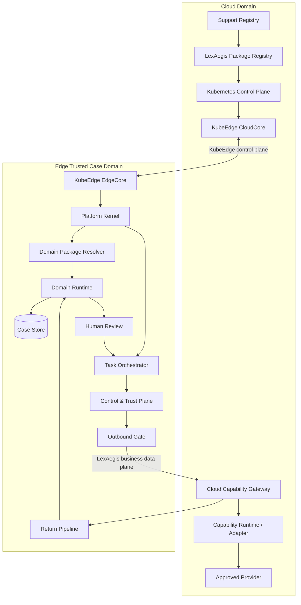
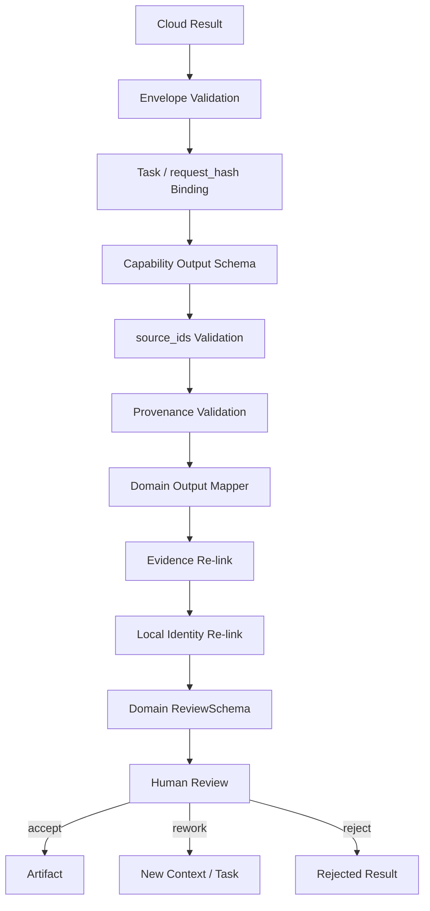
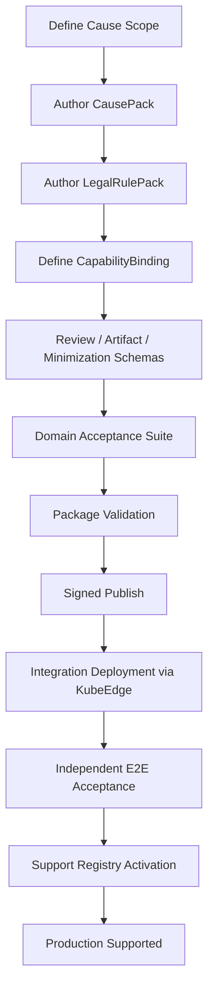

# LexAegis · 案隐盾

## 系统架构设计书（System Architecture Design）

### V2.2 — 基于 KubeEdge 的多案由可扩展云边协同平台架构

| 项目 | 内容 |
| --- | --- |
| 文档版本 | V2.2（`2.2.0`） |
| 架构状态 | Implemented Architecture Baseline + Multi-Cause Extensibility |
| 当前已支持案由 | `labor_dispute`（劳动争议） |
| 当前基准云能力 | `R_fact_summary` |
| 云边基础设施 | Kubernetes + KubeEdge |
| 平台主轴 | `Case → Domain Binding → Task → Edge Processing → Controlled Cloud Capability → Return → Human Review → Case State` |
| 领域扩展机制 | `CausePack + LegalRulePack + CapabilityBinding + ReviewSchema + ArtifactSchema + DomainAcceptanceSuite` |
| 正式外发控制 | `G0–G10 + G-product + outbound_gate` |
| 核心原则 | 平台骨架案由无关；案由语义包化；规则版本化；云边职责分离；结果回边后由人工最终采纳 |

> **支持状态声明**：V2.2 当前已支持并验收的业务域为 `labor_dispute`。平台提供多案由包式扩展能力，但“可加载某个案由包”不等同于“该案由已进入产品支持清单”。任何新增案由必须完成独立的规则、能力、安全与端到端验收后，才可进入 `supported_causes`。

---

# 1. 文档目的

本文在 V2.1 KubeEdge 云边协同架构基础上，进一步定义 LexAegis 的**多案由可扩展平台架构**。

本版本解决两个层次的问题：

1. 当前劳动争议域如何作为首个完整案由，在云边协同闭环上稳定运行；
2. 平台如何在不复制云边基础设施、不复制门禁体系、不复制任务编排器的前提下，扩展新的法律案由。

平台完整闭环统一为：

```text
案件材料
→ 识别案由 / 绑定案由包
→ 边侧解析与证据锚定
→ 案由事实规范化
→ 法学规则上下文
→ 任务创建
→ 本地处理
→ 最小云上下文
→ 控制平面校验
→ 云能力执行
→ 结果回边
→ 来源 / 证据 / provenance 校验
→ 人工法学复核
→ 案件状态 / 产物推进
→ 后继任务 / 完成
```

V2.2 不把“多案由”实现成多个独立系统，而将其实现为：

```text
一个 Platform Kernel
+ 多个 Domain Package Set
```

---

# 2. 设计目标

## 2.1 当前目标

V2.2 当前产品能力满足：

```text
supported_causes = { labor_dispute }
```

劳动争议域拥有完整的：

- Case / Task 闭环；
- `CausePack`；
- `LegalRulePack`；
- 人工复核 Schema；
- 云能力绑定；
- 数据最小化规则；
- G0–G10 控制；
- Return Pipeline；
- Domain Acceptance Suite。

## 2.2 平台目标

平台允许后续新增：

```text
new_cause
→ package authoring
→ validation
→ signed publish
→ compatibility check
→ deployment
→ independent domain acceptance
→ support activation
```

而无需新增：

- 第二套 Case Store；
- 第二套 Task Orchestrator；
- 第二套 Outbound Gate；
- 第二套 Return Pipeline；
- 第二套 G 编号体系；
- 第二套云边基础设施。

## 2.3 明确非目标

V2.2 不把以下能力作为默认架构事实：

- 所有法律案由都已支持；
- 任意第三方包可以无审查加载；
- 一个案由包可以修改平台级门禁语义；
- 云端输出可以直接成为正式法律事实；
- KubeEdge 控制面可以替代 LexAegis 业务数据面。

---

# 3. 核心架构原则

## 3.1 平台内核稳定，领域能力包化

```text
Stable Platform Kernel
    ├── Case Runtime
    ├── Task Orchestrator
    ├── Package Resolver
    ├── Control & Trust Plane
    ├── Outbound Gate
    ├── Return Pipeline
    ├── Audit / Provenance
    └── KubeEdge Runtime Integration

Domain Package Set
    ├── CausePack
    ├── LegalRulePack
    ├── CapabilityBinding
    ├── ReviewSchema
    ├── ArtifactSchema
    └── DomainAcceptanceSuite
```

案由扩展只允许通过 Domain Package Set 改变领域语义，不允许覆盖平台安全不变量。

## 3.2 当前支持与可扩展严格分离

```text
package_loadable(cause) ≠ product_supported(cause)
```

产品支持状态必须通过 Support Registry 明确声明。

## 3.3 Edge 是案件权威域

Edge 持有：

- 原始材料；
- 身份 mapping；
- 证据 anchor；
- Case / Task 业务状态；
- VerifiedFact；
- 人工复核记录；
- 最终采纳结果。

Cloud 提供受控计算能力，不拥有案件最终事实权威。

## 3.4 云返回永远先是候选结果

任何：

```text
CloudResult → VerifiedFact
```

的直接写入都是禁止的。

合法路径为：

```text
CloudResult
→ Return Validation
→ Evidence Re-link
→ Human Review
→ Explicit State Transition
```

## 3.5 案由包不能创建新外发路径

所有案由和所有云能力最终都必须进入：

```text
Task Orchestrator
→ Control & Trust Plane
→ outbound_gate
→ Cloud Capability Gateway
```

---

# 4. KubeEdge 与 LexAegis 的职责边界

## 4.1 KubeEdge 负责基础设施协同

KubeEdge 用于：

- Kubernetes 工作负载扩展到 Edge Node；
- CloudCore / EdgeCore 云边控制连接；
- CloudHub / EdgeHub 控制面消息；
- Edged 管理边缘容器工作负载；
- MetaManager 缓存和查询边缘 Kubernetes 元数据；
- 云连接异常时维持边缘工作负载基础自治。

KubeEdge 的控制面隧道与应用业务数据面保持分离。

## 4.2 LexAegis 负责法律业务协同

LexAegis 自己负责：

- Case / Task；
- Domain Binding；
- CausePack / LegalRulePack；
- 事实、证据和身份；
- CloudContext；
- G0–G10；
- `outbound_gate`；
- Cloud Capability Gateway；
- Return Pipeline；
- Human Review；
- Artifact；
- 案件级 Audit / Provenance。

## 4.3 两条云边通道

```text
A. KubeEdge Control Plane
   Kubernetes / CloudCore
        ↕
   CloudHub
        ↕ WebSocket / QUIC
   EdgeHub / EdgeCore

B. LexAegis Business Data Plane
   Frozen CloudContext
        ↓
   outbound_gate
        ↓ HTTPS / mTLS
   Cloud Capability Gateway
        ↓
   Provider / Capability Runtime
        ↓
   Return Pipeline
```

业务案件数据不得因为 KubeEdge 已经连接云边而绕过 `outbound_gate`。

---

# 5. 总体分层架构



---

# 6. Platform Kernel

Platform Kernel 是案由无关的运行核心。

其稳定接口包括：

```text
CaseRuntime
TaskRuntime
DomainPackageResolver
ContextVersionManager
ControlPlane
OutboundGatewayClient
ReturnPipeline
HumanDecisionRuntime
AuditRuntime
ArtifactRuntime
```

## 6.1 Platform Kernel 不理解具体法律案由

Kernel 不硬编码：

- 工资；
- 加班；
- 解除劳动关系；
- 买卖合同；
- 借款；
- 婚姻家庭；
- 侵权；
- 任何具体法条。

Kernel 只理解通用对象：

```text
Case
DomainBinding
ContextVersion
Task
TaskStep
Fact
EvidenceRef
Issue
Review
Artifact
CloudInvocation
AuditEvent
```

具体语义由 Domain Package Set 提供。

---

# 7. 多案由领域包模型

一个完整案由不是单独一个 YAML，而是一个受版本控制的 **Domain Package Set**。

```text
DomainPackageSet
├── CausePack
├── LegalRulePack
├── CapabilityBinding
├── ReviewSchema
├── ArtifactSchema
├── MinimizationProfile
├── GateProfile
└── DomainAcceptanceSuite
```

## 7.1 CausePack

定义案由语义：

```yaml
cause_pack:
  cause_id: labor_dispute
  version: 1.0.0
  platform_api: v2
  jurisdiction: <configured>
  fact_schema: ...
  issue_taxonomy: ...
  task_templates: ...
  evidence_constraints: ...
  context_builder: ...
```

负责：

- 事实类型；
- 事实关系；
- 证据可接受关系；
- 争点 taxonomy；
- Task 模板；
- 案件上下文构建。

不得负责：

- provider credential；
- G10 审批；
- 绕过 G0–G10；
- 修改系统级审计格式；
- 创建直接 provider socket。

## 7.2 LegalRulePack

定义法学规则和来源：

```yaml
legal_rule_pack:
  rule_pack_id: labor_dispute_cn_rules
  version: 2026.1
  cause_compatibility:
    labor_dispute: ">=1.0 <2.0"
  jurisdiction: ...
  effective_from: ...
  effective_to: ...
  sources: ...
  rules: ...
  review_questions: ...
```

同一个 CausePack 可以绑定不同法域、不同时间版本的 LegalRulePack。

## 7.3 CapabilityBinding

负责领域任务到云 / 本地能力的映射：

```yaml
capability_binding:
  binding_id: labor_fact_summary_v1
  cause_id: labor_dispute
  task_type: fact_summary
  capability_id: R_fact_summary
  execution: cloud
  input_schema: labor_fact_summary_input_v1
  output_schema: fact_summary_output_v1
  minimization_profile: labor_summary_min_v1
  provider_profile: D_DeepSeek_official_API
```

## 7.4 ReviewSchema

定义人工复核页面需要呈现的字段、证据关系和允许的人工动作，但不能替代 G10。

## 7.5 ArtifactSchema

定义域内可形成的业务产物，例如：

```text
fact_summary
issue_matrix
review_bundle
case_fact_snapshot
```

## 7.6 DomainAcceptanceSuite

每个案由必须自带独立验收套件：

```text
happy path
blocked path
rejected path
malformed cloud output
wrong source_ids
PII minimization
rule-pack mismatch
package-version mismatch
rework flow
context-version invalidation
```

---

# 8. Support Registry：支持状态注册

多案由平台必须有一个与 Package Registry 分离的 `Support Registry`。

Package Registry 回答：

```text
“系统里有哪些可验证的软件包？”
```

Support Registry 回答：

```text
“当前产品正式支持哪些案由组合？”
```

建议模型：

```yaml
supported_causes:
  - cause_id: labor_dispute
    cause_pack: 1.0.0
    legal_rule_pack: 2026.1
    status: supported
    environment:
      - integration
      - production
    capabilities:
      - R_fact_summary
```

未出现在 Support Registry 中的案由即使包已存在，也只能处于：

```text
draft
validation
integration_only
unsupported
```

不得进入正式生产闭环。

---

# 9. 案由解析与 Domain Binding

## 9.1 Case 创建时绑定案由

Case 创建后必须形成：

```text
CaseDomainBinding
- case_id
- cause_id
- cause_pack_id
- cause_pack_version
- legal_rule_pack_id
- legal_rule_pack_version
- jurisdiction
- binding_status
- bound_at
- bound_by
```

## 9.2 案由识别可以辅助，绑定必须显式

系统可以使用规则或模型产生：

```text
CauseCandidate[]
```

但正式 `CaseDomainBinding` 必须由明确业务动作确认。

模型不能静默将一个 Case 从案由 A 切换到案由 B。

## 9.3 绑定不可静默升级

已有：

```text
Case A
→ labor_dispute CausePack 1.0
→ LegalRulePack 2026.1
```

当 1.1 / 2026.2 发布后，正在执行的 ContextVersion / Task 不自动切换。

升级必须形成新的：

```text
CaseContextVersion
```

并重新计算相关 `request_hash`。

---

# 10. 多案由运行时解析器

`DomainPackageResolver` 是多案由架构中的关键平台组件。

输入：

```text
case_id
domain_binding
context_version
task_type
runtime_environment
```

输出一个不可变的运行快照：

```text
DomainRuntimeSnapshot
- cause_pack_hash
- legal_rule_pack_hash
- capability_binding_hash
- review_schema_hash
- artifact_schema_hash
- minimization_profile_hash
- gate_profile_hash
- platform_api_version
```

Task 创建后必须绑定该 Snapshot。

因此 Task 运行期间不会因为云端重新发布包而发生语义漂移。

---

# 11. 劳动争议：当前基准案由

## 11.1 当前领域对象

```text
LaborDisputeCase
Party
EmploymentRelationship
EmploymentContract
EmploymentPeriod
Position
Compensation
PayrollPeriod
WorkingTime
TerminationEvent
DisciplinaryEvent
SocialInsuranceFact
Claim
Defense
EvidenceItem
VerifiedFact
LegalIssue
ReviewConclusion
Artifact
```

## 11.2 事实生命周期

```text
source_fact
→ candidate_fact
→ verified_fact
→ normalized_fact
→ cloud_fact
→ reviewed_result
```

云端输出不属于 `verified_fact`。

## 11.3 劳动争议争点 taxonomy

当前包可以定义：

```text
劳动关系认定
工资 / 报酬
加班
解除 / 终止
经济补偿 / 赔偿
社会保险
竞业限制
其他劳动争议事项
```

具体法律判断由 LegalRulePack 约束。

## 11.4 当前基准任务

```text
labor_dispute
× fact_summary
× R_fact_summary
× D_DeepSeek_official_API
```

作为 V2.2 多案由架构的 reference implementation。

---

# 12. Case / Context / Task 模型

## 12.1 Case

```text
Case
├── DomainBinding
├── SourceMaterials
├── CaseContextVersion(s)
├── Task(s)
├── Review(s)
├── Artifact(s)
└── AuditTrail
```

## 12.2 CaseContextVersion

```text
CaseContextVersion
- context_version_id
- case_id
- domain_runtime_snapshot_id
- verified_fact_set_hash
- source_material_set_hash
- identity_mapping_version
- cumulative_disclosure_state
- created_at
```

## 12.3 Task

```text
Task
- task_id
- case_id
- context_version_id
- domain_runtime_snapshot_id
- task_type
- capability_binding_id
- state
- review_policy
- artifact_type
```

## 12.4 TaskStep

```text
LOCAL
CONTROL
CLOUD
VALIDATION
HUMAN
STATE_TRANSITION
```

TaskStep 只能由 Orchestrator 推进。

---

# 13. 通用 Task Orchestrator

Orchestrator 不知道“劳动争议”具体意味着什么，只执行 Domain Runtime 提供的任务计划。

```mermaid
flowchart LR
    CASE[Case + DomainBinding] --> RES[Resolve Domain Runtime]
    RES --> CTX[Build ContextVersion]
    CTX --> TPL[Resolve Task Template]
    TPL --> TASK[Create Task]
    TASK --> LOCAL[Local Step]
    LOCAL --> CTRL[Control Step]
    CTRL --> CLOUD[Cloud Step]
    CLOUD --> RET[Return Validation]
    RET --> HUMAN[Human Review]
    HUMAN --> STATE[Case / Artifact State Transition]
```



Orchestrator 负责：

- 状态推进；
- 幂等；
- TaskStep 顺序；
- retry / rework 策略；
- package snapshot 绑定；
- AuditEvent；
- 失败关闭。

Domain Runtime 负责：

- 事实规范化；
- CloudContext 构建；
- 领域级返回映射；
- 复核表单生成；
- Artifact 领域语义。

---

# 14. 云能力平台化

## 14.1 Capability Registry

云能力不直接写进案由代码。

```yaml
capabilities:
  - capability_id: R_fact_summary
    api_version: v1
    execution: cloud
    input_contract: fact_summary_input_v1
    output_contract: fact_summary_output_v1
    provenance_required: true
```

## 14.2 Capability 与案由是多对多

理论模型：

```text
CausePack N ↔ M Capability
```

但具体使用必须通过显式 `CapabilityBinding`。

同一个 `R_fact_summary` 可以被多个案由复用，但每个案由可拥有不同：

- input schema；
- minimization profile；
- review schema；
- output mapper；
- gate profile。

## 14.3 Provider 与 Capability 分离

```text
Task
→ CapabilityBinding
→ Capability
→ ProviderProfile
```

案由不直接绑定 API key。

---

# 15. CloudContext 构建

CloudContext 由：

```text
VerifiedFact
+ DomainRuntimeSnapshot
+ TaskTemplate
+ MinimizationProfile
```

在 Edge 侧生成。

通用 Envelope：

```json
{
  "case_ref": "opaque-case-ref",
  "task_id": "...",
  "cause_id": "labor_dispute",
  "capability_id": "R_fact_summary",
  "context_version": "...",
  "request_hash": "...",
  "facts": [],
  "contract_version": "v1"
}
```

禁止默认进入 CloudContext：

```text
raw_document
identity_mapping
local_text
unapproved OCR text
internal legal reasoning
unrelated facts
human credential material
```

不同案由可以定义不同 MinimizationProfile，但不能放宽平台禁止项。

---

# 16. request_hash 与运行快照

`request_hash` 不只绑定业务事实，还绑定本轮领域解释环境。

至少绑定：

```text
case_id
context_version_id
task_id
cause_id
domain_runtime_snapshot_hash
capability_binding_hash
provider_profile_hash
frozen cloud facts
source refs
cumulative disclosure state
build / runtime manifest
```

因此：

```text
CausePack changed
LegalRulePack changed
CapabilityBinding changed
MinimizationProfile changed
facts changed
provider target changed
```

任一变化都需要新的 `request_hash`。

---

# 17. Control & Trust Plane

控制平面是平台级共享能力，不属于任何单一案由。

## 17.1 G0–G10 / G-product 保持唯一

```text
G0   请求卫生
G1   法源采用
G2   案件 / 材料授权
G3   provider 事实 / 处理条件
G5   规则包发布
G6   请求冻结
G7   组合风险
G8   攻击验证 / 法学结论
G9   请求级隔离
G10  具名一次批准
G-product 单次产品策略
```

## 17.2 GateProfile 只能参数化，不能改编号语义

案由包可以声明：

```text
该案由在 G0 需要检查哪些字段
该任务在 G7 使用哪些组合风险规则
该 capability 在 G3 需要什么 provider profile
```

但不能：

- 删除 G 项；
- 重定义 G10；
- 新增旁路 G11 作为第二审批体系；
- 把人工 Review 当成 G10。

---

# 18. Outbound Gate

所有案由共用唯一正式出口。

```text
Task Orchestrator
→ Control & Trust Plane
→ authorize_dispatch
→ outbound_gate
→ Cloud Capability Gateway
```

`outbound_gate` 校验：

```text
request_hash
DomainRuntimeSnapshot
CapabilityBinding
GateSnapshot
Permit
ProviderProfile
Target
```

案由包没有网络发送权限。

---

# 19. Cloud Capability Gateway

Cloud Capability Gateway 位于 Kubernetes Cloud Domain。

职责：

```text
verify task envelope
verify capability contract
resolve provider adapter
bind provider profile
invoke provider
normalize result envelope
attach provenance
return result
```

Cloud Gateway 不承担：

- 案件最终事实确认；
- Case 状态机；
- 法学人工复核；
- 案由包升级；
- G10 替代。

---

# 20. Return Pipeline：跨案由共享返回骨架



其中平台共享：

```text
Envelope
Hash Binding
Provenance
Generic source integrity
Audit
```

领域包提供：

```text
Output Mapper
Domain Validation
ReviewSchema
ArtifactSchema
```

---

# 21. Package Registry 与发布链

## 21.1 Registry 中的包类型

```text
CausePack
LegalRulePack
CapabilityBinding
ReviewSchema
ArtifactSchema
MinimizationProfile
GateProfile
DomainAcceptanceSuite
```

## 21.2 包状态

```text
draft
→ validated
→ signed
→ published
→ deprecated
→ revoked
```

只有 `published` 且未撤销版本可以被 production Support Registry 引用。

## 21.3 包必须包含

```text
package_id
package_type
version
platform_api_version
content_hash
compatibility
publisher
signature / provenance
published_at
supersedes
```

---

# 22. 版本与兼容性策略

## 22.1 三类版本必须分开

```text
Platform API Version
Domain Package Version
Legal Rule Effective Version
```

它们不能共用一个版本号。

## 22.2 Compatibility Manifest

每个包声明：

```yaml
compatibility:
  platform_api: ">=2.0 <3.0"
  cause_pack: "labor_dispute >=1.0 <2.0"
  capability_contract: "R_fact_summary/v1"
```

## 22.3 不兼容升级

若 CausePack 2.0 改变核心事实语义：

```text
Existing ContextVersion → keep old snapshot
New ContextVersion → explicit migration
```

禁止运行中静默替换。

---

# 23. 案由升级与迁移

新增案由和升级案由是两种不同操作。

## 23.1 新增案由

```text
New CausePack
→ New LegalRulePack
→ CapabilityBinding
→ Review / Artifact Schema
→ Domain Acceptance Suite
→ Publish
→ Integration Verification
→ Support Registry Activation
```

## 23.2 案由包升级

```text
CausePack 1.0
→ CausePack 1.1
→ compatibility validation
→ migration rule (if needed)
→ domain regression suite
→ publish
```

已有 Case 不自动迁移。

## 23.3 LegalRulePack 生效时间

法律规则应能够根据：

```text
jurisdiction
case relevant date
rule effective_from / effective_to
organization adoption state
```

解析对应版本。

最终实际适用仍由人工复核流程确认。

---

# 24. 多案由共存策略

V2.2 的“支持多案由”首先指：

```text
同一平台可运行多个不同案由的 Case
```

而不是默认允许：

```text
一个 CaseContext 同时混用多个 CausePack
```

## 24.1 单 CaseContext 单主案由

一个 `CaseContextVersion` 绑定一个主 `CausePack`。

这样保证：

- 事实语义唯一；
- 规则解析稳定；
- `request_hash` 可重现；
- ReviewSchema 不冲突。

## 24.2 复合案件

未来需要处理复合案由时，采用：

```text
Case
├── Matter A → CausePack A
├── Matter B → CausePack B
└── Shared Evidence Index
```

而不是让一个 ContextVersion 动态混合两个包。

可扩展对象预留：

```text
Matter
- matter_id
- case_id
- cause_binding
- context_version
- shared_evidence_refs
```

V2.2 当前劳动争议不依赖 Matter 才能运行。

---

# 25. KubeEdge 部署模型

## 25.1 Cloud

```text
Kubernetes Control Plane
├── KubeEdge CloudCore
├── LexAegis Package Registry
├── Support Registry
├── Cloud Capability Gateway
├── Capability Adapter(s)
├── Metrics / Ops Backend
└── Package Validation / Publishing Jobs
```

## 25.2 Edge

```text
KubeEdge EdgeCore
├── Edged
├── EdgeHub
├── MetaManager
└── optional edge modules

LexAegis Edge Workloads
├── Platform Kernel
├── Case Workspace
├── Domain Package Resolver
├── Domain Runtime
├── Task Orchestrator
├── Local Capability Runtime
├── Control & Trust Plane
├── Outbound Gate
├── Return Pipeline
├── Human Review UI
├── Local Case Store
└── Local Audit Store
```

## 25.3 包下发

Kubernetes / KubeEdge 可负责把已批准的：

```text
package manifest
config
workload version
package artifacts
```

分发至 Edge Node。

但：

```text
“包已部署到节点” ≠ “某 Case 已切换到该包”
```

Case / Task 必须显式解析并绑定具体版本。

---

# 26. 边缘自治与断连

云控制面断连时，Edge 仍允许：

```text
查看本地案件
材料导入
OCR / parsing
事实抽取
人工事实确认
本地规则计算
人工复核
创建 waiting-cloud Task
继续使用已经固定且有效的本地包版本
```

不允许：

```text
把 cloud-required task 标记为 completed
使用 mock 冒充 cloud provenance
从未知来源更新 CausePack / LegalRulePack
绕过 outbound_gate
```

---

# 27. 安全隔离

## 27.1 平台级禁止项

任何领域包均不得访问：

```text
provider secrets
raw transport socket
G10 credential material
platform signing keys
other case raw data
other tenant data
```

除非平台提供受控接口且策略允许。

## 27.2 包执行沙箱

Domain Runtime 应通过明确接口访问：

```text
FactReader
EvidenceResolver
ContextBuilder
RuleEvaluator
ReviewSchemaProvider
ArtifactBuilder
```

而不是直接获得整个 Edge Store 的任意访问能力。

## 27.3 包供应链

Production 只接受：

```text
verified content hash
approved publisher
valid signature / provenance
compatible platform_api
published status
not revoked
```

---

# 28. 审计与 Provenance

跨案由统一 AuditEvent 至少包括：

```text
case_id
matter_id (optional)
cause_id
context_version_id
domain_runtime_snapshot_id
task_id
task_step_id
cause_pack_id/version/hash
legal_rule_pack_id/version/hash
capability_binding_id/hash
request_hash
gate_snapshot_id
actor_id / role
edge_node_id
workload_version
cloud_invocation_id
provider_request_id
result_hash
human_decision_id
artifact_id
```

KubeEdge Node / Pod 日志用于基础设施诊断。

LexAegis AuditEvent 用于案件和法律操作追踪。

两者必须保持职责分离，但可以通过：

```text
edge_node_id
workload_version
trace_id
```

进行关联。

---

# 29. 故障与恢复语义

## 29.1 Domain Package 不可解析

```text
package_resolution_failed
→ Task blocked
```

不得退回通用无规则执行。

## 29.2 版本不兼容

```text
platform_api_mismatch
→ Task blocked
```

不得自动选相近版本。

## 29.3 Provider 不可达

可证明请求未离开：

```text
failed_before_send
```

无法证明：

```text
unknown
```

`unknown` 禁止自动重发。

## 29.4 Return schema 不匹配

```text
invalid_cloud_result
→ failed_closed
```

不进入人工正式采纳。

## 29.5 LegalRulePack 被撤销

新的 Task 不再允许绑定该版本。

已完成任务保留历史 provenance；正在执行任务按撤销策略进入：

```text
blocked / review_required
```

而不是静默换包。

---

# 30. 新案由接入流程



接入新案由不修改核心平台状态机。

---

# 31. 新案由验收基线

任何案由要进入 `supported` 至少通过：

1. CausePack schema validation；
2. LegalRulePack 来源和版本验证；
3. CapabilityBinding compatibility；
4. CloudContext 最小化测试；
5. 禁止数据泄露测试；
6. request_hash 稳定性测试；
7. G0–G10 路径测试；
8. outbound_gate 唯一路径测试；
9. provider result schema 测试；
10. wrong `source_ids` 阻断测试；
11. Return Pipeline 证据回链测试；
12. Human Review 采纳 / 驳回 / rework 测试；
13. ContextVersion 变更失效测试；
14. Package 升级不静默替换测试；
15. Cloud 断连边缘自治测试；
16. 包撤销测试；
17. Audit / provenance 完整性测试；
18. 该案由的独立 Domain Acceptance fixtures。

---

# 32. 当前劳动争议 E2E 验收基线

当前参考实现继续使用：

```text
cause_id = labor_dispute
capability = R_fact_summary
flow = Edge → Cloud → Edge → Human → Case State
```

验收要求：

1. 劳动争议材料边侧导入、解析并生成 anchor；
2. FactCandidate 可由人工确认成为 VerifiedFact；
3. `labor_dispute` CausePack 可生成规范化事实；
4. LegalRulePack 可形成 Review Context；
5. Task 绑定不可变 DomainRuntimeSnapshot；
6. CloudContext 排除平台禁止数据；
7. `request_hash` 绑定 facts + package snapshot + capability；
8. 未满足控制条件不产生云调用；
9. 正式云调用只经过 `outbound_gate`；
10. 云结果符合 `claims / source_ids / unused_fact_ids / gaps` 契约；
11. 返回能关联原 Task / request_hash；
12. 证据可回链；
13. 云结果不能自动写入 VerifiedFact；
14. Human Review 后形成 Artifact；
15. gap 可生成后继 Task；
16. 材料或包版本变化生成新的 ContextVersion；
17. 新一轮调用使用新的 `request_hash`；
18. KubeEdge 控制断连时本地允许的处理仍可进行。

---

# 33. 多案由平台架构不变量

以下规则不得因新增案由而改变：

1. Edge 持有案件最终状态和采纳权；
2. Cloud output 只能先成为候选结果；
3. KubeEdge 控制面与 LexAegis 案件业务数据面分离；
4. 原文和身份 mapping 默认留边；
5. CaseContextVersion 绑定不可变 DomainRuntimeSnapshot；
6. Task 必须绑定明确的 CausePack / LegalRulePack / CapabilityBinding；
7. 未进入 Support Registry 的案由不得作为 production supported；
8. CloudContext 在跨边界前必须最小化并冻结；
9. 所有正式案件云调用只允许一个 `outbound_gate`；
10. G0–G10 / G-product 为唯一控制编号体系；
11. Return Pipeline 是所有云结果的必经路径；
12. 云结果不得直接写正式事实；
13. 案由包不得持有 provider credential；
14. 包版本不得对正在运行的 Task 静默升级；
15. 法学规则必须版本化、可追溯并绑定适用范围；
16. 案由扩展通过 Domain Package Set 完成，而不是复制平台；
17. 无法确认是否已外发时 fail closed；
18. KubeEdge 断连不能破坏已允许的本地自治；
19. 新案由必须有独立 Domain Acceptance Suite；
20. package loadable 与 product supported 必须严格区分。

---

# 34. 进一步深化的详细设计接口

V2.2 之后可以直接进入 Detailed Design，重点接口为：

## 34.1 Domain Package SPI

```text
CauseDescriptor
FactSchemaProvider
IssueTaxonomyProvider
TaskTemplateProvider
ContextBuilder
OutputMapper
ReviewSchemaProvider
ArtifactBuilder
MinimizationPolicyProvider
GateProfileProvider
```

## 34.2 Platform SPI

```text
CaseRepository
ContextVersionRepository
TaskRepository
PackageResolver
CapabilityRegistry
SupportRegistry
PolicyEvaluator
OutboundTransport
ReturnValidator
AuditWriter
```

## 34.3 需要固化的 Schema

```text
DomainPackageManifest
CaseDomainBinding
DomainRuntimeSnapshot
CaseContextVersion
Task
TaskStep
CloudTaskEnvelope
CloudResultEnvelope
HumanDecision
Artifact
AuditEvent
```

---

# 35. 参考架构依据

KubeEdge 部分遵循官方公开架构边界：

- KubeEdge 将 Kubernetes 原生应用编排和管理能力扩展到边缘节点；
- CloudHub / EdgeHub 提供云边控制面连接，可基于 WebSocket / QUIC；
- Edged 管理边缘容器工作负载；
- MetaManager 负责边缘侧 Kubernetes 元数据处理和本地持久化；
- KubeEdge 控制面隧道不承担应用 Pod 的业务数据流；
- DeviceTwin 面向设备状态和属性同步，因此不用于 Case / Task 法律领域建模。

LexAegis 在 KubeEdge 基础上增加独立的法律业务数据面、领域包运行时、案件编排、控制门禁和回边验证。

---

# 36. 结论

V2.2 将 LexAegis 的架构正式收敛为：

```text
Kubernetes + KubeEdge
        ↓
Stable LexAegis Platform Kernel
        ↓
Domain Package Runtime
        ↓
Case / Task / Edge–Cloud–Edge Closed Loop
```

当前已支持域：

```text
labor_dispute
```

平台扩展模式：

```text
New Cause
→ CausePack
→ LegalRulePack
→ CapabilityBinding
→ Review / Artifact / Minimization Schemas
→ DomainAcceptanceSuite
→ Signed Publish
→ KubeEdge Deployment
→ Independent Acceptance
→ Support Registry Activation
```

因此 V2.2 的核心架构结论是：

> **KubeEdge 提供统一云边运行底座；LexAegis Platform Kernel 提供案由无关的案件闭环；Domain Package Set 提供可插拔案由语义；Support Registry 决定哪些案由真正进入产品支持范围。劳动争议是当前参考实现和首个受支持案由，后续案由通过同一扩展契约接入，而不复制云边架构。**
