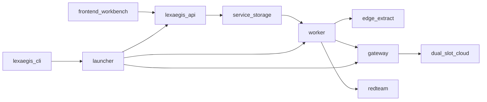

运行 `lexaegis start`，打开 http://127.0.0.1:8765 走合成演示 01。正式外发保持阻断。

版本 **V1.0**（`1.0.0`）。演示 01 可走通；02 批准 409；**正式外发保持阻断**。非正式发行。现行规格三角是 [ARCHITECTURE.md](ARCHITECTURE.md) + [VALIDATION.md](VALIDATION.md) + [PROVENANCE.md](PROVENANCE.md)。归档只追溯，不当规格。

## 1. 立刻能做

约 15 分钟（venv 已装好）。从源码首次安装约 40 分钟，见根 [README.md](../README.md)。

1. 激活 venv，运行 `lexaegis start`（约 2 分钟等到三个服务起来）。
2. 打开 **http://127.0.0.1:8765**（不要用 `localhost`），输入终端里的本地口令。
3. 打开「01 完整披露流程」：生成披露方案 → 检验风险并冻结 → 批准 → 执行模拟调用。「02」批准 409（合同线索风险：唯一岗位或公开事件仍保留），不要批准。
4. 新建正式案件并上传 `examples/` 合成材料：预期审批/发送 **409**，不要当成已开通。
5. `Ctrl+C` 停三个服务。隔离栈已实跑工程基线攻击，**不是**四类 `resisted`，不得写成通过。红队不是正式攻击结论。

## 2. 运行时

1. **native**：`lexaegis start` = launcher 拉起 API + worker + gateway。工作台 **8765**，网关 **8766**。约 2 分钟。
2. **Playwright / `_ui_walk`**：**18765**（`LEX_API_PORT`）。口令与 Playwright 相同：`local-acceptance-only`。walker 截图进 `.data/ui-walk/`。`cd frontend && pnpm walk:ui` 约 3 分钟（须已有 18765 栈）。**未进 CI**。
3. **Compose**：容器内仍是 8765；宿主机默认 `LEX_COMPOSE_API_PORT` 或 **38765**（避开 native 8765）。另有 profile：`redteam` / `benchmark` / `edge`。先停 native。
4. 本机 pytest：2026-09-24 **656 过 / 5 跳过**（含 V2.2 P1–P8 及权威化/控制面/mapper 新增项）；`LEX_ORCHESTRATOR_AUTHORITY=1` 全量同绿。`desktop-1280` e2e 仍以 2026-09-08 记录为准，本轮未重跑。远端 CI 本轮未取，不写成已通过。
5. Compose 隔离探测过 ≠ 浏览器已通，≠ 法学条件已满足。`formal_dispatch=blocked`。

## 3. 代码地图

后端五组：

1. **入口**：`lexaegis/cli.py`、`launcher.py`、`api.py`
2. **案件**：`service.py`、`storage.py`、`parsing.py`
3. **门禁**：`policy.py`、`governance.py`、`detection.py`、`d_path.py`（D 试点；evaluate ≠ 发送）
4. **外发**：`gateway.py`、`cloud.py`、`worker.py`、`providers.py`
5. **评测**：`experiments.py`、`redteam.py`；本地确定性任务只在 `task_engine.py` 内置（`lexaegis.tasks` entry point **未**在 `pyproject.toml` 声明）
6. **V2.2 对齐层**（P1–P8 已落地，均为通用 records 聚合，无迁移）：`domain_runtime.py`（binding/快照/上下文/TaskStep/云信封）、`domain_packages.py`（八类包拆分 + 生命周期 + 签名/撤销 + bundle 导出导入）、`support_registry.py`（可加载 ≠ 已支持）、`capability_registry.py` + `spi.py`（能力注册与包只读消费面）、`orchestrator.py`（状态写点全收敛；`LEX_ORCHESTRATOR_AUTHORITY=1` 时漂移即 409，默认仍关）、`return_pipeline.py`（九阶段 + `waiting-cloud` 断连挂起）、`domain_mapper.py`（cause_pack 声明式 mapper 真执行）、`package_controller.py`（包下发控制面：edge_node/assignment/receipt/reconcile）、`acceptance_suite.py`（19 基线：10 断言 / 8 映射 / 1 人工门禁）。回包与采纳契约：`cloud_result_envelope`（pending_human/rejected 收据，绑 request_hash+result_hash）、`human_decision`（confirm 采纳时落 adopted+actor+artifact_hash）；`LEX_GATEWAY_ROLE` 启动断言（edge 禁持凭据/cloud 必须持凭据）。消费侧仍读单体 pack；正式外发仍 blocked

前端五个表面：

1. **登录 / 案件**：口令页、案件列表、新建正式案
2. **四步工作台**：事实与证据 → 逐项披露方案 → 风险冻结/审批 → 摘要与回链
3. **治理四页**：法学规则中心、服务商治理、隔离实验、本地用户
4. **运行配置**：边侧 URL、双槽回显；密钥不进 API
5. **共享 UI**：`components/ui.tsx`、`design-tokens.css`、`style.css`（未拆 `App.tsx`）

## 4. 数据与门禁

1. **`data/`**：仓库评测语料（当前 `mock_labor_v1` 8 条合成）。`dispatch_allowed` 恒为 false。
2. **`.data/`**：运行库、口令、案件、截图。不进 git。
3. **三份 pack**：`packs/labor_demo.json` = v1 `demo`；`packs/labor_v2_draft.json` = v2 `2.0.0-draft.3` / `draft`（加班核对条件规则与 R/W/I 子目的为待审草稿，非正式法源，`dispatch_allowed=false`）；`packs/contract_test.json` = v1 `draft` 扩展夹具。重启时 `seed_packs` 刷新已有 `demo`/`draft`，不覆盖 `published`。无一 `published`。
4. **正式外发仍缺**（不要写成开关没开）：法学发布与必要性矩阵、经审核服务商与影响评估、法学承认的四类 `resisted`（隔离栈工程基线已跑，不是正式结论）、真实材料授权、真实云端外发取证。
5. 五类事实分开写：技术已在代码里；运行有本机证据；法学仍是 draft；攻击未全部 resisted；当前正式案 409。不合成「安全」。
6. **运行时门禁（一份）**：正式 `cloud` 执法只走 `lexaegis/outbound_gate.py` 的 `collect_outbound_blockers`。批准/网关只核冻结哈希与 wire，不另编法学条件。`product_dispatch_state()` 恒为 `blocked`。法计空表是字段来源，不是第二套引擎。

| id | 法计 | 本批代码 |
| --- | --- | --- |
| G0 | 请求卫生 | `policy.assess`：标识、未确认事实、OCR、预算等 |
| G1 | 法 01 来源人审 | 纸面，下期写入 |
| G2 | 法 02 层 B | `LAYER_B_CLOSED_IDS` |
| G3 | 法 03/04 服务商与 PIPIA | `provider_checks`；D 白名单在网关 |
| G5 | 法 05 规则发布 | `published`+哈希（一条文案）、法学状态/`dispatch_allowed`/scope、五类权重 |
| G6 | 法 07 冻结 | `evaluate` 生成 `request_hash` |
| G7 | 法 08 组合 | 准标识 + `combination_judgment` + 禁止词 |
| G8 | 法 09 四攻击 | 仅全员 `resisted` |
| G9 | 法 10 隔离 | `isolation_verified`（≠ 当次收据） |
| G10 | 技 08 批准 | `authorize_dispatch` |
| G-product | 产品闩 | `formal_dispatch=blocked` |

## 5. 文档与验证

现行入口（先读这 5 个）：

1. 本文件 [PROJECT_MAP.md](PROJECT_MAP.md)
2. [ARCHITECTURE.md](ARCHITECTURE.md)
3. [VALIDATION.md](VALIDATION.md)
4. [PROVENANCE.md](PROVENANCE.md)
5. [DESIGN.md](DESIGN.md)

法学只走 [legal/README.md](legal/README.md)。Agent 边界见根目录 [AGENTS.md](../AGENTS.md)。

Stub 路径（只跳转，不当规格）：[PLAN_STATUS.md](PLAN_STATUS.md)、[IMPLEMENTATION_V2.md](IMPLEMENTATION_V2.md)、[THIRD_PARTY.md](THIRD_PARTY.md)。根目录中文跳转文件已于 2026-09-21 移除，旧路径对照见 [README.md](README.md)「原根目录文件归位对照」。交付物与比赛包在 `deliverables/`（不入库）。

本机复现（按需，本批不跑全量 pytest）：

1. `python -m pytest -q` — 2026-09-24：656 过 / 5 跳过（authority=1 同绿），约 2.6–6.3 分钟
2. `python -m lexaegis.cli dataset validate` — 约 1 分钟
3. `cd frontend && pnpm exec tsc --noEmit && pnpm build` — 约 2 分钟
4. `pnpm test:e2e -- --project=desktop-1280 --grep-invert five-viewport` — 约 8 分钟；五视口本轮未跑
5. `pnpm walk:ui` — 约 3 分钟，须 18765 已起；**不是 CI**

稍后（只列标题，本批不修）：e2e demo 03 / 治理四页进 CI；bootstrap 仍发 v1 `TASKS`，工作台 `task_definitions||tasks` 回退仍要留；`semi_labor_v1` 标注后 `promote-semi`；法学发布与真实外发取证。

正式外发不可用：仓库 `labor_v2` 仍是 draft，四类攻击未全部法学 `resisted`，无真实外发成功记录。工程基线红队不能当作正式风险背书。 **10 案层 A 评估完成，0 案真实发送。**
