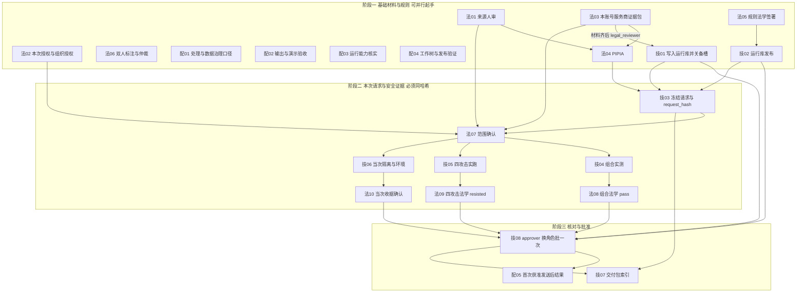

# 法计交接（空表）

性质：有权人填写底稿。**不是**已签署、**不是** `pass`、**不是**发送许可、**不是**完成证明。工程检索、哈希、探测不能代填结论栏。材料名称便于分工，不代表仓库已有同名文件。

适用：一次三元组 **`LA-001` × `R_fact_summary` × `D_DeepSeek_official_API`**。不扩展到其他九案或备用接收方。换三元组须另印一套，不得涂改沿用。

填表不改变外发计数，也不构成 `pass`。交付包版本与各门状态以技 07 登记为准，不在本页预填。

纸质签署：整册 [案隐盾_法计交接签署册.docx](案隐盾_法计交接签署册.docx)；本夹每份 Markdown 另有同名 `.docx`。由 `scripts/make_handoff_workbook_docx.py` 导出。改空表后重跑该脚本。

## 人员

| 方 | 职责 | 系统角色 |
| --- | --- | --- |
| 法学方 | 账号对接、服务商取证、法学判断（主签 / 会签 / 认可） | 主签人；档案复核用 `legal_reviewer` |
| 技术方 | 工程安全、运行证据；同一人兼任最后批准 | 实测与交付；批准时换为 `approver` |

不再另列「账号负责人」或额外审批人。法学同学管理账号 **不能** 替代服务商处理条件的书面证据。同人兼任时，工程安全记录与 `approver` 批准须**分开留痕**（身份、角色、时间、请求哈希）。如实写换角色，不写成「两名独立人员复核」。批准不能代替法学主签和认可。

## 双方交接流程（不是新增门禁）

硬约束：**门 7–9 必须对应门 6 的同一 `request_hash`；门 10 必须等门 1–9 齐备；冻结输入变化则门 7–10 作废。** 法学可先领法 01–06，技术先准备技 01–02 及实测环境，不必一上来把所有签署页同时交齐。技 07 贯穿全程：每收到一份已签材料就登记文件名与 SHA-256。

### 阶段一 · 基础材料与规则

两边可同时起手。法学取证未齐时，技术只准备环境，**不代填、不代点 `reviewed`、不把仓库 draft 写成已发布**。

| 序 | 交出 | 交给 | 下一份才能做什么 |
| --- | --- | --- | --- |
| 1a | 法 01 人审底稿与采用集 | 技术只收存；法学自己进 1b | 没有采用集，后面不能核冻结范围 |
| 1b | 法 02 必写句 + 组织授权 | 技术不得改 `LAYER_B_CLOSED_IDS` | 无本句则不得谈本三元组后续门 |
| 1c | 法 03 本账号证据包 | 技术做技 01 | 缺合同引用 / 主体全称 / 本账号训练与删除书面证：不得 `reviewed`，不得发送 |
| 1d | 法 03 条件已知 | 法学做法 04 | 接收方仍 `unknown` 时 PIPIA 不得选「可用」 |
| 1e | 法 04 主签可用或附条件已落实 | 技术可把评估引用写入档案字段 | 无本案评估不得发 |
| 1f | 法 05 会签矩阵、法源、五权重、写死 scope | 技术做技 02 | 仓库 draft / 旧隔离库试点 ≠ 本次开通 |
| 1g | 法 06 双人标注与仲裁 | 可与法 01 交叉核对采用集 | 不因技术兼 `approver` 而省略 |
| 1h | 技 01 运行库档案 + 主槽绑定 + 备槽关闭证据 | 法学核：未代点复核、未把 Key 指向百炼 | 无已审档案则技 03 仍阻断 |
| 1i | 技 02 运行库 `published` 且 scope 仅本三元组 | 法学核与法 05 一致 | 无运行库发布则正式 cloud 仍阻断 |

配 01、配 02 随阶段一由法学推进；配 03、配 04 由技术推进。四份都不单独构成发送门，也不得用「十门表已印」掩盖。

### 阶段二 · 本次请求与安全证据

必须先有技 03 的系统哈希，后三对材料都绑这一哈希。改提示词、facts、模型、地址或账号：重冻，法 07–10、技 04–06、技 08 全部作废。

| 序 | 技术交出 | 法学交回 | 对齐要求 |
| --- | --- | --- | --- |
| 2a | 技 03 完整冻结单 + 系统 `request_hash`（备槽关闭） | 法 07 核：采用集、三元组、仅 D 主机、无真名/案号/映射 | 法学不手写哈希充数 |
| 2b | 技 04 组合实测报告（同一哈希） | 法 08 主签 `pass` | `uncertain` / `not_run` 阻断。准标识未命中 ≠ pass |
| 2c | 技 05 四类实跑（同一哈希） | 法 09 逐项法学 `resisted` | 工程 outcome ≠ 法学认可。禁止抄历史基线 |
| 2d | 技 06 当次五项收据 + 防火墙与镜像供应链（同一哈希） | 法 10 确认当次、非历史探测 | `native` 不能自证。五项原名不得改 |

技 04、技 05、技 06 在法 07 确认后可并行实测，但各自必须等对应法学页签完，才能进阶段三。

### 阶段三 · 核对与批准

| 序 | 谁 | 做什么 |
| --- | --- | --- |
| 3a | 法学 | 确认法 01–10 主签 / 会签 / 认可均在，且都指向技 03 的哈希（门 6 之后各页） |
| 3b | 技术 | 用技 07 核交付包实物与 SHA-256；版本以后补文件冒充新版无效 |
| 3c | 同一人换 `approver` | 技 08：门 1–9 齐后对该哈希批一次（30 分钟）。不齐应 409。批准 ≠ 发送完成 |
| 3d | 技术执行、双方校核 | 仅当 3c 有效且门禁放行后，才可出现真实 HTTP。结果只写配 05，禁止预填、禁止用模拟代替 |

技 08 与技 04–06 必须分开留痕（角色、时间、哈希）。如实写同人换角色，不写成两名独立人员复核。

### 一对一对齐总表

| 门或主题 | 法学页 | 技术页 | 方向 |
| --- | --- | --- | --- |
| 1 来源 | 法 01 | （无对页；采用集被法 07 使用） | 法学先交 |
| 2 授权 | 法 02 | （无对页；工程不得放行九案） | 法学先交 |
| 3 服务商 | 法 03 取证并 `reviewed` | 技 01 落库、关备槽 | 法 → 技 |
| 4 PIPIA | 法 04（输入来自法 01、法 03） | 档案引用字段随技 01 | 法学主签 |
| 5 规则 | 法 05 签署 | 技 02 运行库发布 | 法 → 技 |
| 标注 | 法 06 | — | 法学；不可省略 |
| 6 冻结 | 法 07 核范围 | 技 03 生成哈希 | 技 → 法 |
| 7 组合 | 法 08 主签 | 技 04 实测 | 技 → 法 |
| 8 四攻击 | 法 09 认可 | 技 05 实跑 | 技 → 法 |
| 9 隔离 | 法 10 确认当次 | 技 06 当次收据 + 环境 | 技 → 法 |
| 交付索引 | — | 技 07 全程登记 | 技术汇总 |
| 10 批准 | 确认前置法学页已齐 | 技 08 `approver` | 技术换角色 |
| 发送结果 | 参与回包校核 | 配 05 记网关账本 | 批之后，不预填 |
| 口径 / 演示 / 能力 / CI | 配 01、配 02 | 配 03、配 04 | 并行配套 |

## 本夹文件

### 法学方

| 文件 | 编号 | 门 |
| --- | --- | --- |
| [法01_门1_来源核验与人工审查.md](法01_门1_来源核验与人工审查.md) | 法 01 | 1 |
| [法02_门2_本次授权与真实材料授权.md](法02_门2_本次授权与真实材料授权.md) | 法 02 | 2 |
| [法03_门3_本账号服务商证据包.md](法03_门3_本账号服务商证据包.md) | 法 03 | 3 |
| [法04_门4_PIPIA.md](法04_门4_PIPIA.md) | 法 04 | 4 |
| [法05_门5_规则发布法学签署.md](法05_门5_规则发布法学签署.md) | 法 05 | 5 |
| [法06_真实材料双人标注与仲裁.md](法06_真实材料双人标注与仲裁.md) | 法 06 | （授权配套） |
| [法07_门6_冻结请求范围确认.md](法07_门6_冻结请求范围确认.md) | 法 07 | 6 |
| [法08_门7_组合判断法学主签.md](法08_门7_组合判断法学主签.md) | 法 08 | 7 |
| [法09_门8_四类攻击法学认可.md](法09_门8_四类攻击法学认可.md) | 法 09 | 8 |
| [法10_门9_当次隔离收据确认.md](法10_门9_当次隔离收据确认.md) | 法 10 | 9 |

### 技术方

| 文件 | 编号 | 门 |
| --- | --- | --- |
| [技01_门3_运行库与主槽配置.md](技01_门3_运行库与主槽配置.md) | 技 01 | 3 |
| [技02_门5_运行规则包发布.md](技02_门5_运行规则包发布.md) | 技 02 | 5 |
| [技03_门6_冻结请求与request_hash.md](技03_门6_冻结请求与request_hash.md) | 技 03 | 6 |
| [技04_门7_组合安全测试.md](技04_门7_组合安全测试.md) | 技 04 | 7 |
| [技05_门8_四类攻击实跑.md](技05_门8_四类攻击实跑.md) | 技 05 | 8 |
| [技06_门9_当次隔离与目标环境.md](技06_门9_当次隔离与目标环境.md) | 技 06 | 9 |
| [技07_交付包汇总.md](技07_交付包汇总.md) | 技 07 | 交付索引 |
| [技08_门10_approver批准.md](技08_门10_approver批准.md) | 技 08 | 10 |

### 配套（不能被十门掩盖；不自行改成新增发送门）

| 文件 | 编号 |
| --- | --- |
| [配01_法学_处理与数据治理口径.md](配01_法学_处理与数据治理口径.md) | 配 01 |
| [配02_法学_输出与演示验收.md](配02_法学_输出与演示验收.md) | 配 02 |
| [配03_技术_运行能力核实.md](配03_技术_运行能力核实.md) | 配 03 |
| [配04_技术_工作树与发布验证.md](配04_技术_工作树与发布验证.md) | 配 04 |
| [配05_首次获准发送后结果.md](配05_首次获准发送后结果.md) | 配 05 |

## 填写规则

1. 空栏保持空。不得把 LEX-LG-AI、公开 TOS、工程基线、口述「默认合法」写入结论。
2. 分词 `[[LEX:P0001]]` 不是匿名。结论里不要写当事人真名、案号全文、API Key。
3. `uncertain`、未跑、未签一律按阻断。一案签署不扩另外九案。
4. 签完把纸质/扫描件放入受控库。交付包 `.data/outbound_packets/LA001_D_外发交付包_20260914/` 的 `gate_status.json` 只登记文件名与 SHA-256，不把签署正文拷进 git，不提交 zip。后补文件不是已生效新版。
5. 本夹不替攻击协议或阈值补写通过标准。现行法学五读仍走 [../README.md](../README.md)。

**分工一句：法学交付「账号与服务商事实证据＋授权、规则和本次法学结论」；技术交付「运行配置＋冻结请求＋实测与隔离证据＋交付索引＋最后一次批准记录」。岗位可合并，材料、签署职责和门禁不能合并省略。**
